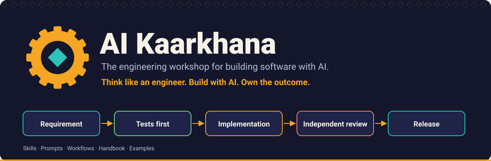
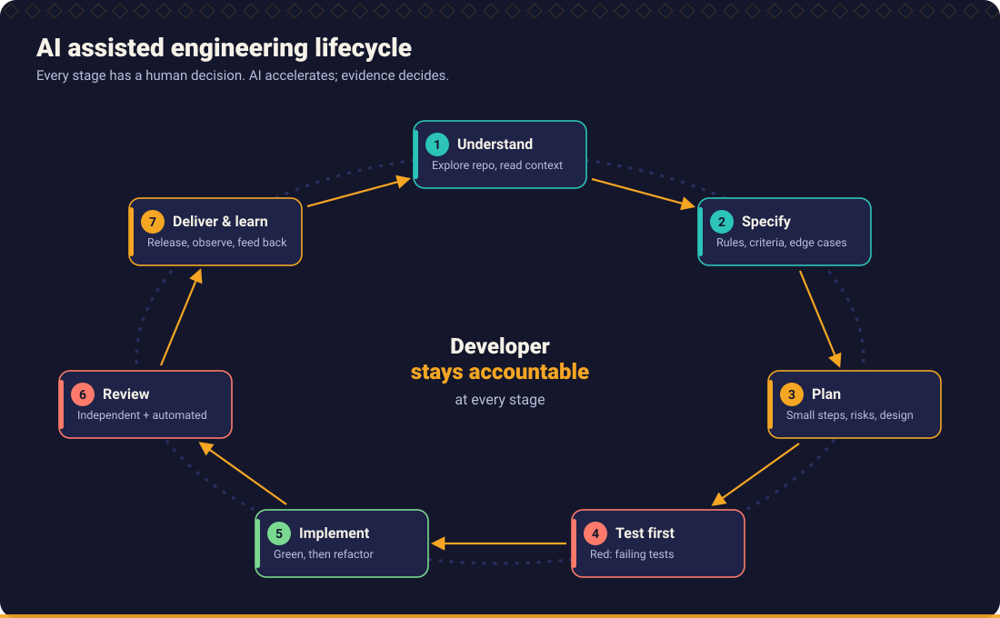
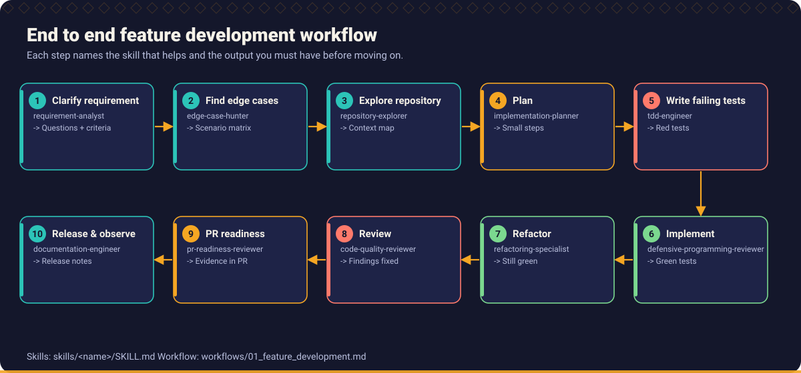

<p align="center">
  
</p>

<h1 align="center">AI Kaarkhana</h1>

<p align="center"><strong>Think like an engineer. Build with AI. Own the outcome.</strong></p>

<p align="center">
  An open source AI engineering handbook and developer operating system:<br>
  12 chapters, 22 skills, 50 prompts, 10 workflows, runnable examples and a Broken Code Lab.
</p>

<p align="center">
  <a href="#start-here">Start here</a> ·
  <a href="docs/getting_started.md">Getting started</a> ·
  <a href="handbook/README.md">Handbook</a> ·
  <a href="skills/README.md">Skills</a> ·
  <a href="prompts/README.md">Prompts</a> ·
  <a href="workflows/README.md">Workflows</a> ·
  <a href="examples/README.md">Examples</a> ·
  <a href="CONTRIBUTING.md">Contribute</a>
</p>

*Kaarkhana* (कारख़ाना) is Hindi and Urdu for a workshop or factory: a place where skilled people use good tools to make things. This repository is that workshop for software engineers who work with AI assistants. It is licensed under the [MIT License](LICENSE).

## Contents

- [Why this exists](#why-this-exists)
- [Philosophy](#philosophy)
- [What is inside](#what-is-inside)
- [Start here](#start-here)
- [Getting started](#getting-started)
- [Using skills](#using-skills)
- [Using prompts](#using-prompts)
- [Supported coding assistants](#supported-coding-assistants)
- [An example developer workflow](#an-example-developer-workflow)
- [Repository map](#repository-map)
- [Verify the repository](#verify-the-repository)
- [Contributing](#contributing)
- [Roadmap](#roadmap)
- [Community](#community)

## Why this exists

AI assistants write plausible code faster than anyone can check it. That is useful and risky at the same time. The failures are familiar, only quicker to produce:

- a requirement that was never understood, implemented confidently;
- an `if` without the `else` that matters, a null nobody considered, a boundary off by one;
- tests that were written to agree with the code instead of the requirement;
- "all tests pass" reported by an assistant that never ran them;
- code nobody on the team can explain.

The answer is not to use AI less. It is to bring more engineering to it: clear requirements, edge cases found before code, tests as specification and evidence, independent review, and a person who is accountable for what ships. This project turns those habits into material you can read, copy, run and adapt.

It is not about teaching developers to use AI. It is about helping engineers build better software with AI.

## Philosophy

The full set is in [Chapter 1](handbook/01_ai_native_engineering/README.md#the-twelve-principles). In short:

1. **AI is a partner, not a replacement for judgement.** The developer is accountable for every line that is merged.
2. **Understand before you build.** AI should surface ambiguity and missing rules, not silently invent them.
3. **Tests first, edge cases first.** Expected behaviour comes from the requirement, not from the implementation.
4. **Verify independently.** Generated code is validated by running it, by static analysis and by review. A confident answer is not evidence.
5. **Every path has intentional behaviour.** Missing branches, nulls, failures and timeouts are decisions, not accidents.
6. **Speed never costs reliability.** Quality and production safety are not traded for output.



## What is inside

| Pillar | What you get | Go to |
| --- | --- | --- |
| **Handbook** | 12 chapters, from AI native engineering to engineering leadership, each with practice tasks and related skills, prompts and examples | [handbook](handbook/README.md) |
| **Skills** | 22 reusable, tool agnostic capabilities in the `SKILL.md` format, with a searchable registry | [skills](skills/README.md), [registry](skills/REGISTRY.md) |
| **Prompts** | 50 ready to use prompts in seven categories, each with expected output and validation steps, plus a playground of weak and strong pairs | [prompts](prompts/README.md), [playground](prompts/playground.md) |
| **Workflows** | 10 gated workflows with diagrams: feature, defect, refactoring, API, schema, pipeline, testing, incident, review, release | [workflows](workflows/README.md) |
| **Examples** | Nine scenarios in Java, Python and TypeScript, each with a real defect, a fix and tests, and a worked end to end walk through | [examples](examples/README.md) |
| **Broken Code Lab** | Eight deliberately defective programs to fix, with tests, challenges and suggested prompts | [broken_code_lab](examples/broken_code_lab/README.md) |
| **Templates** | Requirement, scenario matrix, design, test plan, pull request, review, ADR and more, plus an AI code review checklist | [templates](templates/README.md), [checklist](templates/ai_code_review_checklist.md) |
| **Tool adapters** | Generated files and an installer for GitHub Copilot, Cursor, Claude Code and generic agents | [tools](tools/README.md) |
| **Team tools** | Learning paths, a maturity assessment, a skill of the week rotation, glossary and FAQ | [docs](docs/README.md) |

## Start here

Pick the row that matches your role. Each list is a short route, in order.

### Individual developers

1. [Getting started](docs/getting_started.md): ten minutes to your first verified result.
2. [Chapter 1: AI Native Engineering](handbook/01_ai_native_engineering/README.md) and [Chapter 2: Developer Ways of Working](handbook/02_developer_ways_of_working/README.md).
3. [Chapter 5: Test Driven Development](handbook/05_test_driven_development/README.md) and [Chapter 6: Defensive Programming](handbook/06_defensive_programming/README.md).
4. Do the first [Broken Code Lab exercise](examples/broken_code_lab/01_missing_else/CHALLENGE.md), then follow your [learning path](docs/learning_paths.md).

### Engineering leads

1. [Chapter 10: Code Review and Pull Requests](handbook/10_code_review_and_pull_requests/README.md) and the [AI code review checklist](templates/ai_code_review_checklist.md).
2. [Chapter 12: Engineering Leadership](handbook/12_engineering_leadership/README.md).
3. Install [shared skills and principles](tools/README.md) in a team repository, and agree the [pull request template](templates/pull_request_template.md).
4. Run the [maturity assessment](docs/maturity_assessment.md) and start a [skill of the week](docs/skill_of_the_week.md).

### Architects

1. [Chapter 8: Architecture and Design](handbook/08_architecture_and_design/README.md) and [Chapter 9: Security Engineering](handbook/09_security_engineering/README.md).
2. Skills: [Architecture Reviewer](skills/architecture-reviewer/SKILL.md), [API Contract Reviewer](skills/api-contract-reviewer/SKILL.md), [Database Design Reviewer](skills/database-design-reviewer/SKILL.md), [Security Reviewer](skills/security-reviewer/SKILL.md).
3. Workflows: [new API](workflows/04_new_api.md), [database schema change](workflows/05_database_schema_change.md), [data pipeline](workflows/06_data_pipeline.md).
4. Templates: [technical design](templates/technical_design_template.md) and [ADR](templates/adr_template.md).

### QA engineers

1. [Chapter 3: Requirement Engineering](handbook/03_requirement_engineering/README.md) and [Chapter 5: Test Driven Development](handbook/05_test_driven_development/README.md), especially [test design](handbook/05_test_driven_development/test_design.md) and [mutation testing](handbook/05_test_driven_development/property_based_and_mutation_testing.md).
2. Skills: [Edge Case Hunter](skills/edge-case-hunter/SKILL.md), [Unit Test Engineer](skills/unit-test-engineer/SKILL.md), [Integration Test Engineer](skills/integration-test-engineer/SKILL.md), [Mutation Testing Specialist](skills/mutation-testing-specialist/SKILL.md).
3. [Workflow: unit and integration testing](workflows/07_unit_and_integration_testing.md), the [scenario matrix](templates/scenario_matrix_template.md) and [test plan](templates/test_plan_template.md) templates.
4. Practise: [Lab 08, missing integration test](examples/broken_code_lab/08_missing_integration_test/CHALLENGE.md).

### Engineering managers

1. [Chapter 1](handbook/01_ai_native_engineering/README.md), especially accountability and responsible adoption, then [Chapter 12](handbook/12_engineering_leadership/README.md) on measurement, governance and enablement.
2. [Chapter 11: Delivery and Operations](handbook/11_delivery_and_operations/README.md) for the delivery measures worth tracking.
3. The [maturity assessment](docs/maturity_assessment.md): score honestly, pick one or two improvements.
4. The [FAQ](docs/faq.md) and the [roadmap](ROADMAP.md).

## Getting started

Three ways in, from lightest to deepest. More detail in [Getting started](docs/getting_started.md).

**1. Use a prompt now.** Open the [prompt library](prompts/README.md), copy a prompt, fill in the `[BRACKETED PLACEHOLDERS]`, paste it into your assistant, and check the answer against the prompt's validation steps.

**2. Install the skills into a project.**

```bash
git clone <this-repository-url> ai-kaarkhana
cd ai-kaarkhana
python scripts/sync_adapters.py install --target github-copilot --dest ../my-project --prompts
```

Replace `github-copilot` with `cursor`, `claude-code` or `generic`. See [Tool adapters](tools/README.md).

**3. Run the examples.**

```bash
cd examples/python
python3 -m venv .venv && source .venv/bin/activate
pip install pytest
pytest
```

Java (`mvn test`) and TypeScript (`npm install && npm test`) instructions are in the [examples](examples/README.md).

## Using skills

A **skill** is a folder with a `SKILL.md`: when to use it, what input it needs, exact execution steps, the output format and a validation checklist. Skills turn good practice into something an assistant can follow consistently and a person can check.

- **Find one:** by activity, difficulty or framework in the [registry](skills/REGISTRY.md).
- **Use one:** install it (above) and ask for it by name, or open the `SKILL.md` and paste it into your chat:

```text
Use the edge-case-hunter skill on this requirement and produce a scenario matrix.
Do not write any code yet.

<paste the requirement>
```

- **Check the result** against the skill's own validation checklist. The skill asks the assistant to report real command output; you still run the tests yourself.

## Using prompts

A **prompt** is a ready to paste request for one task, with the context it needs, what a good answer looks like and how to validate it. Each prompt page has the same sections: problem it solves, when to use, required context, the prompt, expected AI output, validation steps and related skills.

- **Browse** by category: [requirements](prompts/requirements/README.md), [development](prompts/development/README.md), [testing](prompts/testing/README.md), [code review](prompts/code_review/README.md), [debugging](prompts/debugging/README.md), [architecture](prompts/architecture/README.md), [delivery](prompts/delivery/README.md).
- **See why wording matters:** the [prompt playground](prompts/playground.md) shows weak and strong prompts side by side, with a rubric.
- **Judge answers, not tone.** An answer is good when it satisfies the validation steps.

## Supported coding assistants

Skills and prompts are plain Markdown and work with any assistant that lets you supply instructions. For three tools, adapters place files where the tool looks for them. The conventions were **checked against each vendor's documentation on 2026-11-02**; tools change, so confirm against current documentation if something does not load. Sources are listed in [Tool adapters](tools/README.md#what-was-verified-and-when).

| Tool | Instructions | Skills | Prompts | Guide |
| --- | --- | --- | --- | --- |
| GitHub Copilot | `.github/copilot-instructions.md`, `.github/instructions/`, `AGENTS.md` | `.github/skills/` | `.github/prompts/*.prompt.md` | [guide](tools/github_copilot/README.md) |
| Cursor | `AGENTS.md`, `.cursor/rules/*.mdc` | `.cursor/skills/` | paste from the library | [guide](tools/cursor/README.md) |
| Claude Code | `CLAUDE.md` (imports `AGENTS.md`) | `.claude/skills/` | paste from the library | [guide](tools/claude_code/README.md) |
| Other agents | `AGENTS.md` | `.agents/skills/` or paste | paste from the library | [guide](tools/generic_agents/README.md) |

Nothing here is endorsed by or affiliated with those vendors.

## An example developer workflow

Building a feature with AI assistance, using [workflow 01](workflows/01_feature_development.md). The developer decides at every gate.

```mermaid
flowchart LR
    A["Ticket"] --> B["Clarify requirement<br/>Requirement Analyst"]
    B --> C["Find edge cases<br/>Edge Case Hunter"]
    C --> D["Plan small steps<br/>Implementation Planner"]
    D --> E["Red: failing test<br/>TDD Engineer"]
    E --> F["Green: smallest change"]
    F --> G["Refactor, tests stay green"]
    G --> H["Review the evidence<br/>PR Readiness Reviewer"]
    H --> I["Human review and merge"]
```





Before each step moves on, a person confirms the output: open questions answered, scenario matrix agreed, the red test fails for the right reason, the tests are green on **your** machine, and the change is explainable. The [other nine workflows](workflows/README.md) cover defects, refactoring, APIs, schemas, pipelines, testing, incidents, review and release.

## Repository map

| Path | Contents |
| --- | --- |
| [`handbook/`](handbook/README.md) | The twelve chapters |
| [`skills/`](skills/README.md) | 22 skills, registry (`REGISTRY.md`, `registry.json`) |
| [`prompts/`](prompts/README.md) | 50 prompts in seven categories, playground |
| [`workflows/`](workflows/README.md) | Ten workflows with Mermaid diagrams |
| [`examples/`](examples/README.md) | Java, Python and TypeScript examples, end to end walk through, Broken Code Lab |
| [`templates/`](templates/README.md) | Document templates and the AI code review checklist |
| [`tools/`](tools/README.md) | Adapters and guides for GitHub Copilot, Cursor, Claude Code, generic agents |
| [`docs/`](docs/README.md) | Getting started, learning paths, maturity assessment, skill of the week, glossary, FAQ, implementation status |
| [`assets/`](assets/README.md) | Logo, hero and diagrams (SVG) |
| [`scripts/`](scripts/README.md) | Validation, registry, adapter and lab scripts |
| [`.github/`](.github/workflows/README.md) | Workflows, issue forms, pull request template, assistant instructions |

## Verify the repository

```bash
python scripts/validate_docs.py            # links, anchors, structure, SVGs, Mermaid lint, placeholders
python scripts/build_registry.py --check   # skill registry is current
python scripts/sync_adapters.py --check    # generated adapter files are current
python scripts/verify_lab.py               # every lab exercise fails on broken.py, passes on solution.py
npm install --no-save mermaid jsdom && node scripts/check_mermaid.mjs .   # Mermaid syntax
```

The same checks run in [GitHub Actions](.github/workflows/README.md). The honest status of what has and has not been verified is in the [implementation status](docs/implementation_status.md).

## Contributing

Contributions are welcome: a sharper skill, a prompt that worked, an example of a real defect, a correction. Read the [contributing guide](CONTRIBUTING.md), which explains how to add a skill, prompt, example or chapter, and the [code of conduct](CODE_OF_CONDUCT.md). To report a security issue, see [SECURITY.md](SECURITY.md).

## Roadmap

More languages for the examples, more lab exercises, an interactive maturity assessment, and Mermaid rendering in CI. See the [roadmap](ROADMAP.md) and the [changelog](CHANGELOG.md). It is a direction, not a schedule.

## Community

This is meant to be a community driven engineering initiative. Open an issue to ask a question or propose a skill, share how you adapted a workflow for your team, or send a pull request. If a page misled you, that is the most useful contribution of all.

---

<sub>No statistics, benchmarks or productivity claims are made anywhere in this repository. Where a result is shown, it is real output from running the code in it. Tool conventions were checked on 2026-11-02 and may have changed since.</sub>
