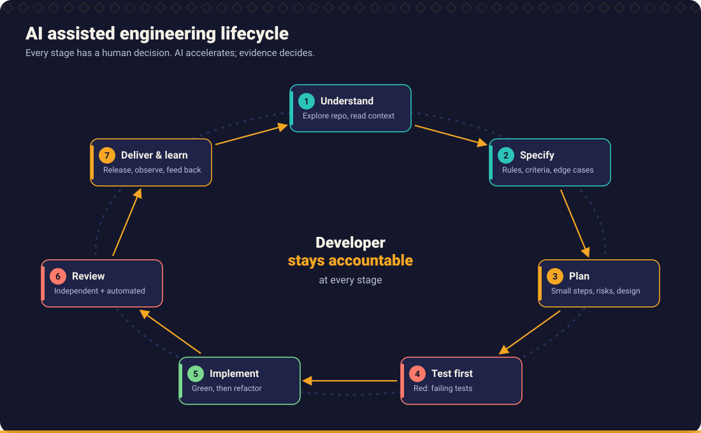
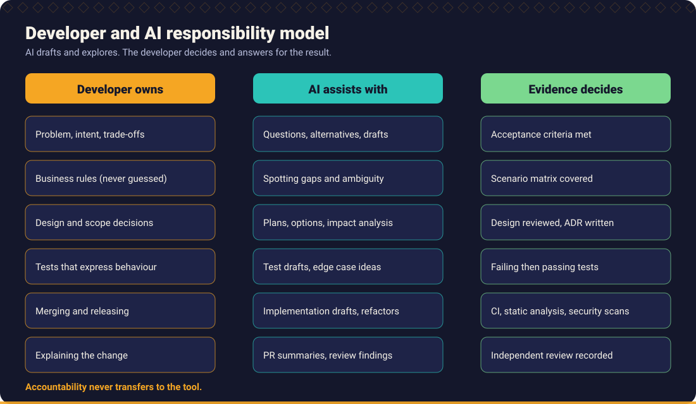
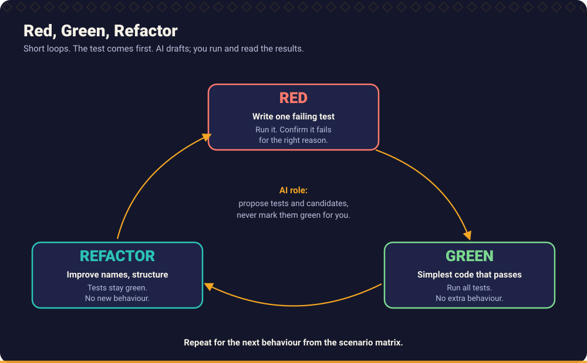
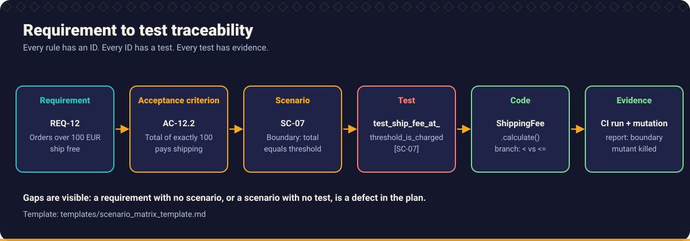
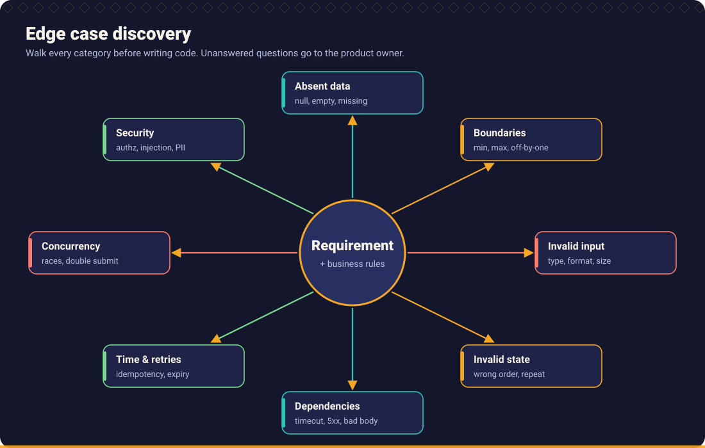
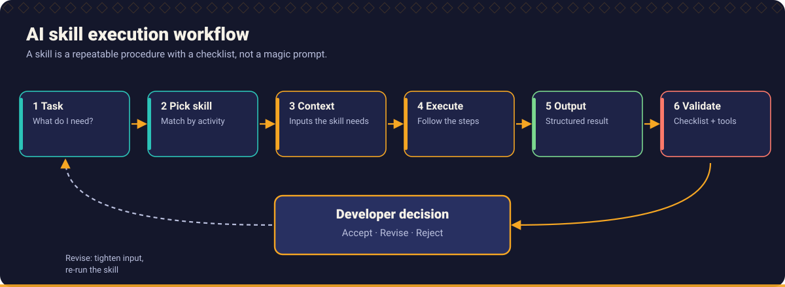
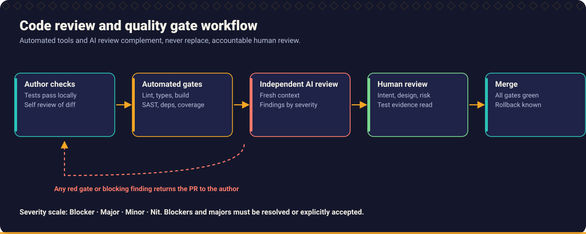
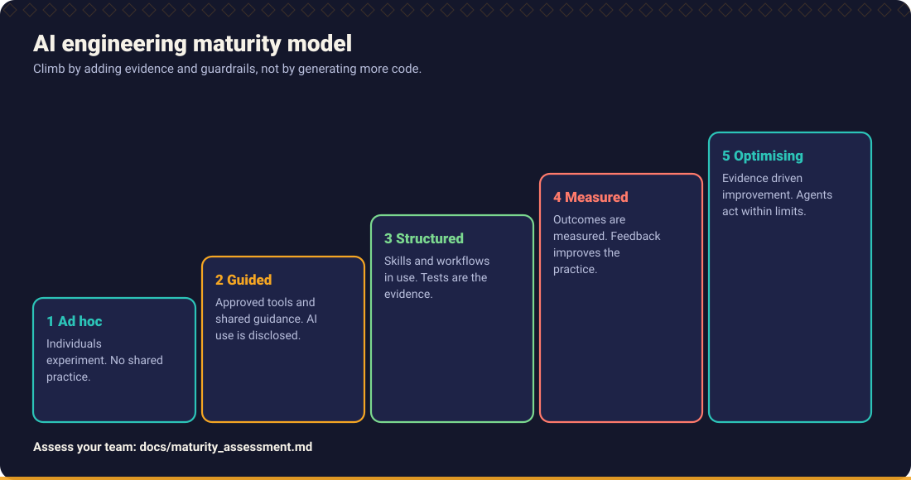
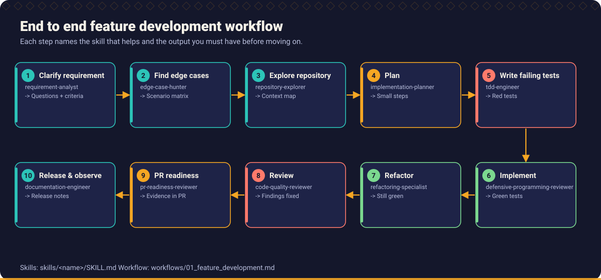

# Diagrams

Nine diagrams used across the handbook. Each is a self contained SVG with a title and description, generated by [`scripts/generate_svgs.py`](../../scripts/generate_svgs.py).

## AI assisted engineering lifecycle

Used in the [handbook index](../../handbook/README.md), [Chapter 1](../../handbook/01_ai_native_engineering/README.md) and the [repository README](../../README.md).

## Developer and AI responsibility model

Used in [Chapter 1](../../handbook/01_ai_native_engineering/README.md).

## TDD: red, green, refactor

Used in [Chapter 5](../../handbook/05_test_driven_development/README.md) and the [end to end example](../../examples/end_to_end/README.md).

## Requirement to test traceability

Used in [Chapter 3](../../handbook/03_requirement_engineering/README.md) and the [end to end example](../../examples/end_to_end/README.md).

## Edge case discovery

Used in [Chapter 3](../../handbook/03_requirement_engineering/README.md), [Chapter 6](../../handbook/06_defensive_programming/README.md) and the [Edge Case Hunter skill](../../skills/edge-case-hunter/SKILL.md).

## AI skill execution workflow

Used in the [skills guide](../../skills/README.md).

## Code review and quality gate workflow

Used in [Chapter 10](../../handbook/10_code_review_and_pull_requests/README.md).

## AI engineering maturity model

Used in [Chapter 12](../../handbook/12_engineering_leadership/README.md#7-ai-adoption-maturity) and the [maturity assessment](../../docs/maturity_assessment.md).

## End to end feature development workflow

Used in [Chapter 2](../../handbook/02_developer_ways_of_working/README.md), the [feature development workflow](../../workflows/01_feature_development.md) and the [repository README](../../README.md).

Back to [assets](../README.md).
