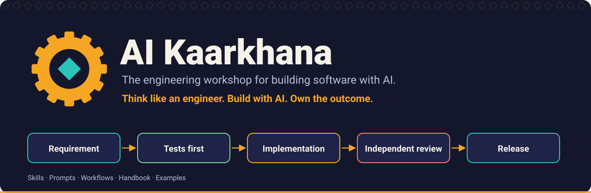

# Images

| File | Use |
| --- | --- |
| [`hero.svg`](hero.svg) | The banner at the top of the [repository README](../../README.md): the gear mark, the project name, the tagline and the pipeline from requirement to release |

The hero is generated by [`scripts/generate_svgs.py`](../../scripts/generate_svgs.py) together with the other assets. See the [assets guide](../README.md) for the design rules and how to regenerate it.

Back to [assets](../README.md).
