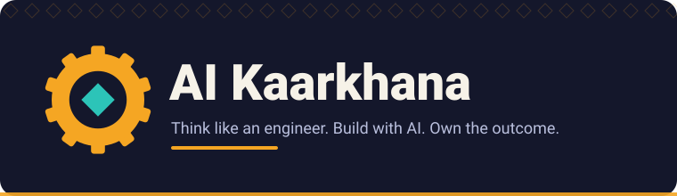

# Logos

| File | Use |
| --- | --- |
| [`ai-kaarkhana-logo.svg`](ai-kaarkhana-logo.svg) | Wordmark with the gear mark and the tagline "Think like an engineer. Build with AI. Own the outcome." |
| [`ai-kaarkhana-mark.svg`](ai-kaarkhana-mark.svg) | The gear with a diamond at its centre, for small spaces such as avatars and favicons |

## Usage

- Keep clear space around the logo equal to the height of the diamond at the centre of the mark.
- Do not recolour, stretch or add effects.
- Use the mark alone only where the wordmark would be too small to read.

These files are generated by [`scripts/generate_svgs.py`](../../scripts/generate_svgs.py). They are released under the same [MIT license](../../LICENSE) as the rest of the repository. The brand direction is a proposal for the open source project; the project name may be used to refer to this repository and forks should make clear they are forks.

Back to [assets](../README.md).
