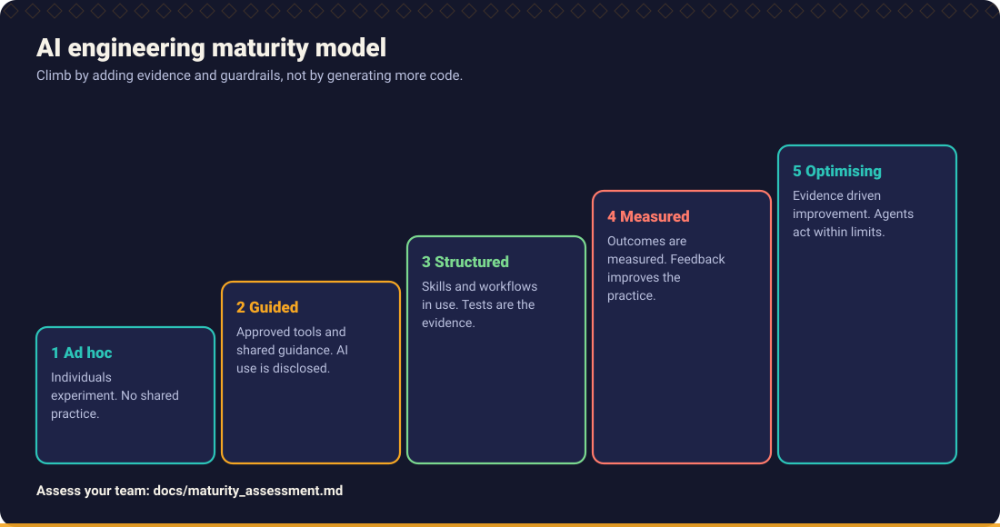

# AI engineering maturity assessment

A self assessment for a team. It helps you see where your AI assisted engineering practice stands **per practice area**, choose one or two improvements, and check again later.

> The five levels are this handbook's own framework (introduced in [Chapter 12](../handbook/12_engineering_leadership/README.md#7-ai-adoption-maturity)). They are **not** an industry standard and there are no benchmarks or averages behind them. Use the result to start a conversation, not to rank teams or people.

## The levels

| Level | Name | In one sentence |
| --- | --- | --- |
| 1 | Ad hoc | Individuals experiment; there is no shared practice. |
| 2 | Guided | Approved tools and shared guidance exist; AI use is disclosed. |
| 3 | Structured | Skills and workflows are used; tests are the evidence; risky work gets independent review. |
| 4 | Measured | Outcomes are measured and the feedback improves the practice. |
| 5 | Optimising | Evidence driven continuous improvement; agents act within least privilege and approval policies. |

## How to run it

1. **Gather** three to eight people who do the work: developers, a tester, a lead. Include at least one sceptic.
2. **Score alone first.** Each person reads the descriptors for each area below and writes the level that best matches *what actually happens*, not what is written in a wiki. If the description fits only partly, choose the lower level.
3. **Compare.** Put the scores side by side. Large disagreements are the most useful findings: they usually mean the practice is not consistent.
4. **Agree one level per area**, with one concrete example of evidence for it (a pull request, a pipeline, a document).
5. **Choose one or two improvements** for the next quarter, from the "Move up by" column. Do not try to jump levels.
6. **Repeat** in three to six months with the same people and compare honestly.

## Practice areas

Read each row as "which cell describes us today". The last column links to material in this repository that helps you move up.

### 1. Tools and data handling

| Level | What it looks like | Move up by |
| --- | --- | --- |
| 1 | Tools chosen by individuals; unclear what data is shared with them | Agree an approved tool list and what data may never be pasted ([Chapter 9](../handbook/09_security_engineering/README.md#7-sensitive-information-handling)) |
| 2 | Approved tools and data rules are written down and known | Add repository instruction files so assistants follow your conventions ([Tool adapters](../tools/README.md)) |
| 3 | Repositories carry assistant instructions and shared skills, reviewed like code | Track which instructions and skills are used, and retire stale ones |
| 4 | Use of tools, incidents and exceptions is reviewed regularly; the approval path is fast | Use evidence to adjust guardrails and tiers ([Chapter 12](../handbook/12_engineering_leadership/README.md#9-governance-without-restricting-innovation)) |
| 5 | Agent permissions follow least privilege with approvals and audit; the policy is revisited as tools change | Share what you learned with other teams |

### 2. Requirements and scenarios

| Level | What it looks like | Move up by |
| --- | --- | --- |
| 1 | Code is requested from the assistant straight from a ticket | Clarify before coding with [Requirement Analyst](../skills/requirement-analyst/SKILL.md) |
| 2 | Open questions are listed and answered before work starts | Record scenarios and edge cases in a [scenario matrix](../templates/scenario_matrix_template.md) |
| 3 | Every change has acceptance criteria and a scenario matrix; business rules are explicit | Check traceability from requirement to test ([prompt](../prompts/requirements/requirement-traceability-check.md)) |
| 4 | Defects are classified by cause, and missed scenarios feed the checklists | Update skills and templates from what escaped |
| 5 | Requirement quality is tracked against rework and incidents and drives process changes | Keep pruning; avoid ceremony for low risk work |

### 3. Implementation workflow

| Level | What it looks like | Move up by |
| --- | --- | --- |
| 1 | Large AI generated changes pasted in and adjusted until they work | Plan first, then implement in small steps ([Implementation Planner](../skills/implementation-planner/SKILL.md)) |
| 2 | Changes are planned and small; people read what they commit | Adopt a workflow, for example [feature development](../workflows/01_feature_development.md) |
| 3 | Standard workflows with gates are used; the repository is explored before changes | Automate the gates that people skip |
| 4 | Cycle time, rework and review effort of AI assisted changes are tracked | Experiment with one change to the workflow at a time |
| 5 | The workflow is tuned from measured results; autonomous work stays inside agreed limits | Revisit when tools or models change significantly |

### 4. Testing and verification

| Level | What it looks like | Move up by |
| --- | --- | --- |
| 1 | Tests written after the code, often by the assistant, and not checked for strength | Write the failing test first ([TDD Engineer](../skills/tdd-engineer/SKILL.md)) |
| 2 | Tests exist for new code; people run them before merging | Cover boundaries and negative cases ([Chapter 5](../handbook/05_test_driven_development/test_design.md)) |
| 3 | Test first for new behaviour; characterisation tests before refactoring; integration tests at real boundaries | Check test strength with mutation testing on critical code ([Mutation Testing Specialist](../skills/mutation-testing-specialist/SKILL.md)) |
| 4 | Mutation or property testing on critical modules; flaky tests are tracked and fixed | Use results to improve the skills and prompts |
| 5 | Verification effort is allocated by risk, using data from escaped defects | Share the approach and keep it light for low risk code |

### 5. Code review

| Level | What it looks like | Move up by |
| --- | --- | --- |
| 1 | Reviews are quick approvals; AI use is not mentioned | Disclose AI assistance in pull requests ([template](../templates/pull_request_template.md)) |
| 2 | Pull requests state what was verified; reviewers know AI was used | Use the [AI code review checklist](../templates/ai_code_review_checklist.md) |
| 3 | Checklist reviews; independent AI review for risky changes, always followed by human review | Right size pull requests and track review turnaround ([Chapter 10](../handbook/10_code_review_and_pull_requests/README.md)) |
| 4 | Review findings are categorised; recurring findings become tests, lint rules or skill updates | Reduce review load by automating what is repeatable |
| 5 | Review depth is risk based and tuned from evidence | Keep humans accountable for approval |

### 6. Security

| Level | What it looks like | Move up by |
| --- | --- | --- |
| 1 | Security depends on individual awareness; secrets and personal data may reach prompts | Set rules for sensitive data and secrets ([Chapter 9](../handbook/09_security_engineering/README.md)) |
| 2 | Dependency and secret scanning exist; known AI related risks are discussed | Review AI generated code for injection and access control flaws ([Security Reviewer](../skills/security-reviewer/SKILL.md)) |
| 3 | Threat modelling for new designs; security review for sensitive changes; prompt injection considered for agent use | Combine AI review with SAST, DAST and expert review, never instead of them |
| 4 | Security findings and near misses are tracked and used to improve guardrails | Test your guardrails, for example with the [Broken Code Lab](../examples/broken_code_lab/README.md) |
| 5 | Agents run in sandboxes with least privilege; tool permissions are audited | Re-assess when you add new tools or integrations |

### 7. Delivery and operations

| Level | What it looks like | Move up by |
| --- | --- | --- |
| 1 | Releases are manual and hard to reverse; AI is not involved in release preparation | Define rollback and release checks ([Chapter 11](../handbook/11_delivery_and_operations/README.md)) |
| 2 | CI runs tests; release notes drafted with help but checked by people | Use [release readiness](../prompts/delivery/release-readiness-check.md) and [rollback planning](../prompts/delivery/rollback-planning.md) |
| 3 | Standard release workflow; observability gaps reviewed for new features | Follow the [production release workflow](../workflows/10_production_release.md) |
| 4 | Delivery performance measured (for example DORA) and discussed; incidents have blameless reviews | Pick one delivery measure to improve per quarter |
| 5 | Delivery changes are experiments with a baseline and review date | Keep measures honest; avoid targets that invite gaming |

### 8. Learning and measurement

| Level | What it looks like | Move up by |
| --- | --- | --- |
| 1 | People learn alone; no shared examples | Share what works: pick a [skill of the week](skill_of_the_week.md) |
| 2 | Occasional sharing; a champion helps others | Create time to learn and a place for shared prompts |
| 3 | Shared library of skills and prompts with owners; onboarding includes the method | Write down a baseline for one outcome and one experience measure |
| 4 | Outcome and experience measures reviewed (see [Chapter 12](../handbook/12_engineering_leadership/README.md#3-measuring-ai-adoption)); the library is improved from feedback | Run small experiments; share results openly |
| 5 | Learning and measurement are routine; practices that stop helping are retired | Contribute improvements upstream |

## Score sheet

Copy this table into your own notes and fill it in.

| Practice area | Level (1 to 5) | Evidence (link or example) | Improvement chosen |
| --- | --- | --- | --- |
| 1. Tools and data handling | | | |
| 2. Requirements and scenarios | | | |
| 3. Implementation workflow | | | |
| 4. Testing and verification | | | |
| 5. Code review | | | |
| 6. Security | | | |
| 7. Delivery and operations | | | |
| 8. Learning and measurement | | | |

## Reading the result

- **A spread is normal.** Teams often sit at level 2 for tooling and level 1 for testing. The weakest area limits the benefit of the others, so look there first.
- **Do not average.** An average hides the one area that will hurt you.
- **Level 3 is a sensible target** for most teams. Levels 4 and 5 cost real effort and only pay off where the work justifies measurement and automation.
- **Beware of metric gaming.** Never tie levels or scores to individual performance reviews.
- **Higher is not always better.** A small internal tool does not need the controls of a payment system. Match the level to the risk.

## Suggested next steps by overall pattern

| Pattern | Start with |
| --- | --- |
| Mostly level 1 | Approved tools, data rules, [Getting started](getting_started.md), the [beginner learning path](learning_paths.md#beginner-path) |
| Mostly level 2 | Scenario matrices, test first for new code, the [feature development workflow](../workflows/01_feature_development.md) |
| Mostly level 3 | Baselines and measures, mutation testing on critical code, library ownership |
| Level 4 or higher in places | Share your practice, contribute skills and prompts, review for gaming and complacency |

Back to [documentation index](README.md).
