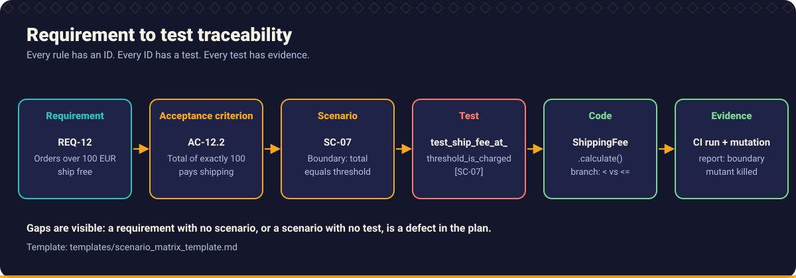
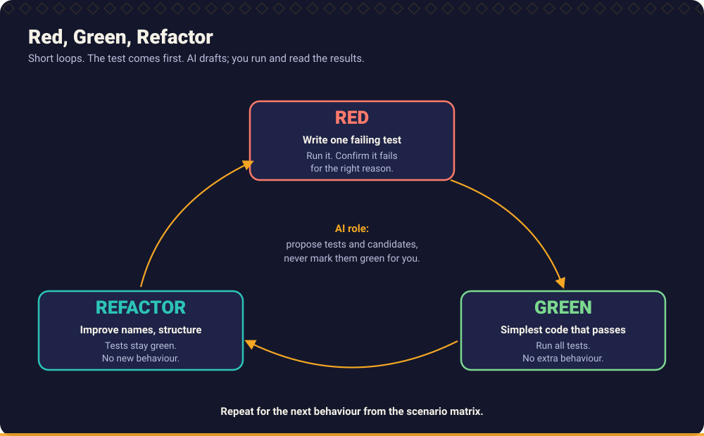

# End to end example: from requirement to passing tests

This walk-through follows one small feature, shipping fees, through the full AI Kaarkhana method: clarify, find edge cases, build a scenario matrix, then implement with Red, Green, Refactor. The final code lives in [`examples/python`](../python/README.md) (scenario S6), with Java and TypeScript equivalents.

The pytest output below was produced by actually running each step while writing this guide.



## 1. The raw requirement

> Customers get free shipping on large orders. Domestic orders ship for 4.99 EUR. International orders cost 14.99 EUR.

## 2. Clarify (skill: [Requirement Analyst](../../skills/requirement-analyst/SKILL.md))

Prompt used: [Requirement clarification](../../prompts/requirements/requirement-clarification.md).

Questions the analysis raises, with the answers a product owner gave for this exercise:

| # | Question | Answer used in this example |
| --- | --- | --- |
| 1 | What is "large"? | Total of 100.00 EUR or more (inclusive). |
| 2 | Does it apply to international orders? | No. International orders are never free. |
| 3 | What is "domestic"? | Country code `DE`. |
| 4 | Is the total before or after discounts and tax? | The order total passed to the function is already the amount that counts. |
| 5 | Can an order total be zero or negative? | No. Orders must have a positive total. |
| 6 | Which country codes are valid? | Two upper case letters (ISO 3166-1 alpha-2 style). Anything else is invalid input. |

Everything marked as an answer above is an *assumption for this exercise*. In a real project it would be recorded in the requirement, with its owner.

## 3. Edge cases and scenario matrix (skill: [Edge Case Hunter](../../skills/edge-case-hunter/SKILL.md))

Prompts used: [Edge case discovery](../../prompts/requirements/edge-case-discovery.md), [Scenario matrix generation](../../prompts/requirements/scenario-matrix-generation.md).

| ID | REQ | Category | Given | Expected | Test name |
| --- | --- | --- | --- | --- | --- |
| SC-01 | REQ-1 | Boundary | DE, 99.99 EUR | fee 4.99 | `domestic_order_below_threshold_pays_standard_fee` |
| SC-02 | REQ-1 | Boundary | DE, 100.00 EUR | free | `domestic_order_at_threshold_ships_free` |
| SC-03 | REQ-1 | Boundary | DE, 100.01 EUR | free | `domestic_order_above_threshold_ships_free` |
| SC-04 | REQ-2 | Normal | FR, 50.00 EUR | fee 14.99 | `international_order_pays_flat_fee` |
| SC-05 | REQ-2 | Boundary | US, 10 000.00 EUR | fee 14.99 | `international_order_never_ships_free` |
| SC-06 | REQ-3 | Boundary | DE, 0.01 EUR | fee 4.99 | `smallest_valid_total_is_accepted` |
| SC-07 | REQ-3 | Invalid | total 0, -0.01 | rejected | `non_positive_totals_are_rejected` |
| SC-08 | REQ-4 | Invalid | country `""`, `D`, `DEU`, `de`, `null` | rejected | `invalid_country_codes_are_rejected` |

The matrix template is in [`templates/scenario_matrix_template.md`](../../templates/scenario_matrix_template.md).

## 4. Plan (skill: [Implementation Planner](../../skills/implementation-planner/SKILL.md))

Money is integer cents (avoids floating point error). One function, `shipping_fee_cents(total_cents, country)`. Slices follow the matrix order: domestic fee, free threshold, international, validation. Prompt: [Implementation planning](../../prompts/development/implementation-planning.md).

## 5. Red, Green, Refactor (skill: [TDD Engineer](../../skills/tdd-engineer/SKILL.md))



Prompt used: [TDD test generation](../../prompts/testing/tdd-test-generation.md), then [Code generation](../../prompts/development/code-generation.md) for each slice.

### Cycle 1: SC-01, domestic fee

Test:

```python
from shipping import shipping_fee_cents as fee


def test_domestic_order_below_threshold_pays_standard_fee():
    assert fee(9_999, "DE") == 499
```

**Red, for the wrong reason.** The first run failed because the module did not exist yet:

```text
test_shipping.py:1: in <module>
    from shipping import shipping_fee_cents as fee
E   ModuleNotFoundError: No module named 'shipping'
1 error in 0.09s
```

That is a collection error, not a failing assertion. It proves nothing about the behaviour. A stub that raises `NotImplementedError` turns it into a meaningful red; the TDD Engineer skill requires this check ("fails for the intended reason") because assistants often report an import error as "test fails as expected".

**Green.** The smallest change that passes:

```python
def shipping_fee_cents(total_cents, country):
    return 499
```

```text
1 passed in 0.01s
```

Returning a constant looks silly, and that is the point: the next test will force the real logic.

### Cycle 2: SC-02, the boundary

```python
def test_domestic_order_at_threshold_ships_free():
    assert fee(10_000, "DE") == 0
```

Red, now for the right reason:

```text
>       assert fee(10_000, "DE") == 0
E       AssertionError: assert 499 == 0
1 failed, 1 passed in 0.01s
```

Green:

```python
FREE_SHIPPING_THRESHOLD_CENTS = 10_000


def shipping_fee_cents(total_cents, country):
    if total_cents >= FREE_SHIPPING_THRESHOLD_CENTS:
        return 0
    return 499
```

```text
2 passed in 0.01s
```

The `>=` comes directly from the scenario "at the threshold ships free". An implementation written without the boundary test often uses `>`.

### Cycle 3: SC-04 and SC-05, international orders

```python
def test_international_order_pays_flat_fee():
    assert fee(5_000, "FR") == 1_499


def test_international_order_never_ships_free():
    assert fee(1_000_000, "US") == 1_499
```

```text
FAILED test_shipping.py::test_international_order_pays_flat_fee
FAILED test_shipping.py::test_international_order_never_ships_free
2 failed, 2 passed in 0.01s
```

The failure of the second test (`assert 0 == 1499`) shows that the current code gives free shipping to a large international order. Without that test, the first two cycles would have shipped that defect. Green adds the `country != "DE"` branch before the threshold check.

### Cycle 4: SC-06 to SC-08, validation

Invalid totals and country codes are added the same way, each with a failing test first and with the error message asserted (`"positive"`, `"integer"`, `"country"`). Validation sits at the top of the function, so nothing past it needs to defend against bad input.

### Refactor

With all tests green the constants get names (`DOMESTIC_FEE_CENTS`, `INTERNATIONAL_FEE_CENTS`), the country regex is compiled once, and the function reads in the order of the requirement. The suite is re-run after each small change.

Final code: [`examples/python/src/kaarkhana/s06_tdd_shipping/improved.py`](../python/src/kaarkhana/s06_tdd_shipping/improved.py), tests: [`examples/python/tests/test_s06_tdd_shipping.py`](../python/tests/test_s06_tdd_shipping.py).

## 6. Compare with the one-shot answer

A single prompt "write a shipping fee function" often produces the code in [`initial.py`](../python/src/kaarkhana/s06_tdd_shipping/initial.py): floats, `>` instead of `>=`, no country handling, no validation. The test file documents each defect with a characterisation test.

| Defect of the one-shot code | Caught by |
| --- | --- |
| Exactly 100.00 pays shipping | SC-02 |
| Country ignored | SC-04, SC-05 |
| Negative total accepted | SC-07 |
| Floating point money | Design decision in the plan (integer cents) |

## 7. Prove the tests are good (skill: [Mutation Testing Specialist](../../skills/mutation-testing-specialist/SKILL.md))

Change `>=` to `>` in `improved.py`. `test_domestic_order_at_threshold_ships_free` fails. Change `499` to `500`: `test_domestic_order_below_threshold_pays_standard_fee` fails. Manual mutation is crude; for real projects use PIT, Stryker or mutmut ([Chapter 5](../../handbook/05_test_driven_development/README.md)).

## 8. Review and PR (skills: [Code Quality Reviewer](../../skills/code-quality-reviewer/SKILL.md), [PR Readiness Reviewer](../../skills/pr-readiness-reviewer/SKILL.md))

Open the pull request using [`templates/pull_request_template.md`](../../templates/pull_request_template.md). Evidence to attach: the scenario matrix, the red and green outputs, the full suite output, and the list of assumptions from step 2 that still need confirmation.

## Where to go next

- [Workflow: build a new feature](../../workflows/01_feature_development.md)
- [Chapter 5: Test Driven Development](../../handbook/05_test_driven_development/README.md)
- [Scenario catalogue](../scenarios.md)
