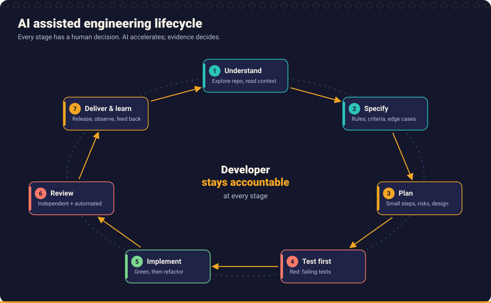
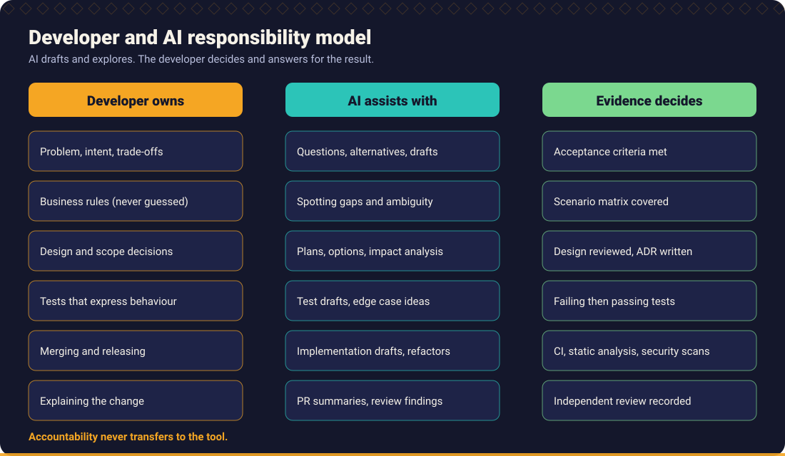

# Chapter 1: AI Native Engineering

> AI changes how fast code can be written. It does not change who is accountable for it.

## What you will learn

- What AI assisted development is, and how it differs from AI driven development.
- Where AI helps an engineer and where it does not.
- Why the developer remains accountable for generated code.
- The failure patterns that appear when teams adopt AI without engineering discipline, and how to counter each.
- How to adopt AI responsibly, and how to tell engineering productivity from code generation productivity.

## 1. What AI assisted development means

AI assisted development is software engineering in which a developer uses an AI system to explore, specify, draft, test, review and explain, while **the developer decides** what is built, verifies the result and answers for it.

The assistant can take several forms: autocomplete in the editor, a chat with repository context, or an agent that reads files, edits several of them and runs commands. The engineering principles are the same for all of them. What changes with agents is the *size of the step* between two human checkpoints, so the checkpoints must be designed deliberately (see [Chapter 2](../02_developer_ways_of_working/README.md)).

AI native engineering goes one step further: the team's practices (requirements, tests, review, delivery) are designed on the assumption that AI will draft much of the code. The consequence is not "less engineering". It is **more emphasis on specification, verification and feedback**, because those are the parts where human judgement adds value and where defects are cheapest to remove.

## 2. AI as an engineering collaborator

Treat the assistant as a fast, well read, tireless colleague who is new to your system, has no memory of last week, and is occasionally and confidently wrong.

| AI is useful for | AI is unreliable for |
| --- | --- |
| Drafting code, tests and documentation from a clear specification | Knowing your business rules, history and unwritten constraints |
| Exploring a codebase and summarising what it finds (with citations you can check) | Telling you whether its own output is correct |
| Proposing alternatives and trade-offs | Choosing between alternatives that depend on your context and risk appetite |
| Spotting inconsistencies, missing cases and boilerplate | Recalling exact APIs, versions, flags and configuration keys without checking |
| Explaining unfamiliar code and generating review questions | Security, concurrency and performance claims without evidence |
| Repetitive, well specified transformations | Decisions that need accountability |

Practical consequences:

- **Give it facts, not guesses.** Context quality bounds output quality ([Chapter 2](../02_developer_ways_of_working/README.md)).
- **Make it show evidence.** "Cite the file and symbol", "show the test output", "list what you could not verify".
- **Use independent checks.** A second review in a fresh session, static analysis, tests and a human reader catch different defects.

## 3. Developer accountability

Whoever commits the code owns it. "The AI wrote it" is not an explanation in a code review, an incident review or an audit.

This is the **accountability rule** that the rest of the handbook builds on:

> You may only submit code that you can explain, that you have run, and whose behaviour is demonstrated by tests you have read.

In practice:

1. **Explain it.** Could you walk a colleague through each changed line and say why it is there? If not, ask the assistant to explain, then verify the explanation against the code.
2. **Run it.** Test results in the pull request come from commands that were executed, not from the assistant's description of what would happen.
3. **Own the gaps.** Known limitations, unhandled cases and open questions go into the pull request description.
4. **Own the dependencies.** A new library suggested by the assistant is your dependency: licence, maintenance, vulnerabilities.
5. **Own the data you share.** Do not paste secrets, personal data or confidential code into tools that are not approved for it ([Chapter 9](../09_security_engineering/README.md)).

## 4. Human judgement versus AI generated implementation

Decisions fall into three groups.

| Kind of decision | Who decides | Examples |
| --- | --- | --- |
| **Intent and risk** | Human | What problem is solved. What happens at the boundary when the requirement is silent. Acceptable failure modes. Security posture. Rollout and rollback. |
| **Design trade-offs** | Human, informed by AI alternatives | Module boundaries. Sync versus async. Build versus buy. Data model. |
| **Mechanical implementation** | AI drafts, human reviews and tests verify | Boilerplate, mapping code, test scaffolding, refactorings with test protection. |

The most common mistake is letting an *intent decision* be made as a side effect of an *implementation* prompt. "Add a discount for gold customers" leaves open: which customers are gold, what happens for unknown tiers, how the discount interacts with other promotions, how it is rounded. An assistant will fill each gap with a plausible guess. Plausible guesses become business rules without anyone deciding them. The method in this handbook forces these questions to the surface *before* implementation ([Chapter 3](../03_requirement_engineering/README.md)).

## 5. AI assisted versus AI driven development

| | AI assisted | AI driven |
| --- | --- | --- |
| Who plans | Developer, with AI input | Agent, within an approved goal |
| Step size between human checkpoints | A function, a test, a small diff | A feature, a branch, a pull request |
| Typical tools | Chat, inline completion | Coding agents, automated pipelines |
| Where the human works | Throughout | At the specification, at gates and at review |
| Main risk | Over-trust in suggestions | Large unreviewed change, drift from intent, compounding errors |
| Needed to be safe | Tests, review, discipline | All of that plus: precise specifications, small scopes, automated gates, strong observability, rollback |

Both are legitimate. The mistake is to adopt the AI *driven* style with the AI *assisted* safeguards. The rule of thumb: **the larger the step you let the AI take, the stronger the automatic verification must be before a human sees the result.** See the [maturity model](../12_engineering_leadership/README.md#7-ai-adoption-maturity) for how teams progress.

## 6. Common failure patterns

| Failure pattern | What it looks like | Countermeasure |
| --- | --- | --- |
| **Silent rule invention** | The code handles a case in a way nobody specified. | Ask for assumptions and questions before code; mark gaps `UNSPECIFIED` ([requirement analysis](../03_requirement_engineering/README.md)). |
| **Happy path engineering** | Works for the demo input; null, empty, boundary and failure paths unhandled. | Edge case discovery first; boundary and negative tests ([Chapter 6](../06_defensive_programming/README.md)). |
| **Tests that mirror the code** | Tests generated from the implementation always pass, including for wrong behaviour. | Tests from requirements before code; mutation testing ([Chapter 5](../05_test_driven_development/README.md)). |
| **Plausible but wrong API usage** | Methods, flags or configuration keys that do not exist or are deprecated. | Compile and run; check documentation for the version you use; do not accept unverified claims. |
| **Over-engineering** | Abstractions, layers and patterns nobody asked for. | Plan in small slices; "no behaviour without a test"; review for unrequested code. |
| **Large unreviewable diffs** | An agent edits 30 files; the reviewer skims. | Small steps, one purpose per pull request, independent review ([Chapter 10](../10_code_review_and_pull_requests/README.md)). |
| **Weakening tests to pass** | The assistant changes an assertion or skips a test to get green. | Treat any change to existing tests as a finding that needs a stated behaviour change. |
| **Confident explanation of wrong code** | Fluent reasoning that does not match what the code does. | Trace the code yourself; reproduce with a test; ask for evidence, not rhetoric. |
| **Context loss** | Long sessions drift; earlier constraints are forgotten. | Restate constraints; keep tasks short; use repository instructions ([Chapter 4](../04_ai_assisted_development/README.md)). |
| **Sensitive data leakage** | Secrets or personal data pasted into a prompt or generated into code. | Approved tools only; secret scanning; sanitise logs ([Chapter 9](../09_security_engineering/README.md)). |
| **Skill atrophy** | Developers can no longer debug code they did not write. | Explain-back rule; pair review; practise without AI (see the [Broken Code Lab](../../examples/broken_code_lab/README.md)). |
| **Metric theatre** | Success measured as lines or suggestions accepted. | Measure outcomes: lead time, change failure rate, defects, rework ([Chapter 12](../12_engineering_leadership/README.md)). |

## 7. Responsible adoption

A practical order for a team that starts today:

1. **Agree the principles.** Start from the [twelve principles](#the-twelve-principles) below and adapt them.
2. **Write repository instructions.** Teach the assistant your architecture, conventions and "never do" list ([Chapter 4](../04_ai_assisted_development/README.md), [tool setup](../../tools/README.md)).
3. **Keep quality gates unchanged or stronger.** CI, static analysis, tests and review are the safety net for everything the assistant produces ([Chapter 7](../07_code_quality/README.md)).
4. **Start with low-risk, high-verifiability work.** Test scaffolding, documentation, refactorings under test, internal tools.
5. **Make verification explicit.** Pull requests state what was AI assisted and how it was validated.
6. **Protect data.** Decide which tools are approved for which classification of code and data.
7. **Review and learn.** Run retrospectives on defects that involved AI generated code, and update instructions, skills and tests, not blame.
8. **Measure outcomes.** Use delivery and quality metrics, not usage metrics ([Chapter 12](../12_engineering_leadership/README.md)).

> **Compliance note.** Licensing, intellectual property and data protection obligations around AI tools depend on your jurisdiction, your contracts and the specific tool. This handbook does not provide legal advice. Involve your legal, security and compliance functions.

## 8. Engineering productivity versus code generation productivity

Generating code faster is not the same as delivering working software faster.

- **Code generation productivity**: how quickly code appears.
- **Engineering productivity**: how quickly a team turns a *correct understanding of a need* into *reliable software in production* and learns from it.

Code is a liability as well as an asset: every line has to be read, tested, secured, operated and eventually changed. If AI doubles the amount of code you produce for the same behaviour, you may have increased your costs. If it reduces the time to *understand, specify, verify and deliver*, you have increased productivity.

Where time actually goes in a typical change, and where AI helps:

| Activity | Effect of AI done well | Effect of AI done badly |
| --- | --- | --- |
| Understanding the code and the need | Faster exploration, better questions | Plausible but wrong summaries accepted as fact |
| Writing the code | Faster drafts | More code than needed; style drift |
| Testing | More scenarios considered, faster scaffolding | Tests that mirror the code and prove nothing |
| Review | Extra independent pass, quicker triage | Larger diffs, reviewer fatigue |
| Fixing defects found later | Fewer defects when specified first | More rework when intent was guessed |

The leadership view is in [Chapter 12](../12_engineering_leadership/README.md): measure lead time, deployment frequency, change failure rate and time to restore (the DORA measures), together with defect and rework trends, and look at them alongside adoption.

## The twelve principles

These principles are repeated, in operational form, in the [repository instructions](../../.github/copilot-instructions.md) and [`AGENTS.md`](../../AGENTS.md).

1. AI is an engineering partner, not a replacement for engineering judgement.
2. Developers remain accountable for all generated code.
3. Requirements must be understood before implementation.
4. AI should identify ambiguity and missing business rules rather than silently inventing them.
5. Test Driven Development is the preferred implementation approach.
6. Edge cases are identified before implementation.
7. Generated code is independently validated.
8. Every important execution path has intentional behaviour.
9. Static analysis, automated testing and security checks complement AI reviews.
10. Code quality and production reliability are not sacrificed for development speed.
11. AI skills are reusable across coding assistants.
12. Every guideline has practical examples, instructions and ready to use prompts.

## Practice

- Do the accountability exercise: fix one [Broken Code Lab](../../examples/broken_code_lab/README.md) exercise with an assistant, then explain every changed line aloud, as if to a reviewer.
- Take a recent AI generated change in your team and classify its decisions into intent, design and mechanical. Which intent decisions were made without anyone deciding?
- Assess your team with the [maturity assessment](../../docs/maturity_assessment.md).

## Related

**Skills:** [Requirement Analyst](../../skills/requirement-analyst/SKILL.md), [PR Readiness Reviewer](../../skills/pr-readiness-reviewer/SKILL.md), [Architecture Reviewer](../../skills/architecture-reviewer/SKILL.md)

**Prompts:** [Requirement clarification](../../prompts/requirements/requirement-clarification.md), [Independent code review](../../prompts/code_review/independent-code-review.md)

**Workflows:** [Build a new feature](../../workflows/01_feature_development.md), [Review a pull request](../../workflows/09_pull_request_review.md)

**Examples:** [Scenario catalogue](../../examples/scenarios.md), [Broken Code Lab](../../examples/broken_code_lab/README.md)

**Further reading** (external; not maintained by this project):

- [DORA research programme](https://dora.dev) for delivery performance measures.
- [OWASP Top 10 for LLM Applications](https://genai.owasp.org/llm-top-10/) for risks of building with and on LLMs.
- [Agent Skills open standard](https://agentskills.io) for portable skill packaging.

---

Next: [Chapter 2: Developer Ways of Working](../02_developer_ways_of_working/README.md) · [Handbook index](../README.md)
