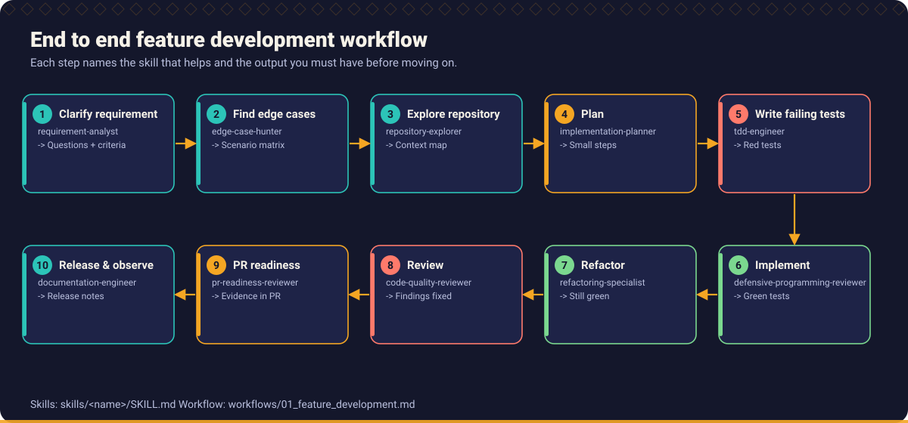
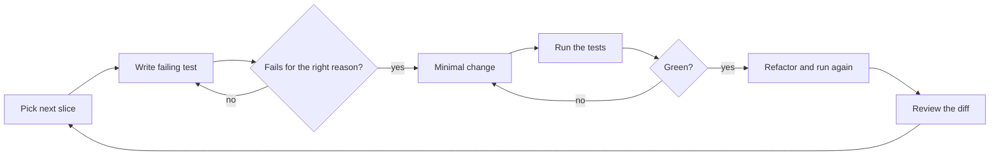

# Chapter 2: Developer Ways of Working

> A good assistant does not remove the need for a good process. It makes the cost of a bad process arrive faster.

## What you will learn

- A complete developer workflow for AI assisted work, from requirement to release.
- How to understand a requirement and decompose a problem before involving AI.
- How to ask AI useful questions, and how to engineer its context.
- How to explore a repository, plan, iterate in small steps and validate generated code.
- How to keep generated code understandable and maintainable.

## 1. The complete developer workflow

Every change, large or small, passes through the same ten steps. Small changes pass quickly. The point is that no step is skipped *silently*.

| # | Step | Skill | Prompt | Output you must have before moving on |
| --- | --- | --- | --- | --- |
| 1 | Clarify the requirement | [Requirement Analyst](../../skills/requirement-analyst/SKILL.md) | [Requirement clarification](../../prompts/requirements/requirement-clarification.md) | Restated requirement, acceptance criteria, answered or flagged questions |
| 2 | Find edge cases | [Edge Case Hunter](../../skills/edge-case-hunter/SKILL.md) | [Edge case discovery](../../prompts/requirements/edge-case-discovery.md) | Scenario matrix |
| 3 | Explore the repository | [Repository Explorer](../../skills/repository-explorer/SKILL.md) | [Repository exploration](../../prompts/development/repository-exploration.md) | Cited map of the code path, tests and conventions |
| 4 | Plan | [Implementation Planner](../../skills/implementation-planner/SKILL.md) | [Implementation planning](../../prompts/development/implementation-planning.md) | Small slices, each with its test, risk and rollback |
| 5 | Write a failing test | [TDD Engineer](../../skills/tdd-engineer/SKILL.md) | [TDD test generation](../../prompts/testing/tdd-test-generation.md) | A test that fails for the right reason |
| 6 | Implement | [TDD Engineer](../../skills/tdd-engineer/SKILL.md) | [Code generation](../../prompts/development/code-generation.md) | Passing tests, minimal change |
| 7 | Refactor | [Refactoring Specialist](../../skills/refactoring-specialist/SKILL.md) | [Refactoring](../../prompts/development/refactoring.md) | Same behaviour, better structure, tests green |
| 8 | Review independently | [Code Quality Reviewer](../../skills/code-quality-reviewer/SKILL.md) | [Independent code review](../../prompts/code_review/independent-code-review.md) | Findings triaged and fixed |
| 9 | Check PR readiness | [PR Readiness Reviewer](../../skills/pr-readiness-reviewer/SKILL.md) | [PR readiness assessment](../../prompts/code_review/pr-readiness-assessment.md) | Pull request with evidence |
| 10 | Release and observe | [Documentation Engineer](../../skills/documentation-engineer/SKILL.md) | [Release readiness check](../../prompts/delivery/release-readiness-check.md) | Released, monitored, documented |

Steps 5 to 7 repeat for each slice from step 4. The full workflow with checkpoints is in [Workflow 01: Build a new feature](../../workflows/01_feature_development.md).

## 2. Requirement understanding

Do this **before** opening a chat window. Read the requirement and answer, in your own words:

1. Who benefits and what do they need to be able to do?
2. What does success look like? How would we observe it?
3. What is *not* in scope?
4. What do I not know? Which terms, numbers or conditions are undefined?

Then use the [Requirement Analyst](../../skills/requirement-analyst/SKILL.md) to challenge your reading. If you start with the AI, you inherit its first interpretation and anchor on it. Details are in [Chapter 3](../03_requirement_engineering/README.md).

## 3. Problem decomposition

Large tasks fail with AI for the same reason they fail without it: the unknowns multiply. Decompose until each piece:

- has an observable result (a test can say whether it is done),
- touches few files,
- can be reviewed in minutes, and
- can be merged without breaking the build (a **vertical slice**: a thin piece of real behaviour, not "the database layer").

A simple recipe:

1. Write the acceptance criteria.
2. Order them from the simplest behaviour to the most complex.
3. Turn each into a slice: *test, minimal change, refactor*.
4. Put risky slices (schema, public contract, concurrency, migration) early, so you learn about problems early.

## 4. Asking AI the right questions

The quality of an answer depends on the shape of the question. Patterns that work:

| Pattern | Example | Why it works |
| --- | --- | --- |
| **Ask for questions first** | "List what is ambiguous or undefined in this requirement before proposing anything." | Surfaces missing rules instead of hiding them. |
| **Ask for evidence** | "Cite the file and symbol for every claim." | You can check the claims. |
| **Constrain the scope** | "Change only `OrderService` and its test." | Prevents sprawling edits. |
| **Ask for alternatives** | "Give two designs with trade-offs and your recommendation." | Prevents anchoring on the first idea. |
| **Ask for the failing case** | "Which input would break this?" | Uses the assistant as a sceptic of its own work. |
| **Ask it to say what it did not verify** | "List what you could not verify." | Makes uncertainty visible. |
| **Separate roles** | Author in one session; reviewer in a fresh session with no authoring history. | The reviewer does not share the author's blind spots. |

Weak versus strong:

| Weak | Strong |
| --- | --- |
| "Write a discount function." | "Implement scenario SC-04 (below). Write the failing test first and show the failure. Do not implement other scenarios. Rules: ... Style reference: `PricingServiceTest`." |
| "Find bugs in this code." | "Trace each branch of `canEdit` for all combinations of `isAdmin`, `isOwner`, `locked` and compare with the rule 'a locked document cannot be edited by anyone'." |
| "Make this faster." | "P95 is 900 ms against a 300 ms target. Here is the trace. Identify the bottleneck from the evidence only." |

The [Prompt library](../../prompts/README.md) gives tested structures for the common cases, and the [Prompt playground](../../prompts/playground.md) shows how prompt quality changes the work you get.

## 5. Context engineering

An assistant only knows what is in its context: the instructions, the files, the conversation. **Context engineering** is deciding, deliberately, what goes in.

### What good context contains

| Layer | Content | Where it lives |
| --- | --- | --- |
| **Standing instructions** | Architecture overview, conventions, build and test commands, "never do" list | Repository instruction files ([Chapter 4](../04_ai_assisted_development/README.md#repository-level-instructions)) |
| **Task context** | The requirement, acceptance criteria, scenario matrix, constraints, definitions | The prompt, or a task file ([`templates/ai_task_template.md`](../../templates/ai_task_template.md)) |
| **Code context** | The files the change touches, their tests, one or two similar existing examples | Attached files, or found by the assistant from your pointers |
| **Evidence** | Failing output, stack trace, logs (sanitised), query plan | The prompt |

### Rules of thumb

- **Relevant beats large.** A short context with the right three files outperforms a dump of the repository. Irrelevant material dilutes attention and adds contradictions.
- **State what is true.** If the code and the documentation disagree, say which one is right.
- **Show an example of the style you want.** "Follow `ShipmentValidator`" is worth a paragraph of description.
- **Restate constraints in long sessions.** Instructions given an hour ago are the first to be forgotten.
- **Start a new session for a new task, and for review.** Stale context is a source of subtle errors.
- **Keep secrets out.** Sanitise logs and data. Check what your tool sends to its provider.

## 6. Repository exploration

Never ask an assistant to modify code it has not read. First ask it to **explore and report**, with citations:

1. Build and test commands. (Run the tests once, so you know the baseline.)
2. Entry point and call path for the task.
3. Existing tests and their style.
4. Two similar existing features, and what conventions they show.
5. What it could *not* find.

Check two or three of its claims yourself. The [Repository Explorer](../../skills/repository-explorer/SKILL.md) skill and [Repository exploration](../../prompts/development/repository-exploration.md) prompt formalise this.

## 7. Planning before implementation

A plan is cheap to change; code is not. Ask for a plan of small test-first slices, and review the plan like code:

- Does each slice have a failing test to start with?
- Does each file in the plan exist (did the assistant look)?
- Are risky steps early and reversible?
- Is anything in the plan based on an unanswered question?

Do not start generating code until you agree with the plan. See [Implementation Planner](../../skills/implementation-planner/SKILL.md).

## 8. Iterative development

Work in loops no longer than you can hold in your head:

- Commit after every green step. Small commits are a time machine.
- Stop the assistant when it starts to do things you did not ask for. Unrequested code is unreviewed code.
- If two attempts fail, **stop prompting and diagnose**. Read the failure, form a hypothesis ([Debugging Specialist](../../skills/debugging-specialist/SKILL.md)). Repeated re-prompting rarely converges on a defect that you do not understand.

## 9. Validating AI generated code

Validation is layered, because each layer catches different problems:

| Layer | Question | Evidence |
| --- | --- | --- |
| **Compile and static analysis** | Is it well formed and does it follow the rules? | Compiler, linter, type checker, static analyser |
| **Tests** | Does it behave as specified? | Failing-then-passing tests, full suite result |
| **Test quality** | Would the tests notice a defect? | Boundary and negative cases, mutation testing |
| **Human reading** | Does it do what I intended, and nothing else? | Diff review; explain-back |
| **Independent AI review** | What would a sceptical reviewer notice? | Review in a fresh session ([prompt](../../prompts/code_review/independent-code-review.md)) |
| **Security checks** | Does it open an attack surface? | SAST, dependency scan, secret scan ([Chapter 9](../09_security_engineering/README.md)) |
| **Integration** | Does it work with real dependencies? | Integration tests ([Chapter 5](../05_test_driven_development/test_design.md)) |

Specific habits for generated code:

- **Run it.** Do not accept "this should work".
- **Read the tests** before you read the implementation. Are the assertions specific?
- **Look for what was not asked.** New dependencies, new files, changed tests, changed configuration.
- **Check the `else`.** What happens for the input nobody mentioned ([Chapter 6](../06_defensive_programming/README.md))?

## 10. Understanding and maintaining generated code

Code you cannot explain is a defect waiting for its incident. Adopt the **explain-back rule**: before you commit, explain the change, in your own words, to a colleague or to the pull request description.

To keep generated code maintainable:

- **Fit the codebase.** Same naming, same error handling, same layering. Reject "creative" patterns.
- **Prefer the smaller solution.** Delete what no test requires.
- **Leave the reasoning behind.** Decisions go into the pull request, an ADR or a comment that explains *why* ([Chapter 8](../08_architecture_and_design/README.md)).
- **Do not leave AI attribution as the only context.** "Generated by an assistant" tells the next engineer nothing.
- **Keep the tests meaningful.** They are the long-term documentation of intent.
- **Practise without the assistant.** Periodically debug and write without it, so that your judgement stays sharp ([Broken Code Lab](../../examples/broken_code_lab/README.md)).

## Practice

- Take a small ticket and follow all ten steps. Record the output of each step in a task file ([`templates/ai_task_template.md`](../../templates/ai_task_template.md)).
- Compare two prompts for the same task: a weak one and a strong one ([playground](../../prompts/playground.md)). Which assumptions did each introduce?
- Run the [end to end example](../../examples/end_to_end/README.md) from start to finish.

## Related

**Skills:** [Requirement Analyst](../../skills/requirement-analyst/SKILL.md), [Repository Explorer](../../skills/repository-explorer/SKILL.md), [Implementation Planner](../../skills/implementation-planner/SKILL.md), [TDD Engineer](../../skills/tdd-engineer/SKILL.md)

**Prompts:** [Repository exploration](../../prompts/development/repository-exploration.md), [Implementation planning](../../prompts/development/implementation-planning.md), [Code generation](../../prompts/development/code-generation.md)

**Workflows:** [Build a new feature](../../workflows/01_feature_development.md), [Fix a defect](../../workflows/02_defect_fix.md)

**Examples:** [End to end example](../../examples/end_to_end/README.md)

**Further reading** (external):

- [Test Pyramid](https://martinfowler.com/bliki/TestPyramid.html) by Martin Fowler, for balancing test levels.
- [Mermaid documentation](https://mermaid.js.org) for the diagram syntax used in this repository.

---

Previous: [Chapter 1](../01_ai_native_engineering/README.md) · Next: [Chapter 3: Requirement Engineering](../03_requirement_engineering/README.md) · [Handbook index](../README.md)
