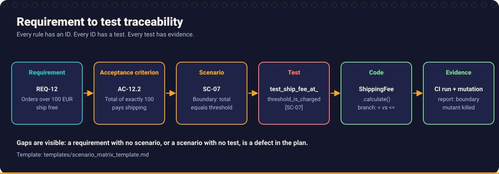
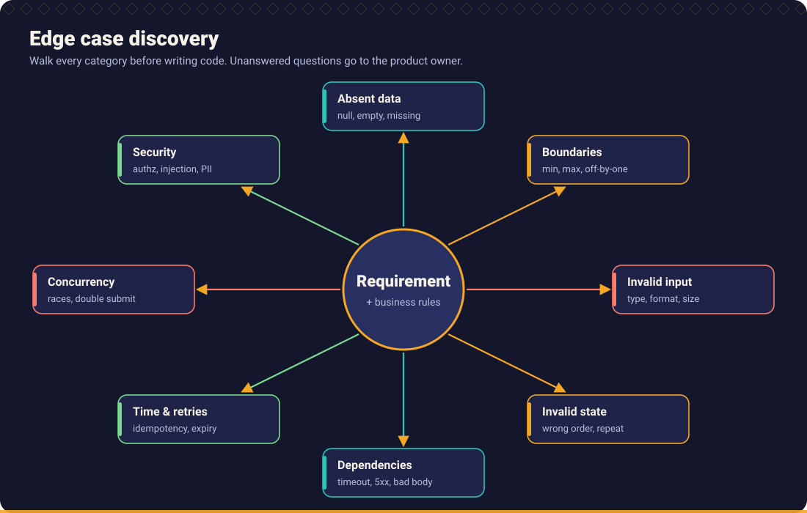
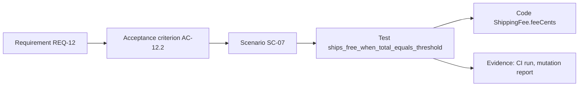

# Chapter 3: Requirement Engineering

> The cheapest defect to fix is the one you find in a sentence. The most expensive is the one you find in production.



## What you will learn

- How to analyse a requirement and separate functional from non functional needs.
- How to write acceptance criteria that can fail a test.
- How to find ambiguity and discover business rules instead of inventing them.
- How to enumerate boundary conditions, negative scenarios, dependencies and failures.
- How to trace requirements to tests, with a scenario matrix you can use today.

## Why this chapter matters more with AI

A human developer who meets an unclear requirement usually *feels* the gap and asks. An assistant fills the gap with the most plausible continuation and carries on. The result is fluent code that implements a requirement nobody wrote. **Requirement engineering is the main defence against silent rule invention.**

The rule for this chapter: **no implementation starts while a question that affects behaviour is unanswered or unflagged.**

## 1. Requirement analysis

Start from the text as written, and work through it systematically.

1. **Restate** the requirement in one or two sentences. If you cannot, you have found the first ambiguity.
2. **Identify actors, inputs, outputs and state changes.**
3. **List terms with no definition**: "large", "recent", "active", "valid", "soon", "customer".
4. **List numbers with no unit, type or inclusivity**: "over 100" (euros or cents? tax? exclusive?).
5. **List conditions with no else**: "if the order is paid, ship it". What if not?
6. **List assumptions** you would need to make, with the risk if each is wrong.
7. **Write questions** for a named person and agree who answers.

The [Requirement Analyst](../../skills/requirement-analyst/SKILL.md) skill and the [Requirement clarification](../../prompts/requirements/requirement-clarification.md) prompt automate the first pass. You do the second pass: do the questions match the real risks of your domain?

## 2. Functional and non functional requirements

| Functional requirements | Non functional requirements (quality attributes) |
| --- | --- |
| What the system does | How well it does it, under which constraints |
| "A customer can cancel an unshipped order." | Performance: "p95 latency under 300 ms at 50 requests per second." |
| "The invoice shows VAT per line." | Availability, reliability, durability: "No acknowledged order is ever lost." |
| "Gold customers receive 10 percent off." | Security and privacy: "Only the order owner may read it." |
| | Auditability, observability, compliance, accessibility, maintainability, compatibility |

Non functional requirements are the ones most often missing from a ticket and most often decisive for design. A requirement that cannot be tested ("fast", "secure", "scalable") is not finished. Turn it into a measurable target with a way to measure it, or mark it as `NFR NOT PROVIDED` and ask.

## 3. Acceptance criteria

Acceptance criteria are the contract between the people who want the behaviour and the people who build and test it.

**Form:** *Given* a state, *when* an action occurs, *then* an observable result follows.

```gherkin
Scenario: Free shipping applies at exactly the threshold
  Given a domestic order with a total of 100.00 EUR
  When the shipping fee is calculated
  Then the shipping fee is 0.00 EUR
```

**Good criteria are:**

- **Observable:** the *then* can be checked by a test.
- **Specific:** exact values, units and error types.
- **Independent:** one behaviour per criterion.
- **Traceable:** each has an ID linked to a requirement (`AC-12.2` for `REQ-12`).
- **Free of implementation:** "returns 0" yes, "uses a cache" no.

**Bad to better:**

| Bad | Better |
| --- | --- |
| "Handles invalid input gracefully." | "Given a quantity of `abc`, when the order is submitted, then the response is HTTP 422 with code `INVALID_QUANTITY` and no order is stored." |
| "Fast response." | "Given 50 concurrent requests, then the p95 response time is under 300 ms." |
| "Big orders ship free." | "Given a domestic order with a total of at least 100.00 EUR, then shipping is free." |

Use the [Acceptance criteria generation](../../prompts/requirements/acceptance-criteria-generation.md) prompt, then review every *then* clause: could it fail an automated test?

## 4. Requirement ambiguity

Ambiguity patterns to look for:

| Pattern | Example | Question to ask |
| --- | --- | --- |
| **Vague quantifier** | "large", "many", "recent" | What number? Inclusive or exclusive? |
| **Undefined term** | "active customer" | Defined where? By which rule? |
| **Missing actor** | "The order is cancelled." | By whom? Who is allowed? |
| **Hidden else** | "If paid, ship." | What if unpaid, partially paid, refunded? |
| **Scope ambiguity** | "All users" | Including guests, admins, deleted accounts? |
| **Temporal ambiguity** | "Within 30 days" | Calendar days? Which time zone? From which event? |
| **Conflicting statements** | Ticket says X, existing behaviour is Y | Which one is intended? |
| **Passive voice** | "A notification is sent." | By whom, to whom, when, how often, what if it fails? |

Every ambiguity ends in one of three outcomes: **answered** (recorded in the requirement), **assumed** (recorded with an owner and risk), or **blocking** (no implementation until answered).

## 5. Business rule discovery

Business rules often live only in code, data or people's memories. When the task changes existing behaviour:

1. **Extract** the rules as "when X then Y" statements, each with a source (file and line, test name, document).
2. **Classify** each: *documented*, *implemented only*, *tested only* or *inferred*.
3. **Detect** conflicts (overlapping conditions with different outcomes) and gaps (combinations no rule covers).
4. **Flag** magic numbers and suspicious boundaries for a business decision.
5. **Pin** current behaviour with characterisation tests before changing it.

The [Business Rule Analyst](../../skills/business-rule-analyst/SKILL.md) skill and the [Business rule discovery](../../prompts/requirements/business-rule-discovery.md) prompt help, but the **decision** whether an implemented-only rule is intended belongs to the business owner.

Example of what to flag: `if (age > 65) discount = 0.10;` with a ticket that says "seniors get 10 percent". Is a 65 year old a senior? That is a business decision, not a coding detail ([Example S3](../../examples/scenarios.md#s3-incorrect-boundary-condition)).

## 6. Boundary conditions

For every ordered or numeric input, identify the limits and test **below, at and above** each of them.

| Input kind | Typical boundaries |
| --- | --- |
| Integers, money | 0, 1, -1, the threshold minus/plus the smallest unit, maximum, overflow |
| Decimals | Rounding points (half cases), precision limits, negative zero |
| Strings | Empty, single character, maximum length, maximum plus one, whitespace only, Unicode, line breaks |
| Collections | Empty, one element, two elements, maximum size, duplicates |
| Dates and times | Start and end inclusive/exclusive, midnight, daylight saving transitions, leap days, end of month, time zones |
| Enumerations | Each value, an unknown value, null |
| Pagination | Page 0, 1, last, beyond last, page size 0, maximum |

State **inclusivity explicitly** ("at least 100", "more than 100"). If the requirement does not say, it is an open question, not a coin flip.

## 7. Negative scenarios

Define what must *not* happen, and what should happen instead.

- Invalid input (wrong type, format, range, size).
- Unauthorised or unauthenticated callers.
- Invalid state transitions (shipping a cancelled order, cancelling twice).
- Duplicate requests (retries, double clicks).
- Missing prerequisites (customer deleted, stock unavailable).

For each, specify the **observable outcome**: error type and code, message policy (no sensitive data), and the guarantee that *no side effect occurred* (nothing stored, charged or sent).

## 8. Dependency analysis

List everything the behaviour depends on, and for each, what happens when it is wrong.

| Dependency | Questions |
| --- | --- |
| Other services and APIs | Contract? Versioning? Rate limits? Timeouts? Behaviour when down, slow or returning an unexpected body? |
| Databases and queues | Transaction boundaries? Ordering? At-least-once delivery? Capacity? |
| Configuration and feature flags | Defaults? What if missing or malformed? |
| Time, randomness, identity | Clock source? Time zone? ID generation? |
| People and processes | Approvals? Data owners? Support teams that need to know? |
| Other teams' releases | Order of deployment? Compatibility window? |

## 9. Failure scenarios

For each external interaction and each important state change, ask: **what if it fails halfway?**

- Timeout after the request was sent (did it happen or not?).
- Partial success in a multi-step operation (money debited, goods not reserved).
- Duplicate delivery of a message.
- Process crash between two writes.
- Downstream permanently unavailable.

Decide, for each: retry (is the operation idempotent?), compensate, fail the whole operation, queue for later, or alert a person. This leads directly to the design topics in [Chapter 6](../06_defensive_programming/README.md#3-failure-handling) and [Chapter 8](../08_architecture_and_design/README.md).



The [Edge Case Hunter](../../skills/edge-case-hunter/SKILL.md) walks the eight categories in the diagram. Run it before writing tests: [Edge case discovery](../../prompts/requirements/edge-case-discovery.md).

## 10. Requirement traceability

Traceability answers: *is every requirement implemented and tested, and does every test serve a requirement?*



Practical conventions:

- Give requirements, criteria and scenarios **stable IDs**.
- Put the scenario ID into the **test name or a comment** (`# SC-07`) so a search finds it.
- Keep the **scenario matrix** in the pull request or next to the code.
- Review the matrix for gaps *in both directions*: requirement with no test, test with no requirement (a sign of unrequested behaviour).

### Scenario matrix

Copy this into your task or pull request. The full template with guidance is in [`templates/scenario_matrix_template.md`](../../templates/scenario_matrix_template.md).

| ID | REQ | AC | Category | Given | When | Then (expected) | Level | Test | Priority | Status |
| --- | --- | --- | --- | --- | --- | --- | --- | --- | --- | --- |
| SC-01 | REQ-1 | AC-1.1 | Boundary | Domestic, total 99.99 | Fee calculated | 4.99 | Unit | `pays_fee_below_threshold` | High | Planned |
| SC-02 | REQ-1 | AC-1.1 | Boundary | Domestic, total 100.00 | Fee calculated | 0.00 | Unit | `free_at_threshold` | High | Planned |
| SC-03 | REQ-2 | AC-2.1 | Normal | International, total 500 | Fee calculated | 14.99 | Unit | `international_flat_fee` | High | Planned |
| SC-04 | REQ-3 | AC-3.1 | Invalid | Total 0 | Fee calculated | Rejected | Unit | `rejects_zero_total` | Medium | Planned |
| SC-05 | REQ-4 | AC-4.1 | Dependency | Rate service times out | Fee calculated | `UNSPECIFIED` | Integration | (blocked) | High | Blocked by question Q3 |

A row with `UNSPECIFIED` is not a failure of the matrix: it is the matrix doing its job.

### Using AI for the matrix

1. Provide clarified requirements and acceptance criteria.
2. Run [Scenario matrix generation](../../prompts/requirements/scenario-matrix-generation.md).
3. Run [Requirement traceability check](../../prompts/requirements/requirement-traceability-check.md) on the implemented change.
4. Review: do all boundaries have exact values? Are the `UNSPECIFIED` rows resolved or consciously deferred?

## Practice

- Take a ticket from your backlog, run the analysis and bring the question list to your product owner. How many of the questions were new to them?
- Build a scenario matrix for the [end to end example](../../examples/end_to_end/README.md) without looking at the one in the example. Compare.
- Pick an implemented rule in your code base and apply the business rule discovery steps. Which rules were *implemented only*?

## Related

**Skills:** [Requirement Analyst](../../skills/requirement-analyst/SKILL.md), [Business Rule Analyst](../../skills/business-rule-analyst/SKILL.md), [Edge Case Hunter](../../skills/edge-case-hunter/SKILL.md)

**Prompts:** [Requirement clarification](../../prompts/requirements/requirement-clarification.md), [Acceptance criteria generation](../../prompts/requirements/acceptance-criteria-generation.md), [Business rule discovery](../../prompts/requirements/business-rule-discovery.md), [Edge case discovery](../../prompts/requirements/edge-case-discovery.md), [Scenario matrix generation](../../prompts/requirements/scenario-matrix-generation.md), [Requirement traceability check](../../prompts/requirements/requirement-traceability-check.md)

**Workflows:** [Build a new feature](../../workflows/01_feature_development.md), [Introduce a new API](../../workflows/04_new_api.md)

**Templates:** [Requirement template](../../templates/requirement_template.md), [Scenario matrix template](../../templates/scenario_matrix_template.md)

**Examples:** [End to end example](../../examples/end_to_end/README.md), [Scenario catalogue](../../examples/scenarios.md)

**Further reading** (external):

- [Specification by Example and BDD overview on Cucumber](https://cucumber.io/docs/bdd/) for the Given/When/Then style.

---

Previous: [Chapter 2](../02_developer_ways_of_working/README.md) · Next: [Chapter 4: AI Assisted Development](../04_ai_assisted_development/README.md) · [Handbook index](../README.md)
