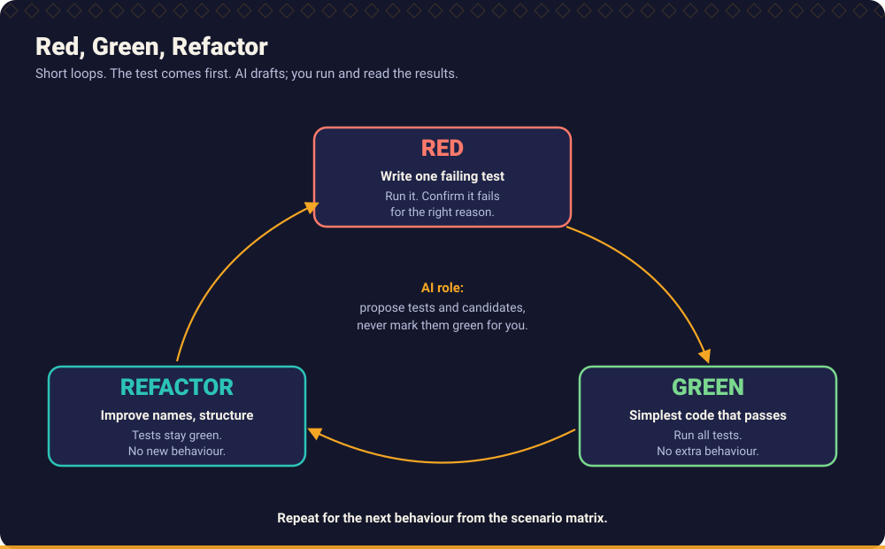

# Chapter 5: Test Driven Development

> In AI assisted development, tests are no longer only a safety net for your code. They are the **specification you hand to the assistant** and the **evidence you demand from it**.



This is the most detailed chapter of the handbook. It is split into four pages:

| Page | Covers |
| --- | --- |
| **This page** | TDD fundamentals, Red Green Refactor, tests before implementation, requirement driven tests, behaviour driven development |
| [TDD with AI](tdd_with_ai.md) | AI assisted test generation, the guarded TDD loop, failure patterns, prompts |
| [Test design](test_design.md) | Fixtures and test data, mocking and stubbing, parameterised, boundary, negative, regression and integration tests |
| [Property based and mutation testing](property_based_and_mutation_testing.md) | Property based testing, mutation testing, limits of coverage |

## What you will learn

- Why TDD is the preferred way to implement behaviour with an AI assistant.
- How to run Red, Green, Refactor in short, honest cycles.
- How to derive tests from requirements instead of from code.
- How to use behaviour driven development without ceremony.
- What a good test is, in Java, Python and TypeScript.

## 1. TDD fundamentals

**Test Driven Development** is a design and implementation technique in which you write a small failing test before you write the code that makes it pass.

The benefits that matter most with AI:

| Benefit | Why it matters when an assistant writes the code |
| --- | --- |
| **The test is a precise specification** | Natural language prompts are ambiguous; an assertion is not. |
| **The test limits the assistant** | "Make this pass, nothing more" prevents speculative code. |
| **The failure proves the test can fail** | A test written after the code may be incapable of failing. |
| **Small steps** | Each cycle is reviewable. |
| **Design pressure** | Code that is hard to test is usually hard to change. The pain shows up first. |
| **A safety net for refactoring** | AI proposes refactorings readily; tests tell you whether they preserved behaviour. |

TDD is a *preferred approach*, not a religion. Use it by default for logic, rules, validations and bug fixes. For exploratory work (a UI spike, learning a new API) it is fine to explore first, but **throw the spike away or put tests around it before it enters the main branch**.

## 2. Red, Green, Refactor

| Phase | What you do | The rule | What AI may do |
| --- | --- | --- | --- |
| **Red** | Write **one** test for the next behaviour. Run it. Read the failure. | It must fail, and for the *intended* reason (an assertion, not a missing import). | Draft the test from a scenario; you check the failure output. |
| **Green** | Write the **simplest** code that passes. Run the tests. | No behaviour that no test demands. | Draft the minimal change. |
| **Refactor** | Improve structure and names. Run the tests. | Behaviour unchanged; tests stay green. | Propose small refactorings. |

### A cycle, concretely

The following real run (from the [end to end example](../../examples/end_to_end/README.md)) shows why "fails for the intended reason" matters.

```text
# first attempt: test written, module not yet created
test_shipping.py:1: in <module>
    from shipping import shipping_fee_cents as fee
E   ModuleNotFoundError: No module named 'shipping'
1 error in 0.09s
```

This is red, but it says nothing about shipping fees. After adding a stub, the failure becomes an assertion failure, which is a meaningful red:

```text
>       assert fee(10_000, "DE") == 0
E       AssertionError: assert 499 == 0
```

and the minimal change that follows (`>=`, not `>`) is forced by the test.

### Why the simplest code?

Returning a constant for the first test looks silly. It is a deliberate technique: each following test **forces** the constant to become logic. If you write the general solution at once, you will not know which of your tests were necessary, and you will not know whether your tests could have caught a wrong general solution. The assistant's instinct is to write the general solution. Restrain it.

### Triangulation

When the right generalisation is unclear, write two or three tests with different values and let the code generalise just enough to satisfy all of them. The tests pin down the behaviour from several sides.

## 3. Writing tests before implementation

A workable routine for one slice:

1. Pick **one** scenario from the scenario matrix ([Chapter 3](../03_requirement_engineering/README.md)).
2. Name the test after the behaviour: `ships_free_when_total_equals_threshold`.
3. Arrange, act, assert, with exact expected values from the requirement.
4. Run it and **read the failure**.
5. Make it pass with the smallest change.
6. Refactor with the tests green.
7. Commit.

The tests in each language look alike:

**Java (JUnit 5)**

```java
@ParameterizedTest(name = "DE order of {0} cents pays {1}")
@CsvSource({"9999,499", "10000,0", "10001,0"})
void domesticFeeAroundTheFreeShippingThreshold(long total, long expected) {
    assertEquals(expected, ShippingFee.feeCents(total, "DE"));
}
```

**Python (pytest)**

```python
def test_domestic_order_at_threshold_ships_free():
    assert fee(10_000, "DE") == 0
```

**TypeScript (Vitest)**

```typescript
it("ships free at exactly the threshold", () => expect(fee(10_000, "DE")).toBe(0));
```

Full versions: [Java](../../examples/java/src/test/java/io/kaarkhana/examples/s06/ShippingFeeTest.java), [Python](../../examples/python/tests/test_s06_tdd_shipping.py), [TypeScript](../../examples/typescript/tests/s06_tdd_shipping.test.ts).

### Good tests have these properties

- **Named after behaviour**, readable as a sentence.
- **One reason to fail.**
- **Exact assertions**: values, error types, messages and side effects, not `is not None`.
- **Independent and repeatable**: no order dependence, real clock, randomness or shared state.
- **Fast**: unit tests in milliseconds.
- **Meaningful on failure**: the output tells you what is wrong.

### The bug-fix variant

For a defect, the first step is a test that **reproduces the bug and fails**. Then the fix. The test then protects against the regression forever. A fix without a failing test first is a guess ([Workflow 02: Fix a defect](../../workflows/02_defect_fix.md), [Regression test generation](../../prompts/testing/regression-test-generation.md)).

## 4. Requirement driven tests

Tests should come from **requirements and scenarios**, not from the code. When you generate tests from the implementation, they confirm what the code does, including its mistakes.

| Source of the test | What it proves |
| --- | --- |
| The scenario matrix | The behaviour the business asked for |
| The code | That the code does what the code does |

Practical rules:

- Give the assistant the **scenario**, not the implementation, when generating the first tests.
- Put the scenario ID in the test name or a comment to make the trace visible.
- When a scenario's expected result is `UNSPECIFIED`, **do not write a test that pins a guess**. Ask the question.
- When you must test existing code with no specification, write **characterisation tests** and mark them as such. They describe what happens, not what should happen. Anything odd is logged as a question.

## 5. Behaviour driven development

Behaviour driven development (BDD) expresses scenarios in a shared language of *Given, When, Then*. You can use the *structure* without any tool:

```python
def test_free_shipping_applies_at_exactly_the_threshold():
    # Given a domestic order with a total of 100.00 EUR
    total_cents, country = 10_000, "DE"
    # When the shipping fee is calculated
    fee_cents = shipping_fee_cents(total_cents, country)
    # Then shipping is free
    assert fee_cents == 0
```

Use a BDD framework (for example Cucumber, behave, or pytest-bdd) only when **non-programmers read and maintain the scenarios**. Otherwise the extra layer costs more than it gives. The ideas that do carry over are: scenarios in the language of the domain, one behaviour each, and examples that are concrete numbers.

For AI assisted work BDD style is a good *bridge format*: product people and developers review the Given/When/Then, the assistant turns each one into a test, and the scenario text is the traceability link.

## 6. Choosing the test level

| Level | Tests | Speed | Use for |
| --- | --- | --- | --- |
| **Unit** | A function or class in isolation | Milliseconds | Rules, calculations, validation, state machines |
| **Integration** | Your code with a real boundary (database, HTTP, queue) | Tens of milliseconds to seconds | Queries, mappings, serialisation, status handling, timeouts, transactions |
| **Contract** | The agreed shape and semantics of an API or message | Fast | Protecting consumers and providers from drift |
| **End to end** | The system through its public interface | Seconds or more | A few critical journeys |

Prefer many unit tests, a solid layer of integration tests at real boundaries and few end to end tests (the *test pyramid*). Mocks cannot show that SQL is right, that a client handles a 500, or that a timeout works. That is the job of integration tests: [scenario S8](../../examples/scenarios.md#s8-missing-integration-tests-and-inadequate-unit-tests) shows a mocked test passing for defective code in all three languages.

## Practice

1. Do the [end to end example](../../examples/end_to_end/README.md) in your own language, one cycle at a time, **before** looking at the solution.
2. In the [Python examples](../../examples/python/README.md), delete `improved.py` for scenario S3 and re-derive it from the tests only.
3. Pick a defect you fixed recently. Write the test that would have caught it first, and check that it fails on the old code.

## Related

**Skills:** [TDD Engineer](../../skills/tdd-engineer/SKILL.md), [Unit Test Engineer](../../skills/unit-test-engineer/SKILL.md), [Integration Test Engineer](../../skills/integration-test-engineer/SKILL.md), [Mutation Testing Specialist](../../skills/mutation-testing-specialist/SKILL.md), [Edge Case Hunter](../../skills/edge-case-hunter/SKILL.md)

**Prompts:** [TDD test generation](../../prompts/testing/tdd-test-generation.md), [Unit test generation](../../prompts/testing/unit-test-generation.md), [Integration test generation](../../prompts/testing/integration-test-generation.md), [Boundary testing](../../prompts/testing/boundary-testing.md), [Negative testing](../../prompts/testing/negative-testing.md), [Mutation testing](../../prompts/testing/mutation-testing.md), [Regression test generation](../../prompts/testing/regression-test-generation.md)

**Workflows:** [Write unit and integration tests](../../workflows/07_unit_and_integration_testing.md), [Build a new feature](../../workflows/01_feature_development.md), [Fix a defect](../../workflows/02_defect_fix.md)

**Examples:** [Scenario S6 (TDD)](../../examples/scenarios.md#s6-tdd-from-requirement-to-passing-tests), [Scenario S7 (weak assertions)](../../examples/scenarios.md#s7-weak-assertions-and-mutation-testing), [Broken Code Lab](../../examples/broken_code_lab/README.md)

**Further reading** (external):

- *Test Driven Development: By Example* by Kent Beck (book).
- [JUnit 5 User Guide](https://junit.org/junit5/docs/current/user-guide/), [pytest documentation](https://docs.pytest.org), [Vitest documentation](https://vitest.dev).
- [Mockito](https://site.mockito.org).

---

Previous: [Chapter 4](../04_ai_assisted_development/README.md) · Next: [TDD with AI](tdd_with_ai.md) · [Handbook index](../README.md)
