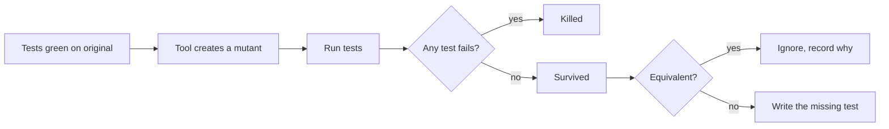

# Property based and mutation testing

> Coverage tells you which lines ran. It does not tell you whether anything would notice if they were wrong. Properties and mutants do.

Part of [Chapter 5: Test Driven Development](README.md).

The running subject on this page is the **late fee** rule from [scenario S7](../../examples/scenarios.md#s7-weak-assertions-and-mutation-testing):

- The first 3 days late are a grace period: no fee.
- From day 4, the fee is 50 cents per day beyond the grace period.
- The fee never exceeds 2000 cents.

## 1. The limits of coverage

**Code coverage** (line, branch) measures what the tests *executed*. Both suites below reach 100% line and branch coverage of `late_fee_cents`:

```python
def weak_suite(fn):
    assert fn(10) > 0
    assert fn(0) >= 0
    assert fn(1000) > 0

def strong_suite(fn):
    assert fn(0) == 0
    assert fn(3) == 0      # last grace day
    assert fn(4) == 50     # first charged day
    assert fn(10) == 350   # 7 days * 50
    assert fn(43) == 2_000 # exactly reaches the cap
    assert fn(44) == 2_000 # would be 2050 without the cap
    assert fn(1000) == 2_000
```

Only the second one is any good. Coverage is useful for finding **untested code**; it is a poor measure of **test quality**. Never set a coverage number as the goal; a low number is a signal, a high number is not a guarantee.

## 2. Mutation testing

A **mutation testing** tool makes many small changes (*mutants*) to your production code, such as `<=` becoming `<`, `+` becoming `-`, a constant incremented, or a condition negated. It runs your tests against each mutant.

| Outcome | Meaning |
| --- | --- |
| **Killed** | At least one test failed. The suite noticed the change. |
| **Survived** | All tests passed. The suite cannot tell the mutant from the original. **A gap.** |
| **Equivalent** | The mutant behaves exactly like the original. It cannot be killed; it is noise. |
| **Timed out / no coverage** | Treated as detected / a coverage gap, depending on the tool. |

The **mutation score** is killed divided by non-equivalent mutants. Treat it as a way to *find specific gaps*, not as a target to chase. A survivor is a question: *which behaviour is unprotected?*



### Tools

Names of widely used tools, all external to this repository (check each project for current language and framework support):

| Language | Tool |
| --- | --- |
| Java | [PIT (pitest)](https://pitest.org) |
| JavaScript / TypeScript | [StrykerJS](https://stryker-mutator.io) |
| Python | [mutmut](https://github.com/boxed/mutmut), [Cosmic Ray](https://github.com/sixty-north/cosmic-ray) |

This repository's examples do **not** depend on these tools. They use five **hand-written mutants** per language so you can see the mechanism with no extra install.

### The five hand-written mutants

Each is the original with exactly one change (from [`mutants.py`](../../examples/python/src/kaarkhana/s07_weak_assertions/mutants.py)):

| Mutant | Change | Why it matters |
| --- | --- | --- |
| `m1_grace_boundary_shifted` | `<= 3` becomes `<= 4` | Off by one at the grace boundary |
| `m2_off_by_one_day` | `days - 3` becomes `days - 2` | Off by one in the charge |
| `m3_rate_changed` | 50 becomes 51 | Wrong rate |
| `m4_cap_changed` | 2000 becomes 2001 | Wrong cap by one |
| `m5_cap_removed` | `min(..., cap)` removed | Cap not enforced |

The recorded test results in the examples are:

- The **weak suite** lets every mutant survive.
- The **strong suite** kills every mutant.

Run them yourself: [Python](../../examples/python/tests/test_s07_weak_assertions.py), [Java](../../examples/java/src/test/java/io/kaarkhana/examples/s07/LateFeeMutationTest.java), [TypeScript](../../examples/typescript/tests/s07_weak_assertions.test.ts).

### An equivalent mutant

Changing `days_late <= 3` into `days_late < 3` alters the result only at `days_late == 3`, where both branches return 0. No test can kill it. It is deliberately left out of the mutant list and explained in the [Java source](../../examples/java/src/main/java/io/kaarkhana/examples/s07/LateFee.java). Real tools produce these; review them, do not blindly write tests to kill them.

### Using mutation testing with AI

1. Run the tool on the code you just changed (changed files only; a full run can be slow).
2. Give the assistant the **list of surviving mutants** and the current tests.
3. Ask it to propose one test per survivor, stating *which behaviour* the test protects, and to flag likely equivalent mutants. Prompt: [Mutation testing](../../prompts/testing/mutation-testing.md).
4. **Run the tool again.** The claim "this kills the mutant" is only true if it did.

The role of the assistant is to *draft*. The tool is the judge.

Practical advice:

- Run it on **critical logic** (money, permissions, state machines), not on everything every time.
- In CI, use it on changed code or nightly rather than on every commit if it is slow.
- Pair it with [Boundary testing](../../prompts/testing/boundary-testing.md): boundary mutants are the most common survivors.
- See the [Mutation Testing Specialist](../../skills/mutation-testing-specialist/SKILL.md) skill.

## 3. Property based testing

An **example based test** says: for *this* input, the output is *that*. A **property based test** says: for *all* inputs of a kind, a general statement holds. The framework generates many inputs (including nasty ones), and when a property fails, it **shrinks** the input to a minimal counterexample.

Good properties for the late fee:

| Property | Statement |
| --- | --- |
| **Bounded** | `0 <= fee(d) <= 2000` for every `d` |
| **Monotonic** | `fee(d) <= fee(d + 1)` |
| **Grace** | `fee(d) == 0` for `d` in `0..3` |
| **Constant step** | Below the cap, one more day costs exactly 50 cents |

### Common property patterns

| Pattern | Example |
| --- | --- |
| **Invariant** | A sorted list has the same elements and is ordered |
| **Round trip** | `decode(encode(x)) == x` |
| **Idempotence** | `normalise(normalise(x)) == normalise(x)` |
| **Commutativity or order independence** | Order of adding items does not change the total |
| **Oracle** | The fast implementation equals a slow, obviously correct one |
| **Metamorphic** | Doubling every quantity doubles the total |
| **Bounds** | Output within the stated range |
| **No crash** | Any input yields a valid result or a *specified* error, never an unhandled exception |

### Python (Hypothesis)

```python
from hypothesis import given, strategies as st

from kaarkhana.s07_weak_assertions.late_fee import late_fee_cents

days = st.integers(min_value=0, max_value=10_000)


@given(days)
def test_fee_is_bounded(d):
    assert 0 <= late_fee_cents(d) <= 2_000


@given(days)
def test_fee_never_decreases_as_days_increase(d):
    assert late_fee_cents(d) <= late_fee_cents(d + 1)


@given(st.integers(min_value=0, max_value=3))
def test_grace_period_is_free(d):
    assert late_fee_cents(d) == 0


@given(st.integers(min_value=3, max_value=10_000))
def test_each_extra_day_below_the_cap_costs_50_cents(d):
    if late_fee_cents(d + 1) < 2_000:
        assert late_fee_cents(d + 1) - late_fee_cents(d) == 50
```

### TypeScript (fast-check)

```typescript
import fc from "fast-check";
import { it } from "vitest";
import { lateFeeCents } from "../src/s07_weak_assertions/lateFee";

it("fee is bounded and never decreases", () => {
  fc.assert(
    fc.property(fc.integer({ min: 0, max: 10_000 }), (d) => {
      const fee = lateFeeCents(d);
      return fee >= 0 && fee <= 2_000 && fee <= lateFeeCents(d + 1);
    }),
  );
});
```

### Java (jqwik)

```java
import net.jqwik.api.ForAll;
import net.jqwik.api.Property;
import net.jqwik.api.constraints.LongRange;

import static org.junit.jupiter.api.Assertions.assertTrue;

class LateFeePropertyTest {
    @Property
    void feeIsBoundedAndNeverDecreases(@ForAll @LongRange(min = 0, max = 10_000) long days) {
        long fee = LateFee.feeCents(days);
        assertTrue(fee >= 0 && fee <= 2_000);
        assertTrue(fee <= LateFee.feeCents(days + 1));
    }
}
```

**Status of these snippets.** The Hypothesis properties were executed once, on 2026-11-02, against the Python late fee code and the five hand-written mutants (see below). The fast-check and jqwik snippets are illustrative and have **not** been executed in this repository; the libraries are not dependencies of the examples. Check each library's documentation for its current API before adopting it: [Hypothesis](https://hypothesis.readthedocs.io), [fast-check](https://fast-check.dev), [jqwik](https://jqwik.net).

### What properties catch, and what they miss

The four Hypothesis properties above were run against each hand-written mutant. The recorded result:

| Mutant | bounded | monotonic | grace | step |
| --- | --- | --- | --- | --- |
| original | pass | pass | pass | pass |
| `m1_grace_boundary_shifted` | pass | pass | pass | **fails** |
| `m2_off_by_one_day` | pass | pass | pass | **fails** |
| `m3_rate_changed` | pass | pass | pass | **fails** |
| `m4_cap_changed` | **fails** | pass | pass | pass |
| `m5_cap_removed` | **fails** | pass | pass | pass |

Three observations:

1. **No single property kills everything.** "Monotonic" killed none of the mutants; it is true of nearly any sane fee function. Properties need to be chosen so that together they constrain the behaviour.
2. **Different properties protect different rules.** The cap is guarded by *bounded*; the rate and boundary are guarded by *step*.
3. **Properties do not replace examples.** A property that restates the implementation is a mirror test. Keep a few exact example tests as a readable specification, and use properties for the *general rules* and for finding inputs you did not think of.

### When property based tests shine

- Parsers, serialisers and round trips.
- Rules with algebraic structure: totals, discounts, ordering, merging, deduplication.
- State machines and stateful sequences (many frameworks support model based testing).
- Anything with a slow, obvious oracle to compare against.
- Finding the "empty, negative, huge, Unicode" inputs nobody listed.

### When they do not

- Behaviour that is purely a list of arbitrary business facts (a price table).
- Tests that need heavy setup per input (database round trips for every generated value).
- When you cannot state a property without re-implementing the function.

### Using property tests with AI

- Ask the assistant to **propose properties** and say which **mutants or bugs each would catch**, then check by experiment.
- Never accept a property that merely repeats the code under test.
- Keep generated inputs **bounded** to realistic domains, and set a fixed seed in CI failures so a counterexample can be reproduced. Record the shrunk counterexample as an ordinary regression test.

## 4. Putting it together: a test strength ladder

| Level | Question | Technique |
| --- | --- | --- |
| 1 | Did the code run? | Line and branch coverage |
| 2 | Does it do what examples say? | Example tests with exact assertions |
| 3 | Does it hold for inputs I did not think of? | Property based tests |
| 4 | Would the suite notice a wrong change? | Mutation testing |
| 5 | Does it work against the real boundary? | Integration and contract tests |

Use the ladder on code that matters. It is a poor use of time to run all five on a getter.

## Practice

1. Run the [Python S7 test](../../examples/python/tests/test_s07_weak_assertions.py). Add a sixth mutant of your own (for example, change `RATE_CENTS_PER_DAY` to 49) and show that the strong suite kills it and the weak suite does not.
2. Add the Hypothesis properties to a scratch project and watch them fail on the mutants. Which property catches which?
3. Install a mutation testing tool for your language and run it on one small module. Choose one survivor, decide if it is equivalent, and write the test that kills it.

## Related

**Skills:** [Mutation Testing Specialist](../../skills/mutation-testing-specialist/SKILL.md), [Unit Test Engineer](../../skills/unit-test-engineer/SKILL.md), [Edge Case Hunter](../../skills/edge-case-hunter/SKILL.md)

**Prompts:** [Mutation testing](../../prompts/testing/mutation-testing.md), [Boundary testing](../../prompts/testing/boundary-testing.md), [Unit test generation](../../prompts/testing/unit-test-generation.md)

**Workflows:** [Write unit and integration tests](../../workflows/07_unit_and_integration_testing.md)

**Examples:** [Scenario S7](../../examples/scenarios.md#s7-weak-assertions-and-mutation-testing)

Previous: [Test design](test_design.md) · Next: [Chapter 6: Defensive Programming and Edge Case Engineering](../06_defensive_programming/README.md) · [Handbook index](../README.md)
