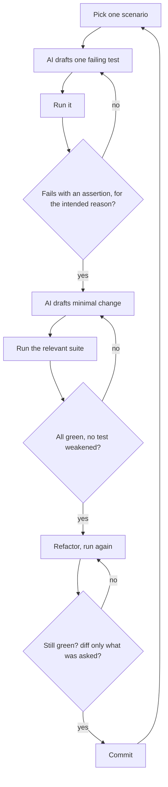

# TDD with AI

> Let the assistant draft. Make it prove. Read the red before you believe the green.

Part of [Chapter 5: Test Driven Development](README.md).

## 1. AI assisted test generation

An assistant is good at producing test *scaffolding* and at proposing *scenarios* you forgot. It is poor at knowing what the *right* expected value is. Therefore:

| Task | Delegate to AI? | Condition |
| --- | --- | --- |
| Propose edge cases and a scenario matrix | Yes | You review; unspecified behaviour is flagged, not decided |
| Turn a scenario into a test | Yes | Expected value comes from the scenario, not from the implementation |
| Write test data builders and fixtures | Yes | Defaults valid by domain rules |
| Choose expected values for unspecified behaviour | **No** | Ask the owner |
| Judge whether the tests are strong enough | Partly | Back it with mutation testing; do not rely on its opinion |
| Declare the tests passing | **No** | Only an executed run counts |

### Order of generation matters

| Generate tests from... | Result |
| --- | --- |
| The **requirement and scenarios**, before the code | Tests specify behaviour. They can fail. |
| The **implementation**, after the code | Tests mirror the code. They pass on first run and prove little. |
| **Both, separately** (tests from requirements; extra tests from reading the code for uncovered branches) | Good: the first set specifies, the second closes coverage gaps and exposes dead code. |

## 2. The guarded TDD loop

The loop below is the [TDD Engineer](../../skills/tdd-engineer/SKILL.md) skill in diagram form. The guards (the diamonds) are what make it work with an assistant.



The three guards in words:

1. **Red is real.** The failure output is shown and read. It is an assertion failure about the behaviour, not a compile error, import error or unrelated exception.
2. **Green is earned.** The suite was *run*. No existing test was edited, skipped or deleted to get there.
3. **Nothing extra.** The diff contains only what the test required.

### Prompt skeleton

The complete versions are [TDD test generation](../../prompts/testing/tdd-test-generation.md) and [Code generation](../../prompts/development/code-generation.md). The essential shape:

```text
Implement scenario SC-04 only.
1. Write the failing test. Run it and show me the failure output.
2. Make the smallest production change that passes. Run the suite and show the output.
3. Refactor only if clearer. Run the suite again.
Rules: touch only [FILES]. Do not weaken existing tests. Do not implement other scenarios.
Report only results from commands you actually ran.
```

## 3. Failure patterns when AI writes tests

| Pattern | Symptom | Countermeasure |
| --- | --- | --- |
| **Tests that cannot fail** | No assertion, or `assert True`, or asserting a mock returns what it was told to return | Break the code on purpose; a test must go red |
| **Mirror tests** | The test recomputes the answer using the same formula as the code | Use literal expected values from the requirement |
| **Weak assertions** | `is not None`, `> 0`, `no exception` | Exact values; mutation testing ([page](property_based_and_mutation_testing.md)) |
| **Over-mocking** | Everything is mocked, including pure logic | Mock boundaries only; add integration tests |
| **Happy path only** | No boundary, null, error or negative tests | Edge case discovery before tests ([Chapter 3](../03_requirement_engineering/README.md)) |
| **Assert the implementation** | `verify(repo).save(x)` with exact call sequences everywhere | Assert outcomes and state; verify interactions only where the interaction *is* the behaviour |
| **Tests edited to pass** | A failing test is changed to match new behaviour | Any change to an existing assertion needs a stated behaviour change |
| **Fabricated results** | "All 14 tests pass" with no run | Require quoted command output |
| **Pinned bugs** | The test asserts a defect as correct behaviour | Mark as characterisation, or raise the question |
| **Flaky by construction** | `sleep`, real clock, random data, shared state | Inject time and randomness; isolate data |

Demonstrations of several of these, with the defective test and its stronger replacement, are in [scenario S7](../../examples/scenarios.md#s7-weak-assertions-and-mutation-testing) and [S8](../../examples/scenarios.md#s8-missing-integration-tests-and-inadequate-unit-tests).

## 4. Keeping the assistant honest

Four habits that cost little:

1. **Run the tests yourself** before opening the pull request.
2. **Read the assertions first**, then the implementation.
3. **Invert something.** Change a `>=` to `>` in the code; if no test fails, the suite is weaker than it looks.
4. **Review the deleted lines in the test diff.** Removed assertions are the most dangerous change in a pull request.

## 5. TDD for the situations that tempt you to skip it

| Situation | What to do |
| --- | --- |
| **Legacy code without tests** | Characterisation tests first, then change under protection ([Existing code modification](../../prompts/development/existing-code-modification.md)) |
| **A bug report** | Reproduce as a failing test first ([Regression test generation](../../prompts/testing/regression-test-generation.md)) |
| **A UI or exploratory spike** | Explore freely; then write tests for what survives, or discard the spike |
| **Glue code that only wires things** | One integration test through the wiring instead of unit tests of every line |
| **Generated code** | Do not test the generator output line by line; test the behaviour it enables |
| **Time pressure** | Cut scope, not tests. A slice without a test is a slice you do not know works |

## Practice

- Run the guarded loop with an assistant on a scenario of your choice. Count how often a guard rejected something.
- Ask an assistant to write tests for a function **from the implementation only**. Then break the function in three ways. How many tests failed?
- Review a past pull request: which tests were edited rather than added?

## Related

**Skills:** [TDD Engineer](../../skills/tdd-engineer/SKILL.md), [Unit Test Engineer](../../skills/unit-test-engineer/SKILL.md)

**Prompts:** [TDD test generation](../../prompts/testing/tdd-test-generation.md), [Code generation](../../prompts/development/code-generation.md), [Unit test generation](../../prompts/testing/unit-test-generation.md)

**Workflows:** [Build a new feature](../../workflows/01_feature_development.md), [Write unit and integration tests](../../workflows/07_unit_and_integration_testing.md)

**Examples:** [End to end example](../../examples/end_to_end/README.md)

Previous: [Chapter 5 overview](README.md) · Next: [Test design](test_design.md)
