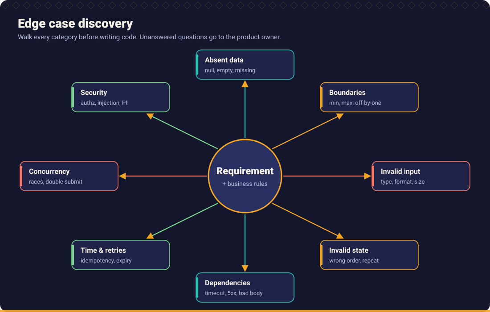

# Chapter 6: Defensive Programming and Edge Case Engineering

> Happy path code is the easy 20%. The rest of production engineering is deciding, deliberately, what happens when things are not happy.



AI assistants produce plausible happy path code very quickly. The defects they leave behind are the ones nobody asked about: the missing branch, the null, the boundary, the timeout, the retry that charges a customer twice. This chapter is the catalogue of those defects and the habits that remove them.

Companion page: [Else is not always the answer](else_is_not_always_the_answer.md).

## What you will learn

- A catalogue of the failure classes that matter, with a fix pattern for each.
- Why "defensive" does not mean "silently tolerate everything".
- How to decide, per failure, between *reject*, *default*, *retry*, *escalate* and *fail*.
- How to prove the fix with an automated test.

## 1. What "defensive" means

Defensive programming is **making failure behaviour explicit and safe**. It is not wrapping everything in `try/catch` or adding `if (x != null)` at every line.

| Defensive means | Defensive does not mean |
| --- | --- |
| Validate input once, at the boundary | Re-check the same value in every function |
| Fail fast with a message that names the cause | Return a plausible default and carry on |
| Make invalid states unrepresentable (types, enums) | Document that "x must not be null" |
| Handle what you can handle; translate the rest | `catch (Exception e) { }` |
| Decide failure behaviour *with the requirement owner* | Let the assistant pick |

### Two rules to keep in mind

1. **Parse, don't re-validate.** Validate at the edge, produce a type that is valid by construction, and let the inside trust it.
2. **Every default is a business rule.** `else return 0` decides that "unknown" means "free". If the requirement does not say so, you have invented a rule.

## 2. The defect catalogue

Each row names a class, how it shows up, and the fix pattern. The *Lab* and *Scenario* columns point to a runnable exercise.

| Class | Typical symptom | Fix pattern | Scenario / Lab |
| --- | --- | --- | --- |
| **Missing else / unhandled case** | Method returns null or does nothing for an unexpected value | Reject at the boundary, or make the cases exhaustive by type | [S1](../../examples/scenarios.md#s1-missing-else-behaviour), [Lab 01](../../examples/broken_code_lab/01_missing_else/CHALLENGE.md) |
| **Null handling** | `NullPointerException`, `TypeError`, `NoneType has no attribute` far from the cause | Model absence explicitly; validate at the edge | [S2](../../examples/scenarios.md#s2-missing-null-handling), [Lab 02](../../examples/broken_code_lab/02_null_dereference/CHALLENGE.md) |
| **Incomplete conditional / boundary** | Off by one; `>` instead of `>=` | Boundary tests: below, at, above | [S3](../../examples/scenarios.md#s3-incorrect-boundary-condition) |
| **Boolean logic errors** | Precedence, De Morgan mistakes, wrong operator | Decision table; test all combinations | [S5](../../examples/scenarios.md#s5-incomplete-or-wrong-boolean-logic), [Lab 03](../../examples/broken_code_lab/03_boolean_condition/CHALLENGE.md) |
| **Missing switch cases** | New enum value silently ignored | Exhaustive switch with no `default`; compile time check | [S1](../../examples/scenarios.md#s1-missing-else-behaviour) |
| **Empty collections** | `max([])` raises; average divides by zero | Decide what empty means and test it | [Test design](../05_test_driven_development/test_design.md) |
| **Invalid input** | Garbage in, corrupt data out | Strict parsing; specific errors | [S4](../../examples/scenarios.md#s4-inadequate-exception-handling) |
| **Numeric boundaries** | Overflow, rounding, negative, NaN, floating point money | Integer cents or decimal types; range checks | [Scenario S6](../../examples/scenarios.md#s6-tdd-from-requirement-to-passing-tests) |
| **Invalid states** | Order shipped before paid | State machine with allowed transitions | [Chapter 8](../08_architecture_and_design/README.md) |
| **Unexpected API responses** | Treats a 404 body as data; crashes on missing field | Check status; validate and map the response | [S8](../../examples/scenarios.md#s8-missing-integration-tests-and-inadequate-unit-tests) |
| **Timeouts** | Thread hangs forever when a dependency stalls | Explicit timeout on every remote call | [S8](../../examples/scenarios.md#s8-missing-integration-tests-and-inadequate-unit-tests) |
| **Retries** | Retry storm; duplicate side effects | Bounded retries, backoff, idempotency | Section 4 |
| **Idempotency** | Double click charges twice | Idempotency key; upsert semantics | Section 4 |
| **Concurrency** | Lost update; oversold stock | Atomic operation, lock, or database constraint | [Lab 04](../../examples/broken_code_lab/04_race_condition/CHALLENGE.md) |
| **Resource cleanup** | Leaked connections, files, locks | `with`, try-with-resources, `finally` | Section 5 |
| **Transaction boundaries** | Half applied change after a failure | One transaction around dependent writes | [Lab 05](../../examples/broken_code_lab/05_missing_transaction_rollback/CHALLENGE.md) |
| **Exception handling** | Swallowed, over-broad, lost cause | Specific exceptions, preserve cause, translate at boundaries | [S4](../../examples/scenarios.md#s4-inadequate-exception-handling), [Lab 06](../../examples/broken_code_lab/06_inadequate_exception_handling/CHALLENGE.md) |

## 3. Failure handling

Once you know something can fail, you must choose **one** of these responses. The choice is a decision, not a coding detail.

| Response | Use when | Example |
| --- | --- | --- |
| **Reject** | The caller gave bad input and can correct it | Unknown loyalty tier: 400 or `UnknownTier` |
| **Default** | The requirement defines a safe default | Blank display name: "customer" (stated in S2) |
| **Retry** | The failure is transient *and* the operation is safe to repeat | Connection reset on an idempotent GET |
| **Degrade** | A non-critical dependency is down | Show page without recommendations |
| **Escalate / fail loudly** | The state is inconsistent; continuing makes it worse | Corrupt data; invariant violated |
| **Compensate** | A multi step process failed halfway and cannot roll back atomically | Refund after a failed shipment booking |

Questions to ask for each failure:

1. Who can fix it: the caller, an operator, nobody?
2. Is it transient or permanent?
3. Is the operation safe to repeat?
4. What must be true afterwards? (No partial state. No lost data. No leaked secret.)
5. How will anyone *know* it happened? (Log, metric, alert: see [Chapter 11](../11_delivery_and_operations/README.md).)

### Handling exceptions well

| Do | Do not |
| --- | --- |
| Catch the **specific** exception you can handle | `catch (Exception)`, `except:`, `catch (e) {}` |
| Add context (what was being done, which input) | Rethrow a message-free error |
| **Preserve the cause** (`new X(msg, cause)`, `raise X from e`, `new Error(msg, { cause })`) | Throw a new error that drops the original |
| Translate low level errors into domain errors at a boundary | Leak `SQLException` to API clients |
| Log once, where it is handled | Log and rethrow at every layer |
| Never include secrets or personal data in messages | Put the full request body in the message |

The runnable S4 example in three languages shows `catch (Exception) { return 0 }` replaced with a specific, informative failure: [Java](../../examples/java/README.md), [Python](../../examples/python/README.md), [TypeScript](../../examples/typescript/README.md).

## 4. Timeouts, retries and idempotency

A remote call without a **timeout** is a defect: one stalled dependency eventually stalls the caller. A retry without **idempotency** is a bigger defect: it converts a transient error into a duplicate charge.

| Rule | Reason |
| --- | --- |
| Every remote call has an explicit timeout | The default is often "forever" or very long |
| Retry only *transient* failures (timeouts, connection reset, 429, 503) | Retrying a 400 never helps |
| Retry only **idempotent** operations, or add an idempotency key | Otherwise side effects repeat |
| Bound the attempts and use exponential backoff with jitter | Avoid retry storms |
| Respect a total deadline | The user stopped waiting a while ago |
| Make failure after the last retry explicit | Do not return partial or default data silently |

**Idempotency key** pattern: the client sends a unique key with each logical operation; the server stores the key with the result and returns the stored result when it sees the key again.

**Python**

```python
import random
import time

def with_retries(operation, attempts=3, base_delay=0.2, retry_on=(TimeoutError, ConnectionError)):
    for attempt in range(1, attempts + 1):
        try:
            return operation()
        except retry_on:
            if attempt == attempts:
                raise
            time.sleep(base_delay * 2 ** (attempt - 1) * random.uniform(0.5, 1.5))
```

**Java**

```java
static <T> T withRetries(Callable<T> operation, int attempts, long baseDelayMillis) throws Exception {
    for (int attempt = 1; ; attempt++) {
        try {
            return operation.call();
        } catch (IOException e) {                      // only the transient kind
            if (attempt == attempts) throw e;
            long delay = (long) (baseDelayMillis * Math.pow(2, attempt - 1)
                    * ThreadLocalRandom.current().nextDouble(0.5, 1.5));
            Thread.sleep(delay);
        }
    }
}
```

**TypeScript**

```typescript
async function withRetries<T>(
  operation: () => Promise<T>,
  attempts = 3,
  baseDelayMs = 200,
  isTransient: (e: unknown) => boolean = () => true,
): Promise<T> {
  for (let attempt = 1; ; attempt++) {
    try {
      return await operation();
    } catch (e) {
      if (attempt === attempts || !isTransient(e)) throw e;
      const delay = baseDelayMs * 2 ** (attempt - 1) * (0.5 + Math.random());
      await new Promise((resolve) => setTimeout(resolve, delay));
    }
  }
}
```

These are patterns, not drop in libraries: in production, prefer your platform's well tested resilience library and verify its defaults. To test retry logic, **inject the sleep function and the failure**; never test with real delays.

## 5. Resource cleanup

Anything opened must be closed on **every** path, including the error path.

| Language | Construct |
| --- | --- |
| Python | `with open(...) as f:` / `contextlib.closing` |
| Java | `try (var in = Files.newInputStream(p)) { ... }` (try-with-resources) |
| TypeScript | `try { ... } finally { await handle.close(); }` |

```python
with conn:                      # commit on success, roll back on exception
    conn.execute("UPDATE ...")
```

Assistants frequently generate code that opens a resource and closes it only on the success path. Review for it explicitly ([Defensive Programming Reviewer](../../skills/defensive-programming-reviewer/SKILL.md)).

## 6. Concurrency

Check-then-act on shared state is a race. If two requests can run at once, assume they will.

Defective (Python, from [Lab 04](../../examples/broken_code_lab/04_race_condition/CHALLENGE.md)):

```python
def reserve(self, qty):
    if self.stock >= qty:          # check
        time.sleep(0.001)          # simulates a database round trip
        self.stock -= qty          # act: another thread may have changed stock
        return True
    return False
```

Corrected: check and update become **one atomic step**.

```python
with self._lock:
    if self.stock >= qty:
        self.stock -= qty
        return True
    return False
```

In a real system the shared state is usually a database row, where the equivalent fixes are an atomic conditional update (`UPDATE ... SET stock = stock - :q WHERE id = :id AND stock >= :q`), optimistic locking with a version column, or a constraint. In-process locks do not protect you across multiple instances.

Test it by running many concurrent callers and asserting the **invariant** (stock never negative; reserved total equals decrease), as the lab does.

## 7. Transaction boundaries

Two writes that must succeed together belong in **one transaction**. If a failure between them leaves the data inconsistent, the boundary is wrong.

```python
with conn:  # one transaction: both balances change or neither does
    conn.execute("UPDATE accounts SET balance_cents = balance_cents - ? WHERE id = ?", (amount, source))
    cursor = conn.execute("UPDATE accounts SET balance_cents = balance_cents + ? WHERE id = ?", (amount, target))
    if cursor.rowcount != 1:
        raise LookupError(f"unknown target account: {target}")
```

Note the check on `rowcount`: an `UPDATE` that matched no rows is *not* an error to the database. Without the check, money disappears. Practise on [Lab 05](../../examples/broken_code_lab/05_missing_transaction_rollback/CHALLENGE.md).

Across services, a database transaction does not exist; use idempotent steps, outbox patterns and compensating actions ([Chapter 8](../08_architecture_and_design/README.md)).

## 8. Make invalid states unrepresentable

The cheapest defensive check is the one the compiler does for you.

**TypeScript** (closed set of cases with exhaustive checking):

```typescript
type Tier = "BASIC" | "SILVER" | "GOLD";

function discountRate(tier: Tier): number {
  switch (tier) {
    case "BASIC": return 0;
    case "SILVER": return 0.05;
    case "GOLD": return 0.1;
    // no default: adding a Tier without handling it is a compile error
    // because the function would no longer return on every path
  }
}
```

**Java** (enum plus switch expression, no default):

```java
enum Tier { BASIC, SILVER, GOLD }

static double discountRate(Tier tier) {
    return switch (tier) {
        case BASIC -> 0.0;
        case SILVER -> 0.05;
        case GOLD -> 0.10;     // no default: a new constant fails to compile here
    };
}
```

**Python** has no compile time check, so validate at the boundary and test every enum member:

```python
from enum import Enum

class Tier(Enum):
    BASIC = 0.0
    SILVER = 0.05
    GOLD = 0.10

def discount_rate(tier: Tier) -> float:
    return Tier(tier).value   # raises ValueError for anything that is not a Tier
```

Pair this with a static type checker (for example mypy or pyright) to catch misuse before runtime.

## 9. How to use AI for edge cases

1. **Before coding:** ask for edge cases and a scenario matrix, with unspecified behaviour flagged rather than decided ([Edge case discovery](../../prompts/requirements/edge-case-discovery.md)).
2. **While coding:** state the failure behaviour in the prompt ("reject unknown tiers with `UnknownTier`; do not add defaults").
3. **After coding:** have an assistant review the diff only for missing cases, nulls, boolean logic and exception handling ([Missing condition detection](../../prompts/code_review/missing-condition-detection.md), [Null handling review](../../prompts/code_review/null-handling-review.md), [Control flow review](../../prompts/code_review/control-flow-review.md), [Exception handling review](../../prompts/code_review/exception-handling-review.md)).
4. **Always:** convert each finding into a **failing test** first, then fix.

### Defensive review checklist

- [ ] Every `if` chain and `switch` handles or rejects every value of its input.
- [ ] Every parameter that can be null, empty or out of range has a defined behaviour and a test.
- [ ] Boundaries have below, at and above tests.
- [ ] Boolean expressions with more than two operands are parenthesised and tested as a table.
- [ ] No catch-all handlers; causes are preserved; no secrets in messages.
- [ ] Every remote call has a timeout; every retry is bounded and safe.
- [ ] Every opened resource is closed on every path.
- [ ] Multi step writes share a transaction or have a compensation.
- [ ] Shared mutable state is protected, and a concurrent test asserts the invariant.
- [ ] Defaults that exist are stated in the requirement.

## Practice

1. Work through the [Broken Code Lab](../../examples/broken_code_lab/README.md) exercises 01 to 06 **before** reading any solution. For each, write the failing test, then fix.
2. Take a real function from your codebase with an `if` chain. List every value its input can take. Which ones are not handled?
3. Search your code for `catch (Exception`, `except Exception`, or `catch (e) {}`. Pick three and decide for each: handle, translate, or let propagate.

## Related

**Skills:** [Defensive Programming Reviewer](../../skills/defensive-programming-reviewer/SKILL.md), [Edge Case Hunter](../../skills/edge-case-hunter/SKILL.md), [Control Flow Analyst](../../skills/control-flow-analyst/SKILL.md), [Debugging Specialist](../../skills/debugging-specialist/SKILL.md)

**Prompts:** [Defensive coding](../../prompts/development/defensive-coding.md), [Edge case discovery](../../prompts/requirements/edge-case-discovery.md), [Missing condition detection](../../prompts/code_review/missing-condition-detection.md), [Null handling review](../../prompts/code_review/null-handling-review.md), [Exception handling review](../../prompts/code_review/exception-handling-review.md), [Resilience review](../../prompts/architecture/resilience-review.md)

**Workflows:** [Fix a defect](../../workflows/02_defect_fix.md), [Build a new feature](../../workflows/01_feature_development.md)

**Examples:** [Scenario catalogue](../../examples/scenarios.md), [Broken Code Lab](../../examples/broken_code_lab/README.md)

**Further reading** (external): [OWASP Cheat Sheet Series: Error Handling](https://cheatsheetseries.owasp.org/cheatsheets/Error_Handling_Cheat_Sheet.html), *Release It!* by Michael Nygard (book).

---

Previous: [Chapter 5](../05_test_driven_development/README.md) · Next: [Chapter 7: Code Quality](../07_code_quality/README.md) · [Handbook index](../README.md)
