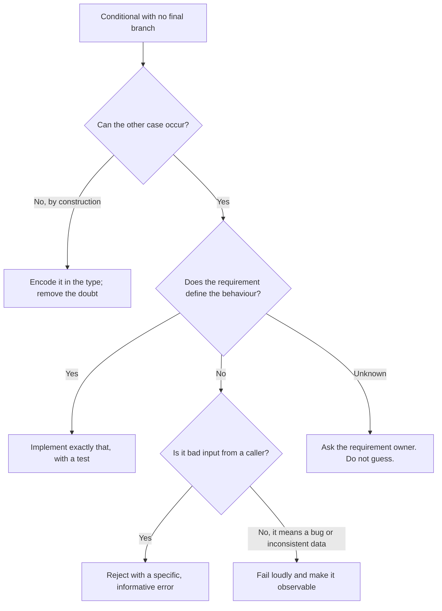

# Else is not always the answer

> When a reviewer says "this is missing an else", the correct reply is a question: *what should happen in the other case, and who decided?*

Part of [Chapter 6: Defensive Programming and Edge Case Engineering](README.md).

## The reflex, and why it is dangerous

Static analysers, reviewers and AI assistants all share a reflex: a conditional without a final branch looks incomplete, so add one. The cheapest `else` is one that returns a harmless value:

```python
def discount_rate(tier):
    if tier == "GOLD":
        return 0.10
    elif tier == "SILVER":
        return 0.05
    elif tier == "BASIC":
        return 0.0
    else:
        return 0.0      # "fixed"
```

The crash went away. So did the evidence. A misspelt tier (`"gold"`, `"GOLD "`), a new tier added by another team (`"PLATINUM"`), or a bug that produces `None` now mean *no discount, silently, forever*. The code no longer fails; it is wrong in a way no one will notice until a customer complains. The `else` has **made up a business rule**: "unknown means free of discount".

This is the "missing else behaviour" defect ([scenario S1](../../examples/scenarios.md#s1-missing-else-behaviour)), and the instinctive fix is often worse than the defect.

## What the missing branch really is: a question

A missing `else` means one of these is unanswered:

| Question | Possible answer | Resulting code |
| --- | --- | --- |
| Can the other case happen at all? | No: the type or earlier validation makes it impossible | No branch needed; make the type enforce it |
| Is it the caller's mistake? | Yes | **Reject** with a specific error |
| Does the requirement define a default? | Yes, in writing | **Default**, with a test and a comment citing the rule |
| Is it a legitimate "do nothing"? | Yes (nothing to apply) | Explicit no-op, with a comment saying why |
| Could it happen because of a bug elsewhere? | Yes | **Fail loudly** (assertion or internal error) and alert |
| Is it a state we should handle later? | Yes | Reject now, record a ticket |

Only the fourth and a defined default are "else returns something".

## A decision procedure



When the answer is "unknown", **stop and ask**. Hand the question to the assistant as a task ("list the cases the requirement does not define"), not as permission to choose.

## Worked example: three languages

The requirement defines exactly three tiers. Anything else is invalid input.

**Python**

```python
class UnknownTier(ValueError):
    """Raised when a tier is not one of the tiers defined by the requirement."""

_RATES = {"BASIC": 0.0, "SILVER": 0.05, "GOLD": 0.10}

def discount_rate(tier):
    if not isinstance(tier, str) or tier not in _RATES:
        raise UnknownTier(f"unknown loyalty tier: {tier!r}")
    return _RATES[tier]
```

**Java** (enum, so the compiler knows the cases)

```java
public enum Tier {
    BASIC, SILVER, GOLD;

    public static Tier parse(String text) {
        if (text != null) {
            for (Tier tier : values()) {
                if (tier.name().equals(text)) {
                    return tier;
                }
            }
        }
        throw new UnknownTierException("unknown loyalty tier: " + (text == null ? "null" : "'" + text + "'"));
    }

    public double discountRate() {
        return switch (this) {
            case BASIC -> 0.0;
            case SILVER -> 0.05;
            case GOLD -> 0.10;      // no default: a new constant fails to compile here
        };
    }
}
```

**TypeScript** (closed union and an exhaustive `switch`)

```typescript
type Tier = "BASIC" | "SILVER" | "GOLD";

function parseTier(value: unknown): Tier {
  if (value === "BASIC" || value === "SILVER" || value === "GOLD") return value;
  throw new Error(`unknown loyalty tier: ${JSON.stringify(value)}`);
}
```

The complete, tested versions are in [Python](../../examples/python/src/kaarkhana/s01_missing_else/improved.py), [Java](../../examples/java/src/main/java/io/kaarkhana/examples/s01/Tier.java) and [TypeScript](../../examples/typescript/src/s01_missing_else/improved.ts). The tests in each include the characterisation of the defective version and the rejection of `"gold"`, `"PLATINUM"`, `""` and null.

## The tests that settle the argument

A test makes the decision explicit and durable:

```python
import pytest

def test_unknown_tier_is_rejected_not_defaulted():
    with pytest.raises(UnknownTier, match="PLATINUM"):
        discount_rate("PLATINUM")

def test_lowercase_tier_is_rejected():
    with pytest.raises(UnknownTier):
        discount_rate("gold")
```

If, later, the business decides "unknown tiers get no discount", changing these two tests is a *visible, reviewed* decision rather than an accident.

## When an else *is* right

| Situation | Why `else` is correct |
| --- | --- |
| The requirement states the default ("anything else is treated as standard shipping") | It implements a rule |
| Two-way logic over a boolean | There really are only two cases |
| Guard clauses and early returns | The "else" is the rest of the function |
| An explicit no-op ("if the cache is warm, nothing to do") | The absence of action *is* the behaviour |

A default is acceptable when you can point to the sentence in the requirement that defines it. If you cannot, it is a guess.

## Same trap, other shapes

| Shape | Equivalent of the lazy else |
| --- | --- |
| `switch` with `default: return 0` | Hides new enum values |
| `Optional.orElse(0)` / `x ?? 0` / `x or 0` | Turns "unknown" into a real value |
| `catch { return null }` | Turns a failure into data |
| `dict.get(key, DEFAULT)` | Turns a missing key into the default |
| `if (x != null) { ... }` with no else | The null case silently does nothing |

Each of these is sometimes correct. Each needs the same question.

## Using AI here

- Ask the assistant to **list the unhandled cases** of a conditional and to say, for each, whether the requirement defines a behaviour. Do not ask it to "complete the conditional".
- If an assistant adds an `else` with a default, ask: *which sentence in the requirement says so?*
- Review prompt: [Missing condition detection](../../prompts/code_review/missing-condition-detection.md). Skill: [Control Flow Analyst](../../skills/control-flow-analyst/SKILL.md).
- Practise on [Lab 01: Missing else](../../examples/broken_code_lab/01_missing_else/CHALLENGE.md).

## Practice

1. Find three conditionals in your code that have no final `else`. For each, write down which row of the question table applies.
2. Find three `else` or `default` branches that return a harmless value. Can you cite the requirement behind each?
3. Complete the [Missing else lab](../../examples/broken_code_lab/01_missing_else/CHALLENGE.md) twice: first with a lazy `else`, then with a rejection. Compare what the tests can see.

## Related

**Skills:** [Defensive Programming Reviewer](../../skills/defensive-programming-reviewer/SKILL.md), [Control Flow Analyst](../../skills/control-flow-analyst/SKILL.md), [Business Rule Analyst](../../skills/business-rule-analyst/SKILL.md)

**Prompts:** [Missing condition detection](../../prompts/code_review/missing-condition-detection.md), [Business rule discovery](../../prompts/requirements/business-rule-discovery.md), [Defensive coding](../../prompts/development/defensive-coding.md)

Previous: [Chapter 6 overview](README.md) · [Handbook index](../README.md)
