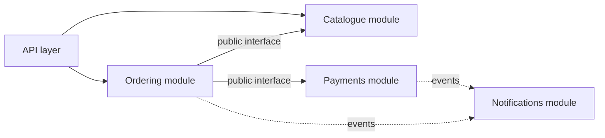
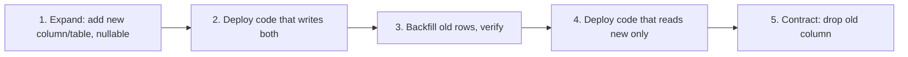

# Chapter 8: Architecture and Design

> Architecture is the set of decisions that are expensive to change. AI can help you *explore* options quickly. It cannot own the trade offs.

## What you will learn

- How to think about system design as a series of explicit trade offs.
- When to use common patterns, modular monoliths, microservices and events, and when not to.
- How to design APIs and databases that can evolve.
- Resilience and scalability basics.
- How to record decisions (ADRs) and use AI as a design reviewer without outsourcing judgement.

## 1. System design as trade offs

There is no best architecture, only architectures that fit a set of **quality attributes** and constraints.

| Quality attribute | Typical question |
| --- | --- |
| **Correctness / consistency** | What must never be wrong, even briefly? |
| **Availability** | What happens when a dependency is down? |
| **Latency and throughput** | What are the real numbers needed? |
| **Scalability** | What grows: users, data, tenants, teams? |
| **Changeability** | What kinds of change do we expect? |
| **Security and privacy** | Whose data, what threats ([Chapter 9](../09_security_engineering/README.md))? |
| **Operability** | Who runs it and how do they see inside it? |
| **Cost** | Build cost, run cost, cognitive cost |
| **Team fit** | Can our teams build and run this? |

A design starts with: *context, constraints, quality attribute priorities, options, decision, consequences*. If the chosen option has no downside written down, the analysis is incomplete.

### Method

1. Write the **problem and the non goals**.
2. List **quality attributes in priority order**, with numbers where you have them (and mark guesses as guesses).
3. Sketch **two or three options**, including "do the simplest thing".
4. Compare against the attributes. Name what you give up.
5. Decide, record in an **ADR** (section 9), and define what would make you revisit.

The [technical design template](../../templates/technical_design_template.md) follows this shape.

## 2. Design patterns

Patterns are named solutions to recurring problems. Use them to **communicate** and to avoid re-inventing, not to decorate.

| Pattern | Problem it solves | Use it when | Beware |
| --- | --- | --- | --- |
| **Strategy** | Swappable algorithm | Several interchangeable behaviours (tier discounts) | An interface for one implementation |
| **Factory** | Hide construction | Creation logic is complex or varies | Factories of factories |
| **Adapter** | Make an incompatible interface fit | Wrapping a third party API | Leaking its types |
| **Decorator** | Add behaviour around another | Logging, caching, retry | Deep stacks that are hard to debug |
| **Observer / events** | Decouple producers from reactors | Many independent reactions to one fact | Invisible control flow |
| **Repository** | Hide persistence | Domain logic should not know SQL | Generic repositories that leak queries |
| **State** | Valid transitions of a lifecycle | Order, payment, document states | Implicit state in booleans |
| **Circuit breaker** | Stop calling a failing dependency | Remote dependency with failures | Without monitoring it hides outages |
| **Outbox** | Reliable publish with a database write | Update and event must be consistent | Needs a relay and idempotent consumers |

AI assistants love patterns. Ask: *what problem in this code does this pattern solve, today?* If the answer is "none yet", remove it.

## 3. Modular architecture

Most teams should start with a **modular monolith**: one deployable, with strong internal boundaries.

| Rule | Reason |
| --- | --- |
| Organise by **business capability** (billing, catalogue), not by technical layer alone | Changes follow capabilities |
| Each module has a **public interface**; everything else is private | Others cannot depend on internals |
| Dependencies point **one way**; no cycles | Cycles make a monolith into a ball of mud |
| Modules own their **data**; no cross-module table access | Preserves the option to split later |
| **Enforce** boundaries in the build (architecture tests, package visibility, lint rules) | Conventions erode without a check |

An **architecture test** checks the rules automatically, for example "nothing in `ordering` imports `payments.internal`". Tools exist for this in every ecosystem (ArchUnit for Java, import linters for Python, dependency-cruiser for TypeScript). Check each tool's documentation for current usage.

## 4. Microservices and event driven architecture

### Microservices

Microservices split a system into independently deployable services owned by separate teams. They buy **independent deployment and scaling** and cost **distributed system complexity**.

| Choose microservices when | Prefer a modular monolith when |
| --- | --- |
| Multiple teams are blocked by a shared deployable | One team or a few teams |
| Parts have very different scaling or availability needs | Load is uniform |
| Domain boundaries are well understood and stable | Boundaries are still being discovered |
| You have mature CI/CD, observability and on call | You do not |

What you take on: network failure, partial failure, distributed tracing, versioned contracts ([contract tests](../05_test_driven_development/test_design.md#9-contract-tests)), eventual consistency, and operating many things. Splitting a badly understood monolith produces a distributed monolith, which is the worst of both.

### Event driven architecture

Services communicate by publishing **events** (facts that happened) that others react to.

| Concept | Meaning |
| --- | --- |
| **Event** | An immutable fact: `OrderPlaced` |
| **Command** | A request to do something: `PlaceOrder` |
| **At-least-once delivery** | The usual guarantee: duplicates happen, so consumers must be **idempotent** |
| **Ordering** | Usually guaranteed only per key or partition |
| **Dead letter queue** | Where messages go after repeated failure; needs monitoring and a replay plan |
| **Schema evolution** | Events are contracts; add optional fields, do not rename or repurpose |
| **Outbox pattern** | Write the event in the same transaction as the state change, then publish |

Events decouple in time and ownership but make flow harder to follow and failures harder to see. Invest in correlation IDs and tracing from the start ([Chapter 11](../11_delivery_and_operations/README.md)).

## 5. API design

An API is a contract that outlives its first implementation. Design it from the **consumer's** point of view.

| Principle | Guidance |
| --- | --- |
| **Resource orientation** | Nouns, consistent naming and pluralisation |
| **Correct semantics** | GET is safe and idempotent; PUT idempotent; POST creates or acts and is not idempotent unless you add an idempotency key |
| **Status codes** | 2xx success, 4xx the caller's fault, 5xx ours; be consistent |
| **Error format** | One structured format with a stable error code, human message and correlation ID; no stack traces, no secrets |
| **Validation** | Reject unknown or invalid fields explicitly; document limits |
| **Pagination and limits** | Never return unbounded lists |
| **Versioning** | Plan for change: additive changes are compatible; removing or repurposing is breaking |
| **Idempotency** | Keys for operations that must not repeat ([Chapter 6](../06_defensive_programming/README.md#4-timeouts-retries-and-idempotency)) |
| **Authentication and authorisation** | Every endpoint, explicitly ([Chapter 9](../09_security_engineering/README.md)) |
| **Documentation** | A machine readable spec (for example OpenAPI) kept in sync by tests |

### What counts as a breaking change

| Change | Breaking for consumers? |
| --- | --- |
| Add an optional response field | No, if consumers tolerate unknown fields |
| Add a required request field | **Yes** |
| Remove or rename a field | **Yes** |
| Change a field's type or meaning | **Yes** |
| Tighten validation | **Yes** (previously valid requests now fail) |
| Add a new enum value in a response | **Possibly**: clients with exhaustive handling may break |
| Change an error code or status | **Yes** |

The [API Contract Reviewer](../../skills/api-contract-reviewer/SKILL.md) skill and the [API design review](../../prompts/architecture/api-design-review.md) prompt apply this table; the full lifecycle is in [Workflow 04: Introduce a new API](../../workflows/04_new_api.md).

## 6. Database design and data modelling

| Topic | Guidance |
| --- | --- |
| **Model the domain, then the tables** | Entities, relationships, invariants first |
| **Keys** | Every table has a primary key; choose stable natural or surrogate keys deliberately |
| **Constraints** | `NOT NULL`, `UNIQUE`, `CHECK`, foreign keys: the database is the last line of defence against bad data |
| **Money** | Integer minor units or exact decimal; never binary floating point |
| **Time** | Store UTC instants; keep the time zone separately where it matters |
| **Indexes** | For real query patterns; each costs writes; verify with the query plan |
| **Normalisation** | Normalise by default; denormalise deliberately, with a stated reason |
| **Soft delete, audit** | Decide up front, including privacy erasure obligations |
| **Transactions** | Boundaries match business invariants ([Chapter 6](../06_defensive_programming/README.md#7-transaction-boundaries)) |

### Evolving a schema safely: expand and contract

Schema changes run while old and new application versions coexist. Make them **backward compatible in steps**:

| Risky change | Safer approach |
| --- | --- |
| Rename a column | Add new, write both, backfill, switch reads, drop old |
| Add `NOT NULL` column | Add nullable, backfill, then add the constraint |
| Change a column's type | New column plus migration, not an in-place change on a large table |
| Drop a column | Only after no code reads it, with a backup and rollback plan |
| Add an index on a large table | Check your database's online index options; schedule and monitor |

Always test the migration on realistic data volume, and write the **rollback** before the migration. See the [Database Design Reviewer](../../skills/database-design-reviewer/SKILL.md), the [Database schema review](../../prompts/architecture/database-schema-review.md) prompt and [Workflow 05: Change a database schema](../../workflows/05_database_schema_change.md).

## 7. Resilience

Assume every dependency will be slow or down. The patterns below limit the blast radius.

| Pattern | What it does | Needs |
| --- | --- | --- |
| **Timeouts** | Bound the wait | Every remote call |
| **Retries with backoff** | Ride out transient failures | Idempotency |
| **Circuit breaker** | Fail fast while a dependency is unhealthy | Fallback or clear error; monitoring |
| **Bulkhead** | Isolate resources so one failure does not exhaust everything | Separate pools or queues |
| **Rate limiting and load shedding** | Protect yourself from overload | Defined priorities |
| **Graceful degradation** | Partial functionality instead of none | Decide what is optional |
| **Idempotent consumers** | Safe re-delivery | Deduplication key |
| **Health checks** | Tell the platform when to route or restart | Meaningful checks, not `return 200` |
| **Backups and restore tests** | Recovery is a tested procedure | Regular restore drills |

Review prompt: [Resilience review](../../prompts/architecture/resilience-review.md).

## 8. Scalability

| Principle | Notes |
| --- | --- |
| **Measure first** | Profile and load test; optimise the bottleneck you have, not the one you imagine |
| **Stateless services** | Easier to scale horizontally; state in databases, caches, queues |
| **Cache with a plan** | Define invalidation, staleness tolerance and what happens on a cold cache |
| **Queue slow work** | Move non-interactive work off the request path |
| **Partition data** | Know your partition key and the queries it makes expensive |
| **Avoid N+1 queries** | Fetch related data in batch |
| **Capacity numbers** | Write down expected load and headroom, label guesses as guesses |

The [Performance Analyst](../../skills/performance-analyst/SKILL.md) skill and [Performance review](../../prompts/code_review/performance-review.md) cover code level performance.

## 9. Architectural decision records

An **Architectural Decision Record (ADR)** is a short, dated document capturing one significant decision and why.

| Section | Content |
| --- | --- |
| **Title** | Short noun phrase: "Use PostgreSQL for order storage" |
| **Status** | Proposed, accepted, superseded by ADR-N |
| **Context** | Forces at play: requirements, constraints, quality attributes |
| **Options considered** | Including the do-nothing and the simplest option |
| **Decision** | What we chose, in a sentence |
| **Consequences** | Good and bad, including what becomes harder |
| **Revisit when** | The trigger that reopens the decision |

Keep them in the repository next to the code, immutable once accepted (supersede, do not edit history). The [ADR template](../../templates/adr_template.md) and the [ADR drafting](../../prompts/architecture/adr-drafting.md) prompt support this.

## 10. AI assisted architecture reviews

AI is a useful **second reviewer** of a design: it never gets tired of asking "what if this fails?", and it knows many patterns. It is a poor decision maker: it lacks your context, constraints, team and history, and agrees with confident framing.

### What to ask for

| Use | Prompt |
| --- | --- |
| Review a design against quality attributes | [Architecture review](../../prompts/architecture/architecture-review.md) |
| Find failure modes of a dependency | [Resilience review](../../prompts/architecture/resilience-review.md) |
| Review an API proposal | [API design review](../../prompts/architecture/api-design-review.md) |
| Review a schema change | [Database schema review](../../prompts/architecture/database-schema-review.md) |
| Threats and mitigations | [Threat modelling](../../prompts/architecture/threat-modelling.md) |
| Write up a decision | [ADR drafting](../../prompts/architecture/adr-drafting.md) |

### How to use it well

1. **Give the real context**: constraints, scale numbers, team size, existing system. Without them you get a generic textbook answer.
2. **Ask for options with trade offs**, not "the best design".
3. **Ask it to argue against your choice.** Then judge the arguments.
4. **Separate facts from assumptions.** Make it list the assumptions it relied on.
5. **Verify claims**: product limits, version specific behaviour and benchmark numbers come from documentation and measurement, not from a model's memory.
6. **Decide as a human and record it** in an ADR with your name on it.

Typical failure modes of AI in design: recommending fashionable architecture regardless of scale, inventing quotas and benchmark figures, ignoring operational cost, and proposing a rewrite where a small change would do. The [Architecture Reviewer](../../skills/architecture-reviewer/SKILL.md) skill is built to counter these.

## Practice

1. Pick a feature in your system. Write a one page design with two options and a trade off table, then ask an assistant to critique it. Which critiques were useful? Which were noise?
2. Review the public API of one of your services against the breaking change table. Would your last three changes have been breaking?
3. Write an expand and contract plan for a column rename in a table you own, including the rollback.
4. Write an ADR for a decision your team made last quarter that nobody remembers the reason for.

## Related

**Skills:** [Architecture Reviewer](../../skills/architecture-reviewer/SKILL.md), [API Contract Reviewer](../../skills/api-contract-reviewer/SKILL.md), [Database Design Reviewer](../../skills/database-design-reviewer/SKILL.md), [Performance Analyst](../../skills/performance-analyst/SKILL.md)

**Prompts:** [Architecture review](../../prompts/architecture/architecture-review.md), [API design review](../../prompts/architecture/api-design-review.md), [Database schema review](../../prompts/architecture/database-schema-review.md), [Resilience review](../../prompts/architecture/resilience-review.md), [Threat modelling](../../prompts/architecture/threat-modelling.md), [ADR drafting](../../prompts/architecture/adr-drafting.md)

**Workflows:** [Introduce a new API](../../workflows/04_new_api.md), [Change a database schema](../../workflows/05_database_schema_change.md), [Develop a data pipeline](../../workflows/06_data_pipeline.md), [Refactor an existing service](../../workflows/03_service_refactoring.md)

**Templates:** [Technical design](../../templates/technical_design_template.md), [ADR](../../templates/adr_template.md)

**Further reading** (external): *Designing Data-Intensive Applications* by Martin Kleppmann, *Building Evolutionary Architectures* by Ford, Parsons and Kua, *Release It!* by Michael Nygard, [OpenAPI Specification](https://spec.openapis.org/oas/latest.html), [Architectural Decision Records](https://adr.github.io).

---

Previous: [Chapter 7](../07_code_quality/README.md) · Next: [Chapter 9: Security Engineering](../09_security_engineering/README.md) · [Handbook index](../README.md)
