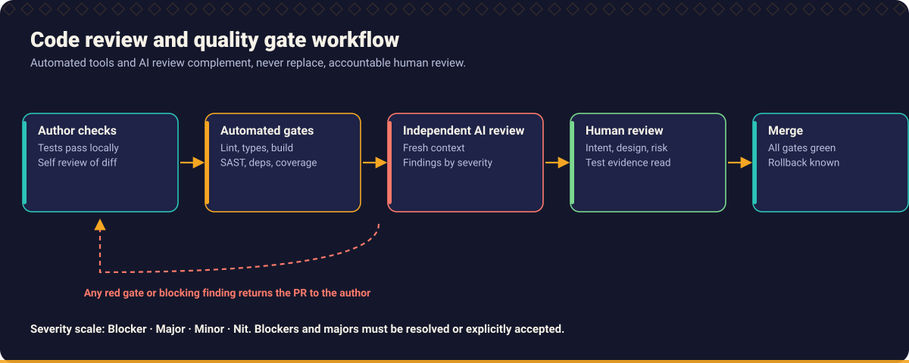
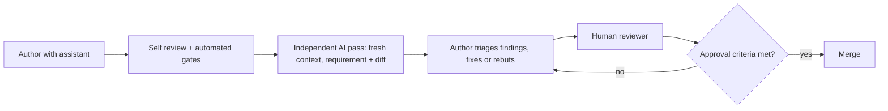

# Chapter 10: Code Review and Pull Requests

> Review is where a team decides, together, that a change is safe to own. AI changes how much code arrives for review, not who is accountable for it.



## What you will learn

- What review is for, and what it is not for.
- How to use an assistant as a reviewer without surrendering judgement.
- Why an *independent* review beats asking the author's assistant "is this OK?".
- How to classify findings by severity and how to write useful comments.
- What a good pull request contains, including test evidence and an honest AI disclosure.
- Who is accountable for what, and clear approval criteria.

## 1. What review is for

| Review is for | Review is not for |
| --- | --- |
| Catching defects the author could not see | Re-deriving the whole design from scratch in the pull request |
| Checking the change matches the requirement | Arguing about formatting a tool can fix |
| Sharing knowledge and keeping the codebase coherent | Showing superiority |
| Confirming evidence: tests, risk, rollback | Rubber stamping because CI is green |
| Spreading ownership: *two* people understand this change | Transferring blame |

Human review capacity is the scarcest resource in an AI assisted team. If generation speeds up tenfold and review does not, review becomes the bottleneck, and the pressure is to skim. The countermeasure is **smaller changes, stronger evidence and automation of the mechanical checks**.

## 2. Make the change reviewable

The author's job is to make review easy and accurate.

| Practice | Why |
| --- | --- |
| **Small, single purpose pull requests** | Defects hide in large diffs; reviewers skim after a few hundred lines |
| **Separate refactoring from behaviour change** | Reviewers can verify each kind differently |
| **Self review first** | Read your own diff as a reviewer before requesting review; remove debug code and unrelated edits |
| **Automate the mechanical** | Format, lint, types, tests and scans run before a human looks |
| **Tests first in the diff** | Reviewers read the specification (tests) before the implementation |
| **Explain the *why*** | The diff shows what changed, not why |
| **Keep generated noise out** | No reformatting of untouched files, no lock file churn without cause |

## 3. A good pull request

The [pull request template](../../templates/pull_request_template.md) captures this. The essential content:

| Section | Content |
| --- | --- |
| **Summary** | What and why, in a few sentences, linked to the requirement or issue |
| **Approach and trade offs** | Key decisions; alternatives rejected |
| **Scope** | What is deliberately *not* in this change |
| **Risk and impact** | Who and what is affected; blast radius; data or API compatibility |
| **Test evidence** | What was run, with output or links; new tests and why they are sufficient |
| **Edge cases considered** | From the scenario matrix, including those not handled and why |
| **Rollback** | How to undo, and whether it is safe |
| **AI assistance** | Where an assistant was used, what you verified yourself (see below) |
| **Screenshots or samples** | For user visible changes |

### Test evidence

"Tests pass" is a claim, not evidence. Evidence is specific and verifiable:

| Weak | Strong |
| --- | --- |
| "Tested locally" | "`pytest tests/test_shipping.py`: 14 passed (output pasted). New tests cover SC-01 to SC-07. Boundary values 99.99, 100.00, 100.01." |
| "All edge cases handled" | "Scenario matrix attached; SC-09 (negative total) rejected with `ValueError`; SC-11 unspecified, question raised in the issue." |
| "No regressions" | "Existing suite: 243 passed, 0 skipped, no test modified." |

State what was **not** tested. A reviewer who learns about a gap from the author trusts the author more than one who discovers it.

### AI disclosure

Say plainly when an assistant produced significant parts, and what you did to verify them. This is not a confession; it tells the reviewer where to look hardest.

```text
AI assistance: first draft of the implementation and tests generated with an assistant.
I rewrote the boundary tests from the requirement (SC-03, SC-04), ran the full suite,
and checked every changed line. The retry logic is my own.
```

Do **not** write "AI generated, looks fine" or claim verification you did not do.

## 4. AI assisted code review

Use assistants as a **tireless first pass**, not as the approver.

| Good use | Why |
| --- | --- |
| Checklists applied consistently (null handling, boundaries, exception handling) | Humans skip steps; models do not get bored |
| Spotting missing tests and untested branches | Cheap and fast |
| Explaining unfamiliar code in the diff | Speeds comprehension |
| Drafting a pull request description from the diff | The author then checks it |
| Finding likely duplicates and inconsistent naming | Pattern matching |
| Security pattern scanning ([Chapter 9](../09_security_engineering/README.md)) | Wide coverage |

| Limitation | Consequence |
| --- | --- |
| **No access to your requirements** unless given | It reviews the code against itself |
| **Confident false positives** | Time spent on non-issues |
| **False negatives** | Silence is not approval |
| **Anchoring on the author's framing** | "Review this correct change" biases the result |
| **No accountability** | It cannot be asked to defend a decision, and it does not carry the pager |

Prompts for each focus: [Independent code review](../../prompts/code_review/independent-code-review.md), [Control flow review](../../prompts/code_review/control-flow-review.md), [Missing condition detection](../../prompts/code_review/missing-condition-detection.md), [Null handling review](../../prompts/code_review/null-handling-review.md), [Exception handling review](../../prompts/code_review/exception-handling-review.md), [Security review](../../prompts/code_review/security-review.md), [Performance review](../../prompts/code_review/performance-review.md), [PR description drafting](../../prompts/code_review/pr-description-drafting.md), [PR readiness assessment](../../prompts/code_review/pr-readiness-assessment.md).

## 5. Independent review

An **independent review** means the reviewer (human or assistant) does not share the author's context and assumptions. If the same assistant session wrote the code and then reviews it, it will tend to approve its own reasoning.

| To get independence | How |
| --- | --- |
| **Fresh context** | A new session with *only* the requirement and the diff, not the generation conversation |
| **Different model or tool** | Where available, a different one from the author's |
| **Give the requirement, not the author's explanation** | So it checks against intent |
| **Ask for defects, not approval** | "List the ways this could be wrong", not "is this correct?" |
| **Review the tests separately** | Ask whether each test could fail; check assertions |
| **A human for anything risky** | Security, money, data migration, public API |

Prompt discipline for independence: [Independent code review](../../prompts/code_review/independent-code-review.md) is written to give the model the requirement and diff and to demand evidence (file and line) for every finding.



## 6. Defect identification

What to look for, in rough priority order:

1. **Does it do what the requirement says?** Compare the scenarios to the tests and the tests to the code.
2. **Failure behaviour** ([Chapter 6](../06_defensive_programming/README.md)): missing branches, nulls, boundaries, exceptions, resources, timeouts.
3. **Security** ([Chapter 9](../09_security_engineering/README.md)): input, authorisation, secrets.
4. **Data and transactions**: integrity, migration safety, concurrency.
5. **Compatibility**: API and schema contracts ([Chapter 8](../08_architecture_and_design/README.md)).
6. **Tests**: do they assert behaviour? Could they fail? Were any weakened or deleted?
7. **Operability**: logging, metrics, configuration, rollback.
8. **Design and readability**: naming, structure, duplication ([Chapter 7](../07_code_quality/README.md)).
9. **Style**: only what tooling cannot enforce.

The [AI code review checklist](../../templates/ai_code_review_checklist.md) turns these into a checklist you can apply to any diff, human or AI authored.

### Extra scrutiny for AI authored code

- **Deleted or modified assertions** in the test diff.
- **New dependencies** (verify they exist and are the intended ones).
- **Catch-all handlers and defaults** (`else return 0`, `catch (Exception)`).
- **Disabled checks**: `@Ignore`, `skip`, `verify=False`, `eslint-disable`, `@SuppressWarnings`.
- **Plausible but unverified claims** in comments and descriptions.
- **Scope creep**: files changed that the task did not require.
- **Duplicate helpers** that already exist in the repository.

## 7. Review severity

Label every comment so the author knows what blocks.

| Level | Meaning | Blocks merge? | Example |
| --- | --- | --- | --- |
| **Blocker / Critical** | Incorrect behaviour, security flaw, data loss risk, broken contract | Yes | Authorisation check missing on a delete endpoint |
| **Major** | Likely defect or serious maintainability or test gap | Yes, unless justified | `age > 65` where the requirement says 65 or older |
| **Minor** | Real but low risk improvement | No; fix now or ticket | Missing test for an unlikely input |
| **Nit** | Taste or tiny polish | No | Variable name preference |
| **Question** | Reviewer needs to understand | Depends on the answer | "Why is this retried three times?" |
| **Praise** | Something done well | No | "Nice use of a builder here" |

Findings from an assistant get the same labels and the same bar: *evidence required*. "This might be a problem" with no line reference is a question for the assistant to substantiate, not a finding.

### Writing good comments

| Do | Do not |
| --- | --- |
| State the **problem and its consequence** ("returns null for unknown tiers, which fails later as a `TypeError`") | "This is wrong" |
| Reference the **requirement or evidence** | "I don't like it" |
| Offer a **direction or a question**, not only a verdict | Rewrite the author's design in comments |
| Be specific about **location** | Comment on the whole file |
| Separate **blockers from nits** | Bury the one blocker in twenty nits |
| Critique the **code** | Critique the person |

## 8. Responding to review

- **Fix or rebut with evidence**; never ignore.
- **Add a test** for each defect found, then fix it ([Chapter 5](../05_test_driven_development/README.md)).
- **Do not resolve** a thread unless the reviewer is satisfied or the change is made.
- When an assistant helps you address comments, **re-run the whole suite** and re-read the diff; assistant edits made to satisfy a comment sometimes break something else.
- **Explain** your reasoning when you disagree. Escalate to a design discussion if the disagreement is architectural.

### Developer explanations

The author must be able to **explain every changed line**, including those drafted by an assistant. A reviewer may ask, in the pull request or in person, "why does this retry?" or "what happens when `items` is empty?". The answers *"the AI wrote it"* and *"I'm not sure"* are not acceptable for code you are merging. If you cannot explain it, simplify it, test it until you can, or do not merge it.

## 9. Reviewer accountability

Approving a pull request means: *I read it, I understood it, and I would be comfortable being paged for it.*

| Role | Accountable for |
| --- | --- |
| **Author** | The behaviour of the change, the tests, the evidence, honest disclosure. AI assistance does not transfer this. |
| **Reviewer** | A genuine examination within the agreed scope; flagging what they did not review ("I did not review the migration") |
| **Assistant** | Nothing. It is a tool. Its output is neither an approval nor an excuse. |
| **Team / lead** | Review capacity, norms, tooling and a culture where raising defects is welcome |

Anti-patterns:

- **Rubber stamp**: "LGTM" in two minutes on 800 lines.
- **Approving because CI is green**: CI proves the tests passed, not that the tests are right.
- **Approving because an assistant said it was fine.**
- **Review by exhaustion**: too large to read; decline and ask for splitting.
- **Hero reviewer**: all reviews go to one person.

## 10. Approval criteria

Agree these as a team and write them down. A reasonable starting list for "ready to merge":

| Criterion | Evidence |
| --- | --- |
| Requirement met | Scenarios traced to tests |
| Automated gates green | Build, tests, lint, types, scans |
| New or changed behaviour is tested | Tests in the diff; assertions are specific |
| No unresolved blocker or major | Threads resolved by fix or agreed reasoning |
| Risk understood | Impact, rollback and migration notes present where relevant |
| Security considered | Checklist applied for sensitive changes |
| Documentation updated | README, API docs, changelog where relevant |
| Author can explain the change | Reviewer asked and was satisfied |
| Reviewer actually reviewed | Comments or an explicit "reviewed X, not Y" |

The [PR Readiness Reviewer](../../skills/pr-readiness-reviewer/SKILL.md) skill and [PR readiness assessment](../../prompts/code_review/pr-readiness-assessment.md) prompt check the evidence is *present*, and leave the judgement to the humans.

The [code review template](../../templates/code_review_template.md) provides a structure for recording a review, and [Workflow 09](../../workflows/09_pull_request_review.md) describes the end to end flow.

## Practice

1. Take your last merged pull request. Rewrite its description with the sections in this chapter. What was missing?
2. Ask an assistant to review a diff twice: once in the session that wrote it with "is this correct?", once in a fresh session with the requirement and "list defects with evidence". Compare findings.
3. Review the test diff of a recent AI assisted pull request: which assertions were deleted or loosened?
4. Agree on a one page approval criteria list with your team.

## Related

**Skills:** [PR Readiness Reviewer](../../skills/pr-readiness-reviewer/SKILL.md), [Code Quality Reviewer](../../skills/code-quality-reviewer/SKILL.md), [Security Reviewer](../../skills/security-reviewer/SKILL.md), [Defensive Programming Reviewer](../../skills/defensive-programming-reviewer/SKILL.md), [Control Flow Analyst](../../skills/control-flow-analyst/SKILL.md), [Regression Analyst](../../skills/regression-analyst/SKILL.md)

**Prompts:** [Independent code review](../../prompts/code_review/independent-code-review.md), [PR readiness assessment](../../prompts/code_review/pr-readiness-assessment.md), [PR description drafting](../../prompts/code_review/pr-description-drafting.md), [Control flow review](../../prompts/code_review/control-flow-review.md)

**Workflows:** [Review a pull request](../../workflows/09_pull_request_review.md), [Build a new feature](../../workflows/01_feature_development.md)

**Templates:** [Pull request](../../templates/pull_request_template.md), [Code review](../../templates/code_review_template.md), [AI code review checklist](../../templates/ai_code_review_checklist.md)

**Further reading** (external): [Google Engineering Practices: Code Review](https://google.github.io/eng-practices/review/), [Conventional Comments](https://conventionalcomments.org).

---

Previous: [Chapter 9](../09_security_engineering/README.md) · Next: [Chapter 11: Engineering Delivery and Operations](../11_delivery_and_operations/README.md) · [Handbook index](../README.md)
