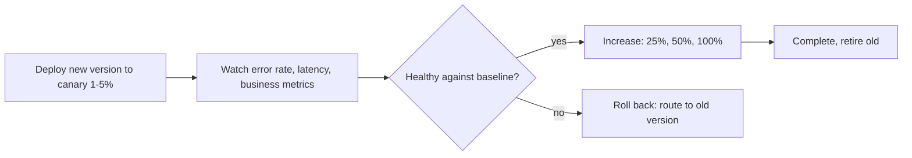
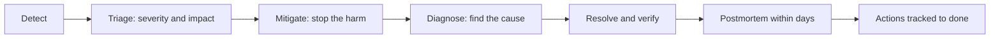

# Chapter 11: Engineering Delivery and Operations

> Code that is merged but not running is inventory. Code that is running but not observable is a gamble. This chapter is about turning changes into safe, reversible, visible production behaviour.

## What you will learn

- What a CI/CD pipeline should check, and in what order.
- Release management, deployment strategies, canaries and feature flags.
- Smoke testing and rollback, designed *before* the release.
- Observability, production debugging and incident management.
- How AI can help in operations, and where it must not act alone.

## 1. Continuous integration and delivery

**Continuous integration (CI)** merges small changes frequently, verified by automated checks. **Continuous delivery** keeps the main branch always releasable. **Continuous deployment** goes further and releases every passing change automatically.

### Pipeline stages

| Stage | Checks | Fail means |
| --- | --- | --- |
| **1. Fast checks** | Format, lint, type check | Fix before anything else (seconds) |
| **2. Unit tests** | Logic tests, parallel | Behaviour broken |
| **3. Build** | Compile and package once; produce an immutable artefact | Not shippable |
| **4. Security scans** | Dependencies, secrets, SAST ([Chapter 9](../09_security_engineering/README.md)) | Vulnerability |
| **5. Integration and contract tests** | Real boundaries ([Chapter 5](../05_test_driven_development/test_design.md)) | Components disagree |
| **6. Deploy to a test environment** | Same artefact as production | Deployment or config problem |
| **7. Smoke and end to end tests** | A few critical journeys | System not working |
| **8. Promote** | Same artefact, next environment | |

Principles:

- **Build once, deploy many.** The artefact tested is the artefact released; configuration differs by environment, the binary does not.
- **Fast feedback first.** Cheap checks before expensive ones.
- **Keep main green.** A broken main blocks everyone; fix or revert quickly.
- **Pipelines are code.** Reviewed, versioned, tested.
- **Treat flaky tests as incidents in the test suite** ([Flaky test diagnosis](../../prompts/testing/flaky-test-diagnosis.md)).
- **Protect the pipeline.** It holds credentials and deploy rights; treat its configuration and third party actions as a supply chain surface ([Chapter 9](../09_security_engineering/README.md)).

A minimal illustrative GitHub Actions workflow (this repository's own checks are described in [`.github/workflows`](../../.github/workflows/README.md)):

```yaml
name: ci
on:
  pull_request:
  push:
    branches: [main]
jobs:
  test:
    runs-on: ubuntu-latest
    steps:
      - uses: actions/checkout@v4
      - uses: actions/setup-python@v5
        with:
          python-version: "3.12"
      - run: pip install -e ".[dev]"
      - run: ruff check .
      - run: pytest
```

Adapt it to your build tool and pin actions according to your organisation's policy. Check the documentation of your CI system for current syntax.

## 2. Release management

A release is a **decision with a plan**.

| Element | Content |
| --- | --- |
| **Scope** | Which changes ship; their risk |
| **Versioning** | Semantic versioning or your chosen scheme; breaking changes are explicit |
| **Changelog and release notes** | What changed and what users or operators must do ([Changelog and release notes](../../prompts/delivery/changelog-and-release-notes.md)) |
| **Readiness checklist** | Tests green, migrations reviewed, flags set, docs updated, on call informed, rollback ready ([Release readiness check](../../prompts/delivery/release-readiness-check.md)) |
| **Timing** | Avoid unmonitored times (Friday evening) unless the process is robust |
| **Communication** | Who needs to know, before and after |
| **Rollback plan** | Written and rehearsed ([section 6](#6-rollback-strategies)) |

The end to end flow is [Workflow 10: Prepare a production release](../../workflows/10_production_release.md).

Small, frequent releases are *safer* than large, rare ones: less change per release, easier diagnosis, easier rollback.

## 3. Deployment strategies

| Strategy | How | Pros | Cons | Fits |
| --- | --- | --- | --- | --- |
| **Recreate** | Stop old, start new | Simple | Downtime | Internal tools, batch |
| **Rolling** | Replace instances gradually | No downtime, no extra capacity | Old and new run together; slow rollback | Most stateless services |
| **Blue/green** | Two full environments; switch traffic | Instant switch and rollback | Double capacity; data compatibility | Services with strict availability needs |
| **Canary** | Send a small share of traffic to the new version, then increase | Real traffic with limited blast radius | Needs good metrics and traffic routing | Risky changes at scale |
| **Shadow** | Copy traffic to the new version, discard its responses | Test with real load, no user impact | Side effects must be disabled | Validating rewrites |
| **Feature flag release** | Deploy dark, enable later | Decouples deploy from release | Flag debt | Almost anything |

Two compatibility rules apply to *all* strategies that run old and new simultaneously:

1. **Database changes must work with both versions** (expand and contract: [Chapter 8](../08_architecture_and_design/README.md#6-database-design-and-data-modelling)).
2. **APIs and events must be backward compatible** for at least one version.

### Canary deployments



What makes a canary work:

- **Compare against the baseline** running at the same time, not against yesterday.
- **Define success and abort criteria in advance** (error rate, p95 latency, a key business metric) and automate the abort if you can.
- **Watch long enough** for rare paths and caches to warm.
- **Include business metrics**: a service can return 200 and still be wrong.

## 4. Feature flags

A **feature flag** lets you change behaviour at runtime without redeploying. It separates *deploying* code from *releasing* a feature.

| Use | Example |
| --- | --- |
| **Release flag** | Ship a half finished feature dark; enable when ready |
| **Kill switch** | Disable a risky or failing feature instantly |
| **Gradual rollout** | 1%, then 10%, then everyone |
| **Experiment** | Compare variants (needs measurement discipline) |
| **Permission or entitlement** | Per customer or plan |

```python
def checkout_total_cents(order, flags):
    if flags.is_enabled("new-discount-engine", user=order.customer_id):
        return new_discount_engine.total_cents(order)
    return legacy_discount.total_cents(order)
```

Rules:

- **Test both states.** The off path is the rollback path, so it must be tested and work.
- **Default to the safe state** if the flag service is unreachable.
- **Name, owner, expiry.** A flag without a removal date becomes permanent complexity; delete flags once rolled out.
- **Avoid combinatorial explosions**: nesting many flags multiplies the states to test.
- **Do not use flags for security decisions** that must hold if the service is down.
- **Audit** who changed what and when.

## 5. Smoke testing

A **smoke test** is a small, fast check after deployment that the system's critical functions work. It does not prove correctness; it proves "not on fire".

| Characteristic | Guidance |
| --- | --- |
| **Few and critical** | Login, the primary read, the primary write, a dependency check |
| **Fast** | Seconds to a couple of minutes |
| **Safe in production** | Use test accounts and non-destructive operations; clean up |
| **Automated and part of the pipeline** | A failing smoke test triggers rollback or halts promotion |
| **Meaningful** | Exercises real dependencies, not a stub |

Also verify **health checks** return something that reflects reality (a database ping), not only "process is alive".

## 6. Rollback strategies

Decide the rollback plan **before** deploying, and know the *point of no return*.

| Strategy | When it works | Caveat |
| --- | --- | --- |
| **Redeploy previous artefact** | Stateless changes | Needs the previous artefact retained |
| **Switch blue/green back** | Environments kept | Data written by the new version must be compatible |
| **Flip a feature flag** | The risk is behind a flag | The flag path must work |
| **Revert and redeploy** | Small changes | Slower than the above |
| **Roll forward with a fix** | A tiny, well understood fix is faster and safer than rolling back | Needs a fast pipeline and confident diagnosis |
| **Restore from backup** | Data corruption | Last resort; data loss between backup and now; practice restores |

Hard cases:

- **Database migrations**: dropping or transforming data is not reversible by redeploying. Use expand and contract so the old version keeps working.
- **Events already published** and **emails already sent** cannot be recalled; make consumers idempotent and consider compensation.
- **Third party side effects** (payments, notifications) need explicit compensation steps.

See [Rollback planning](../../prompts/delivery/rollback-planning.md) and [Deployment risk analysis](../../prompts/delivery/deployment-risk-analysis.md).

## 7. Observability

**Observability** is the ability to understand the internal state of a system from its outputs. You cannot debug at 3 a.m. what you did not instrument at 3 p.m.

| Signal | Answers | Good practice |
| --- | --- | --- |
| **Logs** | What happened, in detail | Structured (JSON), one event per line, **correlation ID** on every line, levels used consistently, **no secrets or personal data** |
| **Metrics** | How much, how fast, how often, over time | Rate, errors, duration for every service endpoint; saturation of resources; business metrics |
| **Traces** | Where did this request spend time across services | Propagate trace context through every hop, including queues |
| **Events / audits** | Who did what | For security and compliance |
| **Profiles** | Where is CPU and memory used | On demand in production, with care |

A useful starting framework for services is the **RED** method (Rate, Errors, Duration) and, for resources, **USE** (Utilisation, Saturation, Errors).

### Alerts

- **Alert on symptoms users feel** (errors, latency, failed jobs), not every cause.
- **Every alert must be actionable** and link to a runbook. Alerts nobody acts on train people to ignore alerts.
- Define **service level objectives (SLOs)** with the product owner and alert on burning the error budget.

**Python** structured log line with a correlation ID:

```python
import json, logging, uuid

log = logging.getLogger("orders")

def log_event(event, correlation_id, **fields):
    log.info(json.dumps({"event": event, "correlation_id": correlation_id, **fields}))

log_event("order_rejected", str(uuid.uuid4()), reason="UNKNOWN_TIER", tier="PLATINUM")
```

Never log the full request, tokens, passwords or personal data. Review of observability for a change: [Observability gap analysis](../../prompts/delivery/observability-gap-analysis.md).

## 8. Production debugging

Production debugging is hypothesis driven investigation under time pressure with limited tools.

1. **Stabilise first.** Mitigate (roll back, flip a flag, scale, fail over) before you diagnose. Understanding can wait; customers cannot.
2. **State the symptom precisely.** What, since when, how many, which segment.
3. **Check what changed.** Deployments, flags, config, traffic, dependencies, data, time based triggers. Most incidents follow a change.
4. **Form hypotheses and test cheaply**, the most likely and cheapest first. Write them down.
5. **Use the three signals together.** A metric shows *that*, a trace shows *where*, a log shows *why*.
6. **Change one thing at a time.**
7. **Reproduce outside production** if you can, as a failing test ([Fix a defect](../../workflows/02_defect_fix.md)).
8. **Record the timeline** as you go.

| Technique | Notes |
| --- | --- |
| Bisect | Find the change that broke it (commits, config, flag, data) |
| Compare with healthy | Healthy vs unhealthy instance or time window |
| Read-only first | Prefer observation to modification |
| Production access discipline | Least privilege, time boxed, audited; no shortcuts that bypass review |

### Using AI during debugging

| Helpful | Careful |
| --- | --- |
| Summarising large log excerpts | **Redact** secrets and personal data before pasting |
| Proposing hypotheses and tests to discriminate between them | Its hypotheses are guesses; check each with evidence |
| Explaining a stack trace or unfamiliar error | It may state a confident wrong cause |
| Writing queries and one off scripts | Review before running against production; read-only first |
| Drafting a timeline from notes | Check facts and times |

**Never let an assistant run commands that change production state unattended**, and do not paste production data into tools your organisation has not approved ([Chapter 9](../09_security_engineering/README.md#7-sensitive-information-handling)).

Prompts: [Hypothesis driven debugging](../../prompts/debugging/hypothesis-driven-debugging.md), [Stack trace analysis](../../prompts/debugging/stack-trace-analysis.md), [Log analysis](../../prompts/debugging/log-analysis.md), [Root cause analysis](../../prompts/debugging/root-cause-analysis.md), [Performance bottleneck analysis](../../prompts/debugging/performance-bottleneck-analysis.md). Skill: [Debugging Specialist](../../skills/debugging-specialist/SKILL.md).

## 9. Incident management

An **incident** is an unplanned event that degrades the service. The aim is **restore service, then learn**.

### Roles

| Role | Responsibility |
| --- | --- |
| **Incident commander** | Coordinates, decides, keeps the focus; does not debug |
| **Technical lead / responders** | Investigate and mitigate |
| **Communications** | Updates to stakeholders and customers on a schedule |
| **Scribe** | Keeps the timeline |

### Lifecycle



### Severity (example scale; define your own)

| Severity | Example | Response |
| --- | --- | --- |
| **Sev 1** | Full outage or data loss or security breach | Immediate, all hands, executive notification |
| **Sev 2** | Major feature degraded for many users | Immediate on call response |
| **Sev 3** | Minor degradation, workaround exists | Business hours |
| **Sev 4** | Cosmetic or low impact | Backlog |

### Postmortems

A **blameless postmortem** asks *what in our system and process allowed this?* and not *who did this?*

| Section | Content |
| --- | --- |
| **Summary and impact** | Duration, users affected, business impact |
| **Timeline** | Detection, decisions, mitigation, resolution, with timestamps |
| **Root causes and contributing factors** | Usually several: technical, process, detection |
| **What went well / what was lucky** | |
| **Action items** | Owner, due date, priority; tracked to completion |
| **Prevention** | A test, alert, guardrail or design change, not a reminder to be careful |

If an AI assistant contributed to the incident (an unreviewed change, an auto-approved command), treat it like any other contributing factor and fix the *process*: review gates, permissions and approvals.

Prompt: [Production incident analysis](../../prompts/debugging/production-incident-analysis.md). Workflow: [Handle a production incident](../../workflows/08_production_incident.md).

## 10. AI assisted operations

| Use | Value | Guardrails |
| --- | --- | --- |
| **Release readiness check** | Consistent checklist application | A human confirms every item |
| **Changelog and release notes** | Drafts from commit history | Check accuracy and audience |
| **Runbook drafting and gap finding** | Faster documentation | Test the runbook in a drill |
| **Log and trace summarisation** | Less reading under stress | Redact; verify claims |
| **Alert tuning suggestions** | Spots noisy alerts | Humans decide thresholds |
| **Post incident drafting** | Timeline and contributing factors | Facts from records, not memory of the model |
| **Query and script generation** | Speed | Read-only first; review before running |
| **Observability gap analysis** | "What would we not see if this failed?" | Verify with a fault injection |

Operational AI rules:

1. **Read access by default, write access by exception**, with human approval.
2. **No production credentials in agent sessions** that process untrusted content ([prompt injection](../09_security_engineering/README.md#10-prompt-injection)).
3. **Every automated action is logged** and reversible where possible.
4. **A human owns the decision** to deploy, roll back, fail over or declare an incident over.

## Practice

1. Write the rollback plan for your next release *before* the release, including the point of no return.
2. Add a correlation ID to one log path in your service and follow a single request across two services.
3. Define success and abort criteria for a canary of a recent change. Which metrics would have caught your last incident?
4. Run a 30 minute tabletop exercise of a Sev 2 with your team and an assistant used only for log summarisation.

## Related

**Skills:** [Debugging Specialist](../../skills/debugging-specialist/SKILL.md), [Regression Analyst](../../skills/regression-analyst/SKILL.md), [Performance Analyst](../../skills/performance-analyst/SKILL.md), [Documentation Engineer](../../skills/documentation-engineer/SKILL.md), [PR Readiness Reviewer](../../skills/pr-readiness-reviewer/SKILL.md)

**Prompts:** [Release readiness check](../../prompts/delivery/release-readiness-check.md), [Deployment risk analysis](../../prompts/delivery/deployment-risk-analysis.md), [Rollback planning](../../prompts/delivery/rollback-planning.md), [Observability gap analysis](../../prompts/delivery/observability-gap-analysis.md), [Changelog and release notes](../../prompts/delivery/changelog-and-release-notes.md), [Production incident analysis](../../prompts/debugging/production-incident-analysis.md)

**Workflows:** [Prepare a production release](../../workflows/10_production_release.md), [Handle a production incident](../../workflows/08_production_incident.md), [Fix a defect](../../workflows/02_defect_fix.md)

**Further reading** (external): *Accelerate* by Forsgren, Humble and Kim, *Site Reliability Engineering* (Google, free online), [Google SRE: Postmortem Culture](https://sre.google/sre-book/postmortem-culture/), [OpenTelemetry](https://opentelemetry.io), *Continuous Delivery* by Humble and Farley.

---

Previous: [Chapter 10](../10_code_review_and_pull_requests/README.md) · Next: [Chapter 12: Engineering Leadership](../12_engineering_leadership/README.md) · [Handbook index](../README.md)
