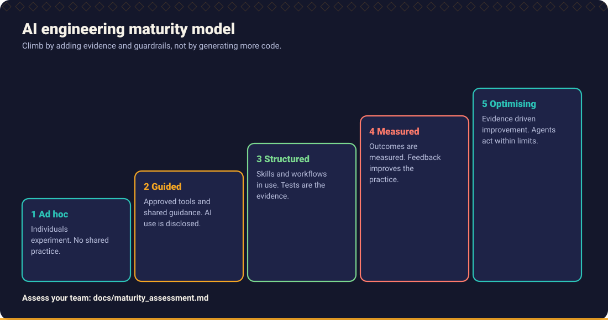

# Chapter 12: Engineering Leadership

> Leading AI adoption is not buying licences. It is deciding what good looks like, teaching it, measuring honestly, and keeping the system safe enough that people can move fast inside it.

This chapter is for engineering leads, staff engineers, architects and managers. It makes no claims about industry averages or productivity gains: any numbers you see must come from **your own** measurement.

## What you will learn

- How to set standards for AI assisted work that people actually follow.
- How to coach developers, including those who over-trust and those who refuse.
- What to measure, what not to, and how to avoid measuring yourself into bad behaviour.
- How to read DORA metrics next to AI adoption.
- How to balance quality and velocity.
- A maturity model for AI adoption and how to use it.
- How to govern without strangling innovation.

## 1. Establishing AI engineering standards

Standards turn "everyone does it differently" into shared expectations. Keep them **short, concrete and enforced by tools where possible**.

### A minimal standard

| Area | Standard (example) |
| --- | --- |
| **Accountability** | The author owns and can explain every line they merge, however it was produced |
| **Approved tools** | A list of approved assistants and configurations; how to request additions |
| **Data rules** | What may never be pasted (secrets, personal data, customer data) ([Chapter 9](../09_security_engineering/README.md#7-sensitive-information-handling)) |
| **Workflow** | Requirements and scenarios before code; tests before or with code ([Chapters 3 and 5](../03_requirement_engineering/README.md)) |
| **Review** | Independent review for risky areas; disclosure of AI assistance in pull requests ([Chapter 10](../10_code_review_and_pull_requests/README.md)) |
| **Evidence** | Test output in the pull request; no claims without runs |
| **Repository instructions** | Each repository carries assistant instructions that encode its conventions ([Chapter 4](../04_ai_assisted_development/README.md#repository-level-instructions)) |
| **Security** | Agents run with least privilege; human approval for consequential actions ([Chapter 9](../09_security_engineering/README.md#10-prompt-injection)) |
| **Learning** | Prompts and skills that work are shared and versioned |

### How to roll standards out

1. **Start from real work**, not theory: run the [maturity assessment](../../docs/maturity_assessment.md) and look at actual pull requests.
2. **Co-create** with the people who will follow the standard. Imposed standards are routed around.
3. **Make the right thing the easy thing**: ship templates ([templates](../../templates/README.md)), repository instruction files, pipeline gates and a [skills library](../../skills/README.md).
4. **Automate enforcement** where you can (CI checks, secret scanning, pull request template). Rely on culture for the rest.
5. **Review the standard** every quarter; the tools change quickly.
6. **Write down the reason** for each rule. Rules without reasons are broken the first time they are inconvenient.

## 2. Coaching developers

Developers fall on a spectrum, and each end needs different help.

| Pattern | Risk | Coaching |
| --- | --- | --- |
| **The over-truster** | Merges output unread; skips tests; "the AI said so" | Pair on reviewing a generated diff line by line; run mutation testing on their tests; make explain-it-back part of review |
| **The refuser** | Misses real leverage; becomes a bottleneck of skepticism | Start with low risk tasks (tests, documentation, exploration); let evidence from the team persuade; respect legitimate concerns |
| **The prompt gambler** | Retries until something works; learns nothing | Teach the structure (context, task, constraints, output, verification) ([Chapter 4](../04_ai_assisted_development/README.md)) |
| **The junior who can't evaluate** | Cannot tell good from plausible | More pairing, smaller tasks, tests first; ask them to predict the assistant's output and compare |
| **The senior who does not share** | Valuable techniques stay private | Brown bag sessions; contribute skills and prompts to the shared library |

### Techniques that work

- **Review generated code together.** Narrate what you check. This is the highest leverage coaching activity.
- **Failure show and tell.** Share examples where the assistant was confidently wrong, and how the tests caught it. The [Broken Code Lab](../../examples/broken_code_lab/README.md) is a ready made exercise.
- **Structured routes**: [Learning paths](../../docs/learning_paths.md) provide structured routes by role.
- **Rotate the "skill of the week"**: a short, hands on practice of one skill ([Skill of the week](../../docs/skill_of_the_week.md)).
- **Protect learning.** Juniors still need to write code unaided sometimes, or they will not develop the judgement to review it. Define where.
- **Praise good evidence**, not volume of output.

## 3. Measuring AI adoption

Adoption has layers. Measure from the bottom up, and be wary of the top of the list.

| Layer | Examples of signals | Caution |
| --- | --- | --- |
| **Access** | Who has the tools, trained | Not usage |
| **Activity** | Active users, sessions | Activity is not value. Never use as a target |
| **Practice** | Pull requests with AI disclosure and test evidence; repositories with instruction files; skills in use | Needs a definition of "good practice" |
| **Outcome** | Lead time, change failure rate, rework, defect escape rate, review turnaround | Many influences besides AI |
| **Experience** | Developer surveys: confidence, friction, time lost to bad suggestions | Subjective, but valuable and hard to game |

Do not measure:

- **Lines of code or acceptance rate of suggestions as productivity.** They reward volume and encourage accepting without reading.
- **Individuals ranked by AI usage.** This creates theatre.
- **Tokens or cost per developer as a goal.** It is an input, not a result.

### Make measurement honest

1. **Establish a baseline before the change.** Without it, any improvement claim is anecdote.
2. **Compare like with like** (similar teams, similar work). Beware selection effects: enthusiasts adopt first.
3. **Use several measures together**, including quality and experience. A single measure gets gamed.
4. **Measure at team level**, not individual level.
5. **Report uncertainty**, and say "we don't know yet" when you do not.
6. **Verify claims from vendors and studies** against your own context. Results from other organisations may not transfer.

## 4. Evaluating engineering productivity

Productivity is multidimensional. The **SPACE** framework (Satisfaction, Performance, Activity, Communication and collaboration, Efficiency and flow) is one published way to reason about it, and its central message is: use several dimensions, at several levels, and never a single metric.

| Dimension | Example question |
| --- | --- |
| **Satisfaction and well-being** | Do developers feel effective and sustainable? |
| **Performance** | Are the outcomes good: quality, reliability, customer impact? |
| **Activity** | What is being produced? (context only) |
| **Communication and collaboration** | How well does knowledge flow? Review quality? Onboarding? |
| **Efficiency and flow** | How often are people blocked, interrupted, waiting? |

Observations to keep in mind (these are reasoning aids, not measured claims):

- Faster code generation moves the bottleneck: to **requirements clarity, review, testing, integration and release**. Improve the whole flow, not only the typing.
- More code generated means more code **to review, secure, operate and maintain**.
- Time saved on easy tasks may be spent on verifying output. Whether the net is positive depends on the task and the team; measure it.

## 5. Quality versus velocity

The framing of "quality versus velocity" is mostly false over time horizons longer than a few weeks: low quality eventually slows delivery through rework, incidents and fear. The question is how to get *both*, safely.

| Lever | Effect |
| --- | --- |
| **Small batches** | Faster feedback and easier review and rollback |
| **Automated tests and gates** | Move quality checks earlier and make them cheap |
| **Trunk based development with feature flags** | Frequent integration with reversible releases ([Chapter 11](../11_delivery_and_operations/README.md)) |
| **Clear requirements and scenarios** | Less rework |
| **Independent review of risk** | Targeted human attention |
| **Observability and fast rollback** | Makes mistakes cheap, so speed is safer |
| **Technical debt budget** | Prevents the slow decay of velocity ([Chapter 7](../07_code_quality/README.md#11-technical-debt)) |

Warning signs that velocity is being bought with quality:

- Rising review sizes and falling review comments per pull request.
- Test changes that loosen assertions.
- More rollbacks, hotfixes and incidents following releases.
- Duplicated code and growing dependency counts.
- Engineers unable to explain code they own.
- "It passed CI" used as the argument for merging.

When you see them, **slow the intake, not the checks**: reduce work in progress, split changes, invest in tests.

## 6. Engineering team enablement

Enablement removes friction so people can use good practice by default.

| Enabler | What it gives |
| --- | --- |
| **Repository templates** | New projects start with tests, lint, CI and assistant instructions |
| **Shared skills and prompts** | Proven practices reused, versioned and improved ([skills](../../skills/README.md), [prompts](../../prompts/README.md)) |
| **Golden path pipelines** | CI/CD that works out of the box |
| **Test data builders and fixtures** | Tests are cheap to write |
| **Safe sandboxes** | Experiment without production risk |
| **Documentation that is current** | Assistants and humans both rely on it |
| **Office hours and champions** | Peer help close to the work |
| **Time to learn** | Learning is scheduled, not squeezed |

Treat the assistant instructions and skills in your repositories as **code**: reviewed, owned and updated when conventions change. Stale instructions teach the assistant the wrong habits.

## 7. AI adoption maturity

A maturity model gives teams a shared vocabulary and a next step. It is a **diagnostic tool, not a ranking**: a team can be at different levels for different practices, and "higher" is not automatically "better" for every context.

| Level | Name | Characteristics | Typical risks | Next step |
| --- | --- | --- | --- | --- |
| **1** | **Ad hoc** | Individuals experiment; no shared practice; tools unapproved or unknown | Data leaks; inconsistent quality; hidden usage | Approved tools; data rules; basic training |
| **2** | **Guided** | Approved tools; shared guidance; some prompts shared; AI disclosed in pull requests | Over-trust; tests not strengthened; uneven adoption | Repository instruction files; test first expectations |
| **3** | **Structured** | Skills and workflows used; requirements and scenarios before code; tests as evidence; independent review of risky changes | Process overhead; stale guidance | Measure outcomes; automate gates; maintain the library |
| **4** | **Measured** | Baselines, DORA and experience metrics reviewed; mutation testing on critical code; feedback loop improving skills | Metric gaming | Targeted enablement; experiment responsibly |
| **5** | **Optimising** | Continuous improvement of skills, workflows and guardrails driven by evidence; agents operate within least privilege and approval policies | Complacency; tool churn | Share learning; keep questioning assumptions |

Use the [Maturity assessment](../../docs/maturity_assessment.md) to self assess per practice area and to pick **one or two** improvements for the next quarter. Do not try to jump levels. The levels are this handbook's own framework, not an industry standard.

## 8. Measuring DORA metrics

The **DORA** research programme (DevOps Research and Assessment) identified a small set of delivery performance measures that correlate with organisational outcomes. The classic four are:

| Metric | Measures | Definition (summary) |
| --- | --- | --- |
| **Deployment frequency** | Throughput | How often you deploy to production |
| **Lead time for changes** | Throughput | Time from commit to running in production |
| **Change failure rate** | Stability | Share of deployments that cause a failure needing remediation |
| **Time to restore service** | Stability | How long to recover from a production failure |

DORA's definitions and the set of metrics have been refined over the years (for example, newer reports discuss additional measures such as rework). **Check the current definitions at [dora.dev](https://dora.dev)** before you adopt them, and define precisely how *you* measure each (what counts as a deployment, a failure, a restore).

### Reading DORA alongside AI adoption

| Observation | Possible interpretation | What to check |
| --- | --- | --- |
| Lead time falls, change failure rate rises | Speed gained, verification lost | Review depth, test strength, batch size |
| Deployment frequency up, time to restore unchanged | More change, same recovery capacity | Observability, rollback, runbooks |
| Lead time unchanged although coding is faster | Bottleneck is elsewhere (review, approvals, testing, release) | Value stream map |
| Both throughput and stability improve | Possibly good practice, or confounders | Compare with baseline and other teams |

Practical rules:

- **Team level, trend over time**, not a league table.
- **Automate collection** from your CI/CD and incident systems, so the numbers cost nothing and cannot be massaged.
- **Pair with experience data.** A dashboard that is green while developers are burning out is not success.
- **Never set DORA values as individual targets.** They become gamed ("deploy empty changes").
- **Do not attribute changes to AI without evidence.** Many things change at once.

## 9. Governance without restricting innovation

Governance fails in two ways: *too little* (shadow usage, data leaks, quality decay) and *too much* (people route around it, learn nothing and take risks in secret).

| Principle | In practice |
| --- | --- |
| **Guardrails, not gates, where possible** | Automated checks and safe defaults instead of approval committees |
| **Risk proportionate** | Low risk (documentation, tests) is light; high risk (auth, payments, data migrations, agents with write access) gets more control |
| **Fast paths** | A quick, clear process to approve a new tool or use case |
| **Transparent rules with reasons** | People follow what they understand |
| **Safe experimentation space** | Sandboxes with synthetic data where anything goes |
| **Learn from incidents, blamelessly** | Improve the guardrail, not the blame |
| **Review regularly** | The tools and risks move quickly |
| **Stay inside organisational policy** | This handbook does not replace legal, privacy or security requirements |

### A lightweight governance model

| Tier | Examples | Controls |
| --- | --- | --- |
| **Green** | Explaining code, drafting tests and docs on non sensitive code, approved tools | Standard rules and disclosure |
| **Amber** | Changes to security sensitive or regulated code; adding dependencies; agents that run commands | Independent review; security checklist; approvals for actions |
| **Red** | Production access by agents; customer or personal data in prompts; autonomous deployment | Explicit approval from the owner role; strong controls and audit; often not allowed |

### Anti-patterns for leaders

- **Mandating usage numbers.** People will generate to hit the number.
- **Announcing productivity multipliers** without measurement.
- **Replacing review capacity with AI review** and calling it done.
- **Treating the assistant's output as the engineer's work product** in performance reviews, in either direction.
- **No time to learn.** Practices cannot be adopted on top of a full sprint.
- **Ignoring juniors' development.** Today's unreviewed shortcuts are tomorrow's skill gap.

## Practice

1. Run the [maturity assessment](../../docs/maturity_assessment.md) with your team, separately, then compare answers. Where do you disagree?
2. Choose one outcome and one experience measure; record a baseline this week.
3. Write the approval criteria for your team on one page and put them in the repository ([Chapter 10](../10_code_review_and_pull_requests/README.md#10-approval-criteria)).
4. Pick one amber area and design a guardrail that is automated rather than a meeting.

## Related

**Skills:** [PR Readiness Reviewer](../../skills/pr-readiness-reviewer/SKILL.md), [Architecture Reviewer](../../skills/architecture-reviewer/SKILL.md), [Documentation Engineer](../../skills/documentation-engineer/SKILL.md)

**Docs:** [Maturity assessment](../../docs/maturity_assessment.md), [Learning paths](../../docs/learning_paths.md), [Skill of the week](../../docs/skill_of_the_week.md), [Implementation status](../../docs/implementation_status.md)

**Templates:** [Technical design](../../templates/technical_design_template.md), [Pull request](../../templates/pull_request_template.md), [AI task](../../templates/ai_task_template.md)

**Further reading** (external): [DORA](https://dora.dev), [The SPACE of Developer Productivity](https://queue.acm.org/detail.cfm?id=3454124) (Forsgren et al.), *Accelerate* by Forsgren, Humble and Kim, *Team Topologies* by Skelton and Pais.

---

Previous: [Chapter 11](../11_delivery_and_operations/README.md) · [Handbook index](../README.md)
