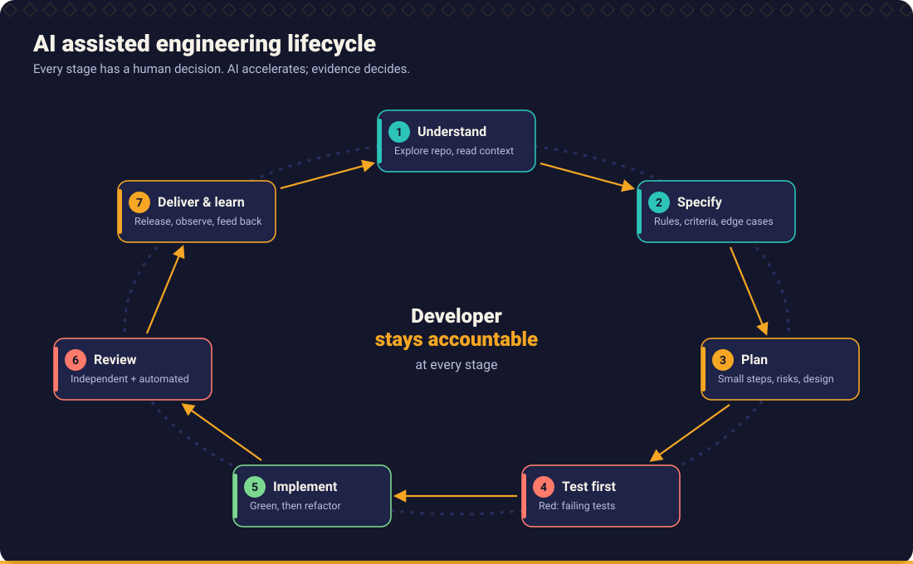

# The AI Kaarkhana Handbook

Twelve chapters on engineering with AI assistants without giving up engineering. Each chapter has the same shape: *What you will learn*, the content, *Practice*, *Related* (skills, prompts, workflows, examples, further reading) and links to the previous and next chapter.

## Chapters

| # | Chapter | Read it to learn |
| --- | --- | --- |
| 1 | [AI Native Engineering](01_ai_native_engineering/README.md) | What AI assisted engineering is, who stays accountable, the twelve principles, failure patterns |
| 2 | [Developer Ways of Working](02_developer_ways_of_working/README.md) | The ten step workflow from requirement to merge; context engineering; checkpoints |
| 3 | [Requirement Engineering](03_requirement_engineering/README.md) | Clarifying requirements, business rules, edge cases, scenario matrices, traceability |
| 4 | [AI Assisted Development](04_ai_assisted_development/README.md) | Prompting, repository instructions, planning, generation, review of generated code |
| 5 | [Test Driven Development](05_test_driven_development/README.md) | Red Green Refactor, TDD with AI, test design, property based and mutation testing |
| 6 | [Defensive Programming and Edge Case Engineering](06_defensive_programming/README.md) | Nulls, branches, boundaries, retries, idempotency, concurrency, transactions, exceptions |
| 7 | [Code Quality](07_code_quality/README.md) | Clean code, smells, complexity, static analysis, quality gates, technical debt |
| 8 | [Architecture and Design](08_architecture_and_design/README.md) | Trade offs, patterns, modules, microservices, events, APIs, databases, resilience, ADRs |
| 9 | [Security Engineering](09_security_engineering/README.md) | Secure coding, authentication, authorisation, secrets, OWASP, prompt injection, threat modelling |
| 10 | [Code Review and Pull Requests](10_code_review_and_pull_requests/README.md) | AI assisted and independent review, severity, test evidence, accountability |
| 11 | [Engineering Delivery and Operations](11_delivery_and_operations/README.md) | CI/CD, releases, canaries, flags, observability, incidents |
| 12 | [Engineering Leadership](12_engineering_leadership/README.md) | Standards, coaching, measurement, DORA, maturity, governance |

Chapter 5 has additional pages: [TDD with AI](05_test_driven_development/tdd_with_ai.md), [Test design](05_test_driven_development/test_design.md), [Property based and mutation testing](05_test_driven_development/property_based_and_mutation_testing.md). Chapter 6 has [Else is not always the answer](06_defensive_programming/else_is_not_always_the_answer.md).

## Where to start

| You are | Start with | Then |
| --- | --- | --- |
| **A developer new to AI assistance** | [Chapter 1](01_ai_native_engineering/README.md), [Chapter 2](02_developer_ways_of_working/README.md) | [Chapter 5](05_test_driven_development/README.md), [Chapter 6](06_defensive_programming/README.md) |
| **A developer who already uses assistants daily** | [Chapter 6](06_defensive_programming/README.md), [Chapter 5](05_test_driven_development/README.md) | [Chapter 10](10_code_review_and_pull_requests/README.md) |
| **A tech lead** | [Chapter 10](10_code_review_and_pull_requests/README.md), [Chapter 12](12_engineering_leadership/README.md) | [Chapter 7](07_code_quality/README.md) |
| **An architect** | [Chapter 8](08_architecture_and_design/README.md), [Chapter 9](09_security_engineering/README.md) | [Chapter 11](11_delivery_and_operations/README.md) |
| **QA or test engineer** | [Chapter 3](03_requirement_engineering/README.md), [Chapter 5](05_test_driven_development/README.md) | [Chapter 6](06_defensive_programming/README.md) |
| **An engineering manager** | [Chapter 1](01_ai_native_engineering/README.md), [Chapter 12](12_engineering_leadership/README.md) | [Chapter 10](10_code_review_and_pull_requests/README.md) |

Structured routes for each role are in the [learning paths](../docs/learning_paths.md).

## How the handbook connects to the rest of the repository

| Handbook says... | Repository provides... |
| --- | --- |
| "Use a skill for this activity" | [22 skills](../skills/README.md) |
| "Use this prompt" | [50 prompts](../prompts/README.md) |
| "Follow this sequence" | [10 workflows](../workflows/README.md) |
| "See it fail, then fix it" | [Java, Python and TypeScript examples](../examples/README.md) and the [Broken Code Lab](../examples/broken_code_lab/README.md) |
| "Record it like this" | [Templates](../templates/README.md) |
| "Make your assistant follow it" | [Tool adapters](../tools/README.md) |

## Conventions used in the chapters

- **Code** in Java, Python and TypeScript. Code that lives in [`examples/`](../examples/README.md) was executed; short snippets in chapters are illustrative unless a link says otherwise.
- **External facts** (tool behaviour, standards) are linked or labelled with the edition or date checked. Verify against current documentation before relying on them.
- **No statistics** are quoted unless the source is given; where this handbook gives a threshold, it is a starting point to adapt.
- **Tool agnostic.** Assistant specific notes are in the [tool adapters](../tools/README.md), not in the chapters.

[Back to the repository README](../README.md)
