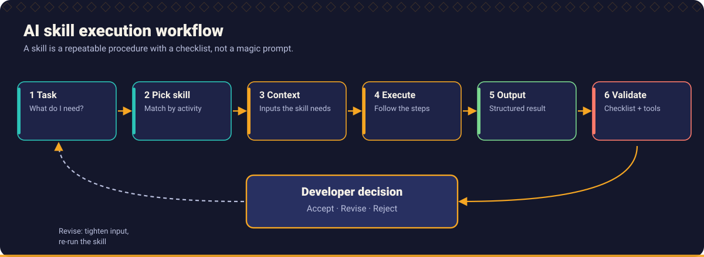
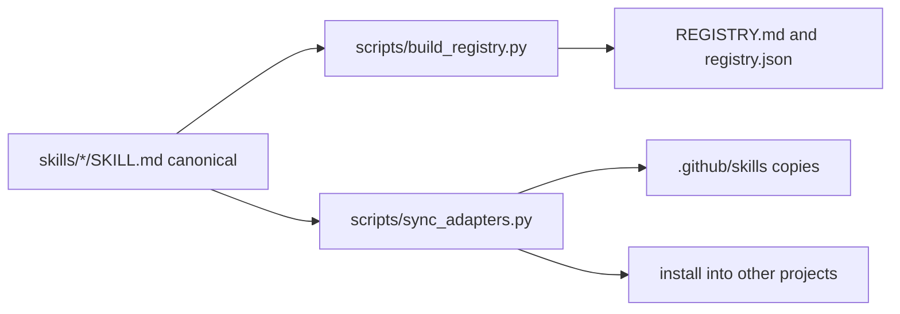

# Skills

A **skill** is a reusable, tool agnostic capability for an AI assistant: a folder with a `SKILL.md` that says *when* to use it, *what input* it needs, *exactly what to do*, *what output* to produce and *how to check the result*. Skills turn good engineering practice into something an assistant can follow consistently, and something a human can review.

There are **22 skills**. Browse them in the [registry](REGISTRY.md) by activity, difficulty or framework, or in the table below.



## The skills

| Activity | Skills |
| --- | --- |
| **Requirements** | [Requirement Analyst](requirement-analyst/SKILL.md), [Business Rule Analyst](business-rule-analyst/SKILL.md), [Edge Case Hunter](edge-case-hunter/SKILL.md) |
| **Planning and exploration** | [Repository Explorer](repository-explorer/SKILL.md), [Implementation Planner](implementation-planner/SKILL.md) |
| **Testing** | [TDD Engineer](tdd-engineer/SKILL.md), [Unit Test Engineer](unit-test-engineer/SKILL.md), [Integration Test Engineer](integration-test-engineer/SKILL.md), [Mutation Testing Specialist](mutation-testing-specialist/SKILL.md) |
| **Code quality and correctness** | [Defensive Programming Reviewer](defensive-programming-reviewer/SKILL.md), [Control Flow Analyst](control-flow-analyst/SKILL.md), [Code Quality Reviewer](code-quality-reviewer/SKILL.md), [Refactoring Specialist](refactoring-specialist/SKILL.md) |
| **Security** | [Security Reviewer](security-reviewer/SKILL.md) |
| **Performance** | [Performance Analyst](performance-analyst/SKILL.md) |
| **Debugging and regression** | [Debugging Specialist](debugging-specialist/SKILL.md), [Regression Analyst](regression-analyst/SKILL.md) |
| **Architecture and design** | [Architecture Reviewer](architecture-reviewer/SKILL.md), [API Contract Reviewer](api-contract-reviewer/SKILL.md), [Database Design Reviewer](database-design-reviewer/SKILL.md) |
| **Review and documentation** | [PR Readiness Reviewer](pr-readiness-reviewer/SKILL.md), [Documentation Engineer](documentation-engineer/SKILL.md) |

## Where to start

If you adopt only five, adopt these. They address the failure modes behind most AI assisted defects: guessed requirements, happy path only code, tests that cannot fail, missing failure handling and unverifiable pull requests.

1. [Requirement Analyst](requirement-analyst/SKILL.md)
2. [Edge Case Hunter](edge-case-hunter/SKILL.md)
3. [TDD Engineer](tdd-engineer/SKILL.md)
4. [Defensive Programming Reviewer](defensive-programming-reviewer/SKILL.md)
5. [PR Readiness Reviewer](pr-readiness-reviewer/SKILL.md)

## Anatomy of a skill

Every `SKILL.md` starts with YAML front matter and then has the same sections:

```text
---
name: edge-case-hunter              # lowercase, hyphens, equals the folder name
description: "What it does and when to use it."
license: MIT
metadata:
  activity: requirements            # drives the registry
  difficulty: intermediate
  frameworks: "any"
  version: "1.0"
---
```

| Section | Purpose |
| --- | --- |
| **Purpose** | The outcome and the failure it prevents |
| **When to invoke** | Triggers |
| **Required input** | What the assistant must be given; it must ask if missing |
| **Execution instructions** | Numbered steps |
| **Expected output** | The artefacts and their format |
| **Validation checklist** | What a human checks, independent of the assistant's claims |
| **Example usage** | A short worked example, labelled illustrative where hand written |
| **Sample prompts** | Ready to paste |
| **Common mistakes** | How the skill is misused |
| **Related skills / Related resources** | Links to handbook, prompts, workflows, examples |

The format follows the open [Agent Skills](https://agentskills.io) convention (a folder with a `SKILL.md` and front matter containing `name` and `description`). Fields beyond those, such as `metadata`, are this repository's own use of the format's free form metadata. Check the specification for the current rules.

## Using a skill

The skills are plain Markdown, so you can always use them without any tool support.

### Option 1: paste

Open the `SKILL.md`, paste it into the chat, and say what to apply it to:

```text
Apply the skill below to the requirement that follows. If required input is missing, ask me.

[PASTE SKILL.MD]

Requirement: [REQUIREMENT]
```

### Option 2: let your assistant discover it

Several assistants load skills from a project folder and read the `description` to decide when a skill applies. This repository provides:

- the canonical, tool agnostic skills in this folder (`skills/`), and
- generated copies in [`.github/skills/`](../.github/skills/README.md) for assistants that read that location.

Where each tool looks, and the exact setup steps, are in [tools](../tools/README.md). Those conventions change; the pages record the date they were verified.

### Option 3: install into another project

```bash
python scripts/sync_adapters.py install --target github-copilot --dest /path/to/your/project
python scripts/sync_adapters.py install --target cursor --dest /path/to/your/project
python scripts/sync_adapters.py install --target claude-code --dest /path/to/your/project
python scripts/sync_adapters.py install --target generic --dest /path/to/your/project
```

The script copies the skills (and for some targets the prompts) into the location that tool reads, and rewrites relative links so they still resolve. See [tools](../tools/README.md).

## One canonical source

Skills are written **once**, here. Everything else is generated:



Edit only the canonical file, then run:

```bash
python scripts/build_registry.py
python scripts/sync_adapters.py
python scripts/validate_docs.py
```

CI runs the `--check` variants and fails if generated files drift.

## Skills in context

- **Handbook:** each chapter ends with the skills that apply ([handbook](../handbook/README.md)).
- **Prompts:** each skill links to prompts that start it; each prompt lists the skills it uses ([prompts](../prompts/README.md)).
- **Workflows:** workflows say which skill to invoke at which step ([workflows](../workflows/README.md)).

## Contributing a skill

1. Copy the [skill template](../templates/skill_template.md) to `skills/<name>/SKILL.md`.
2. Fill every section. Meet the quality bar at the end of the template.
3. Run the three commands above.
4. Open a pull request using the [pull request template](../.github/PULL_REQUEST_TEMPLATE.md).

See [CONTRIBUTING](../CONTRIBUTING.md).

[Back to the repository README](../README.md)
