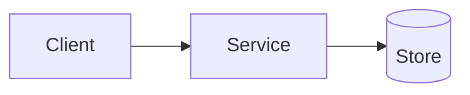

# Technical design: <title>

> Keep it as short as the decision allows. A design with no stated downside is incomplete. Replace every `<...>`; delete sections that do not apply and say why.

| Field | Value |
| --- | --- |
| **Author** | <name> |
| **Reviewers** | <names> |
| **Status** | Draft / In review / Accepted / Superseded |
| **Date** | <YYYY-MM-DD> |
| **Requirement** | REQ-<number> |

## 1. Context and problem

<What exists today, what is wrong or missing, and why now.>

## 2. Goals and non goals

**Goals**

- <outcome>

**Non goals**

- <what this design deliberately does not do>

## 3. Quality attributes, in priority order

| Priority | Attribute | Target or constraint | Evidence level |
| --- | --- | --- | --- |
| 1 | <e.g. consistency> | <measurable target> | Measured / Estimated / Guess |
| 2 | <e.g. latency> | | |

Mark guesses as guesses.

## 4. Options considered

### Option A: <name>

- Description:
- Pros:
- Cons:
- Cost and effort:

### Option B: <name>

- Description:
- Pros:
- Cons:
- Cost and effort:

### Option C: do the simplest thing

- Description:
- What it gives up:

## 5. Decision

<Which option, and the main reasons. Link the ADR if one exists.>

## 6. Design

### 6.1 Components and responsibilities

<Diagram (Mermaid is fine) and a short description of each component.>

### 6.2 Data model

<Entities, keys, constraints, retention. Migration plan if the schema changes (expand and contract).>

### 6.3 Interfaces and contracts

<APIs, events, error format, versioning, backward compatibility, idempotency.>

### 6.4 Failure behaviour

| Failure | Detection | Behaviour | Recovery |
| --- | --- | --- | --- |
| <dependency timeout> | <how we notice> | <retry, degrade, fail> | <how it returns to normal> |

### 6.5 Security and privacy

<Authentication, authorisation, data classification, secrets, threats considered.>

### 6.6 Observability

<Logs, metrics, traces and alerts needed to operate this. Correlation IDs.>

## 7. Testing strategy

| Level | What is covered | How |
| --- | --- | --- |
| Unit | <rules, calculations> | <framework> |
| Integration | <real boundaries> | <how provided> |
| Contract | <consumers and providers> | |
| Non functional | <load, security> | |

## 8. Rollout and rollback

<Deployment strategy, flags, migration stages, point of no return, rollback steps, success and abort criteria.>

## 9. Risks and open questions

| # | Risk or question | Likelihood | Impact | Mitigation or owner |
| --- | --- | --- | --- | --- |
| 1 | <text> | | | |

## 10. Consequences

- Becomes easier: <...>
- Becomes harder: <...>
- Revisit when: <trigger that reopens this decision>
