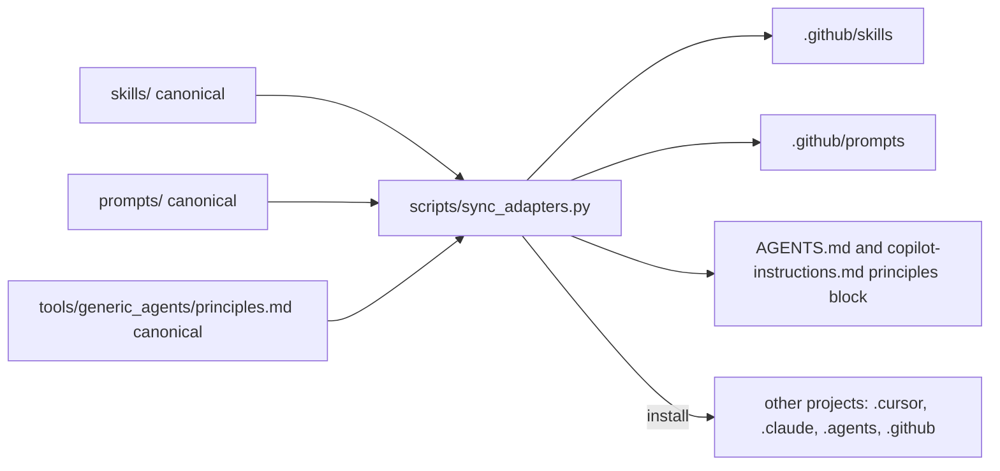

# Tool adapters

The skills, prompts and principles in this repository are **tool agnostic Markdown**. Different assistants look for instructions and skills in different places. The adapters here bridge that gap **without forking the content**: one canonical source, generated copies, and a script that proves they have not drifted.

| Tool | Guide | Instructions file | Skills location |
| --- | --- | --- | --- |
| GitHub Copilot | [github_copilot](github_copilot/README.md) | `.github/copilot-instructions.md`, `.github/instructions/*.instructions.md`, `AGENTS.md` | `.github/skills/` |
| Cursor | [cursor](cursor/README.md) | `AGENTS.md`, `.cursor/rules/*.mdc` | `.cursor/skills/` |
| Claude Code | [claude_code](claude_code/README.md) | `CLAUDE.md` (imports `AGENTS.md`) | `.claude/skills/` |
| Any other agent | [generic_agents](generic_agents/README.md) | `AGENTS.md` | `.agents/skills/` or paste |

## How it works



- **In this repository**, `python scripts/sync_adapters.py` regenerates `.github/skills/`, `.github/prompts/` and the principles blocks. `--check` fails if any generated file differs from what the sources produce, and CI runs it on every pull request.
- **In your own project**, `python scripts/sync_adapters.py install --target <tool> --dest <project>` copies the skills and principles into the places that tool reads.

```bash
python scripts/sync_adapters.py install --target github-copilot --dest ../my-project --prompts
python scripts/sync_adapters.py install --target cursor         --dest ../my-project
python scripts/sync_adapters.py install --target claude-code    --dest ../my-project
python scripts/sync_adapters.py install --target generic        --dest ../my-project
```

Installed skills keep links between skills and turn links to this repository's handbook, prompts and workflows into plain text, because those files do not exist in your project. Existing skill and rule files are not overwritten without `--force`. Principles are written between marker comments so that re-running the installer updates only that block.

## What was verified, and when

Tool conventions change often. The statements below were checked against the vendors' documentation on **2026-11-02**. They describe documented behaviour, not a guarantee that every version or product surface supports it. If something does not work, check the linked documentation for your version first.

| Convention | Source checked |
| --- | --- |
| Agent Skills format: a folder with `SKILL.md`; front matter requires `name` (lowercase letters, digits, hyphens; matches the folder) and `description`; optional `license`, `compatibility`, `metadata` (string keys and values), `allowed-tools` | [agentskills.io specification](https://agentskills.io/specification) |
| Copilot project skills in `.github/skills`, `.claude/skills` or `.agents/skills`; the specification is described as an open standard used across systems | [GitHub Docs: About agent skills](https://docs.github.com/en/copilot/concepts/agents/about-agent-skills) |
| Copilot repository instructions: `.github/copilot-instructions.md`; path specific `*.instructions.md` under `.github/instructions` with an `applyTo` glob (on GitHub.com supported for Copilot cloud agent and code review); `AGENTS.md`; a root `CLAUDE.md` or `GEMINI.md` | [GitHub Docs: repository custom instructions](https://docs.github.com/en/copilot/how-tos/configure-custom-instructions/add-repository-instructions) |
| Copilot prompt files: `*.prompt.md`, typically in `.github/prompts/`; optional front matter such as `description`; described as public preview in IDEs at the time of checking | [GitHub Docs: prompt files](https://docs.github.com/en/copilot/concepts/prompting-and-context/prompt-files), [VS Code docs](https://code.visualstudio.com/docs/agent-customization/prompt-files) |
| Cursor skills discovered from `.agents/skills/`, `.cursor/skills/` and, for compatibility, `.claude/skills/` and `.codex/skills/` | [Cursor docs: Agent Skills](https://cursor.com/docs/context/skills) |
| Cursor rules: `.cursor/rules/*.mdc` with `description`, `globs`, `alwaysApply` front matter; plain `.md` in that folder is ignored; `AGENTS.md` supported in the root and subdirectories | [Cursor docs: Rules](https://cursor.com/docs/context/rules) |
| Claude Code skills in `.claude/skills/<name>/SKILL.md`; `CLAUDE.md` supports `@path` imports; Claude Code can read `AGENTS.md` when no `CLAUDE.md` is present, and a `CLAUDE.md` that imports `AGENTS.md` loads it | [Claude Code docs: Skills](https://code.claude.com/docs/en/skills), [Memory](https://code.claude.com/docs/en/memory) |

## Design decisions

1. **Canonical skills are tool agnostic.** They contain no assistant specific syntax. Anything specific lives under `tools/` or is generated.
2. **Generated copies are never edited by hand.** `--check` makes drift a failing build rather than a surprise.
3. **No claims beyond what was read.** If a tool is not listed, it is not claimed to work, though plain Markdown means you can always [paste a skill](../skills/README.md#option-1-paste).
4. **`metadata` stays string typed.** The specification defines it as a map of strings, and the skills here comply, so a stricter validator will not reject them.
5. **Instructions stay short.** Assistants follow short, concrete instructions better than long ones, and some vendors recommend keeping instruction files compact. The shared principles block is deliberately brief.

## Adding support for another tool

1. Find the tool's documented locations for instructions and skills. Record the date and URLs.
2. Add a target to `TARGETS` in `scripts/sync_adapters.py` and an install branch if it needs a special file.
3. Add a guide folder here, modelled on the existing ones, with *how to verify it works*.
4. Do not make compatibility claims you have not checked.

[Back to the repository README](../README.md)
