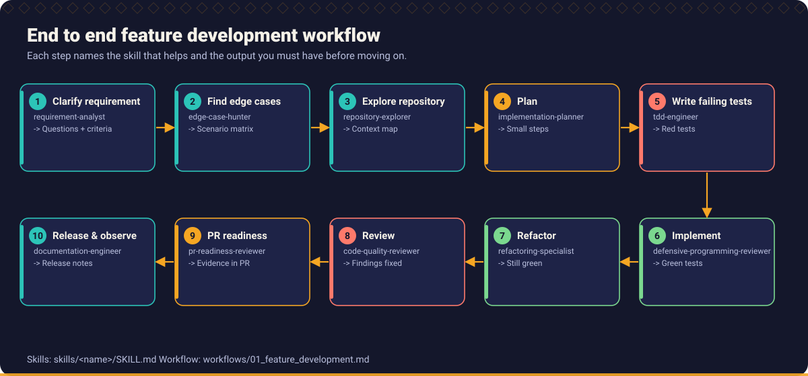
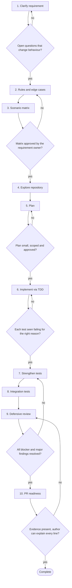

# Workflow 01: Build a new feature

> From an ambiguous ticket to a reviewed, tested, documented change.

This is the default workflow for new behaviour. It front loads the thinking (requirements, rules, edge cases, scenarios) because that is where assistants are weakest, and uses assistants heavily where they are strong (exploration, drafting tests and code, review passes). It is the long form of the [ten step developer workflow](../handbook/02_developer_ways_of_working/README.md).

## When to use

- A new capability, endpoint, screen, rule or integration is being added.
- A change has business rules that must be traced to tests.
- You are about to ask an assistant to generate more than a few lines of production code.

## Starting inputs

| Input | Why it is needed |
| --- | --- |
| Requirement or ticket | The starting point, however vague. Unclear parts are expected. |
| Access to the repository and a way to run build and tests | Evidence must come from real runs. |
| A person who can answer business questions | Unspecified behaviour is a question for them, not for the assistant. |
| Non functional constraints | Performance, security, compatibility and data rules that shape the design. |
| Repository assistant instructions | Conventions the assistant must follow (see [tools](../tools/README.md)). |

## Workflow diagram

Diamonds are gates. If the answer is *no*, return to the step shown and repeat before continuing. The full list of checkpoints and the evidence each needs is below.

## Sequence of activities

| # | Activity | Skill | Prompts | Developer responsibility | Output |
| --- | --- | --- | --- | --- | --- |
| 1 | **Clarify the requirement** | [Requirement Analyst](../skills/requirement-analyst/SKILL.md) | [Requirement Clarification](../prompts/requirements/requirement-clarification.md) | Answer or escalate every question. Do not let the assistant guess. | Clarified requirement, list of open questions with owners |
| 2 | **Discover business rules and edge cases** | [Business Rule Analyst](../skills/business-rule-analyst/SKILL.md), [Edge Case Hunter](../skills/edge-case-hunter/SKILL.md) | [Business Rule Discovery](../prompts/requirements/business-rule-discovery.md), [Edge Case Discovery](../prompts/requirements/edge-case-discovery.md) | Decide each `UNSPECIFIED` item, or ask the owner. | Rule list, edge case list |
| 3 | **Build the scenario matrix and acceptance criteria** | [Requirement Analyst](../skills/requirement-analyst/SKILL.md) | [Scenario Matrix Generation](../prompts/requirements/scenario-matrix-generation.md), [Acceptance Criteria Generation](../prompts/requirements/acceptance-criteria-generation.md) | Approve the matrix with the product owner; it becomes the test plan. | Scenario matrix with IDs, acceptance criteria |
| 4 | **Explore the repository** | [Repository Explorer](../skills/repository-explorer/SKILL.md) | [Repository Exploration](../prompts/development/repository-exploration.md) | Verify the claims by opening the files. Note conventions to follow. | Map of relevant code, conventions and existing tests |
| 5 | **Plan the implementation** | [Implementation Planner](../skills/implementation-planner/SKILL.md) | [Implementation Planning](../prompts/development/implementation-planning.md) | Approve scope, files touched and order. Remove anything speculative. | Ordered plan of small slices, each tied to scenario IDs |
| 6 | **Implement test first** | [TDD Engineer](../skills/tdd-engineer/SKILL.md) | [TDD Test Generation](../prompts/testing/tdd-test-generation.md), [Code Generation From a Plan](../prompts/development/code-generation.md) | Read every red and green output. Run the tests yourself. | Passing tests and minimal code per slice |
| 7 | **Strengthen the tests** | [Unit Test Engineer](../skills/unit-test-engineer/SKILL.md), [Edge Case Hunter](../skills/edge-case-hunter/SKILL.md), [Mutation Testing Specialist](../skills/mutation-testing-specialist/SKILL.md) | [Unit Test Generation](../prompts/testing/unit-test-generation.md), [Boundary Testing](../prompts/testing/boundary-testing.md), [Negative Testing](../prompts/testing/negative-testing.md), [Mutation Testing Analysis](../prompts/testing/mutation-testing.md) | Make assertions exact. Triage surviving mutants. | Boundary and negative tests, mutation findings addressed |
| 8 | **Test the real boundaries** | [Integration Test Engineer](../skills/integration-test-engineer/SKILL.md) | [Integration Test Generation](../prompts/testing/integration-test-generation.md) | Ensure each real dependency is exercised at least once. | Integration tests for database, HTTP, messaging as relevant |
| 9 | **Review defensively** | [Defensive Programming Reviewer](../skills/defensive-programming-reviewer/SKILL.md), [Control Flow Analyst](../skills/control-flow-analyst/SKILL.md), [Security Reviewer](../skills/security-reviewer/SKILL.md) | [Missing Condition Detection](../prompts/code_review/missing-condition-detection.md), [Null Handling Review](../prompts/code_review/null-handling-review.md), [Exception Handling Review](../prompts/code_review/exception-handling-review.md), [Security Review](../prompts/code_review/security-review.md) | Triage findings; every accepted finding becomes a failing test first. | Findings list, new tests, fixes |
| 10 | **Prepare the pull request** | [PR Readiness Reviewer](../skills/pr-readiness-reviewer/SKILL.md), [Documentation Engineer](../skills/documentation-engineer/SKILL.md) | [PR Readiness Assessment](../prompts/code_review/pr-readiness-assessment.md), [PR Description Drafting](../prompts/code_review/pr-description-drafting.md), [Documentation Update](../prompts/development/documentation-update.md) | Write the description with test evidence and AI disclosure. Be able to explain every line. | Pull request, updated documentation |

## Step notes

### Step 1: Clarify the requirement

Ask the assistant for questions, not answers. Group them by who can answer. Record the answers next to the requirement so tests can cite them.

### Step 2: Discover business rules and edge cases

Separate rules stated in the requirement from rules the assistant inferred. Inferred rules are proposals until confirmed.

### Step 3: Build the scenario matrix and acceptance criteria

Use the [scenario matrix template](../templates/scenario_matrix_template.md). Each row has an input, an expected result and a source.

### Step 4: Explore the repository

Prevents duplicate helpers and style drift. Ask for file paths and line references, then check a sample yourself.

### Step 5: Plan the implementation

Each slice should be small enough to review. Record what is deliberately out of scope.

### Step 6: Implement test first

One scenario at a time: failing test, minimal change, refactor. Reject any code no test demands. See [Chapter 5](../handbook/05_test_driven_development/tdd_with_ai.md).

### Step 7: Strengthen the tests

Add below, at and above tests for each boundary; add negative cases; run a mutation tool or the hand mutation technique on critical logic.

### Step 8: Test the real boundaries

Mocks cannot show the SQL or the status handling is right. Include failure paths: timeouts, 5xx, malformed bodies.

### Step 9: Review defensively

Use a fresh assistant session with only the requirement and the diff for independence ([Chapter 10](../handbook/10_code_review_and_pull_requests/README.md)).

### Step 10: Prepare the pull request

Use the [pull request template](../templates/pull_request_template.md). State what was not tested.

## Required outputs

- Clarified requirement with recorded answers.
- Approved scenario matrix with IDs.
- Implementation plan.
- Tests that fail on defective code, covering every scenario, including boundaries and failure paths.
- Production code limited to what the tests demand.
- Review findings and their resolution.
- Pull request with test evidence, risk notes and AI disclosure.

## Validation checkpoints

| Checkpoint | After step | Evidence required |
| --- | --- | --- |
| No behaviour changing open question | 1 | Questions list with answers or an explicit decision to defer |
| Scenario matrix approved | 3 | Approval by the requirement owner |
| Plan scoped | 5 | Plan lists files and out of scope items |
| Tests were red for the right reason | 6 | Quoted failing output for each test |
| Findings resolved | 9 | Each blocker or major finding has a test and a fix, or a recorded rebuttal |
| Ready to review | 10 | Suite output, scenario to test trace, disclosure |

## Completion criteria

The workflow is complete when **all** of these are true:

- [ ] Every scenario in the matrix maps to at least one test, or is recorded as deferred with a reason.
- [ ] The full suite passes, and the output is attached to the pull request.
- [ ] No existing test was weakened, skipped or deleted without explanation.
- [ ] The author can explain every changed line without the assistant.
- [ ] Documentation and changelog are updated where users or operators are affected.

## Common failure modes

| Failure mode | Countermeasure |
| --- | --- |
| Assistant fills requirement gaps with plausible rules | Step 1 and 2 produce questions; unspecified items go to the owner |
| Tests written after code mirror the code | Tests from the scenario matrix, written first |
| Large unreviewable diff | Slice the plan; one scenario per cycle |
| Mock only tests pass while integration is broken | Step 7 against real boundaries |
| Self review by the same assistant session | Fresh session, requirement plus diff only |

## Related

**Handbook:** [Chapter 2: Developer Ways of Working](../handbook/02_developer_ways_of_working/README.md), [Chapter 3: Requirement Engineering](../handbook/03_requirement_engineering/README.md), [Chapter 4: AI Assisted Development](../handbook/04_ai_assisted_development/README.md), [Chapter 5: Test Driven Development](../handbook/05_test_driven_development/README.md), [Chapter 6: Defensive Programming and Edge Case Engineering](../handbook/06_defensive_programming/README.md)

**Templates:** [Requirement](../templates/requirement_template.md), [Scenario matrix](../templates/scenario_matrix_template.md), [AI task](../templates/ai_task_template.md), [Pull request](../templates/pull_request_template.md)

**Examples:** [End to end TDD walkthrough](../examples/end_to_end/README.md), [Scenario catalogue](../examples/scenarios.md)

**Skills used:** [Requirement Analyst](../skills/requirement-analyst/SKILL.md), [Business Rule Analyst](../skills/business-rule-analyst/SKILL.md), [Edge Case Hunter](../skills/edge-case-hunter/SKILL.md), [Repository Explorer](../skills/repository-explorer/SKILL.md), [Implementation Planner](../skills/implementation-planner/SKILL.md), [TDD Engineer](../skills/tdd-engineer/SKILL.md), [Unit Test Engineer](../skills/unit-test-engineer/SKILL.md), [Mutation Testing Specialist](../skills/mutation-testing-specialist/SKILL.md), [Integration Test Engineer](../skills/integration-test-engineer/SKILL.md), [Defensive Programming Reviewer](../skills/defensive-programming-reviewer/SKILL.md), [Control Flow Analyst](../skills/control-flow-analyst/SKILL.md), [Security Reviewer](../skills/security-reviewer/SKILL.md), [PR Readiness Reviewer](../skills/pr-readiness-reviewer/SKILL.md), [Documentation Engineer](../skills/documentation-engineer/SKILL.md)

---

Next: [Workflow 02: Fix a defect](02_defect_fix.md) · [All workflows](README.md)
