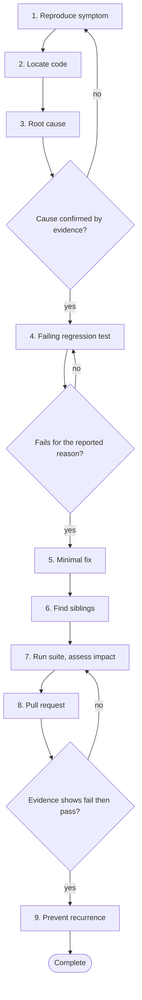

# Workflow 02: Fix a defect

> Reproduce it, prove it, fix it, and make sure it cannot return.

Defects tempt people to guess. With an assistant the guess arrives faster and looks more convincing. This workflow forces the order: reproduce as a failing test, find the root cause, fix minimally, then look for siblings.

## When to use

- A bug report, failing test, alert or support case describes behaviour that is wrong.
- A fix is proposed without a reproduction.
- The same kind of bug has appeared before.

## Starting inputs

| Input | Why it is needed |
| --- | --- |
| Defect report | Symptoms, expected behaviour, versions, frequency. |
| Logs, traces or stack trace | Evidence of what happened. Redact secrets and personal data before sharing with an assistant. |
| Steps to reproduce, if known | Starting point for the failing test. |
| Recent changes | Most defects follow a change. |
| Build and test commands | To prove the failing and passing states. |

## Workflow diagram

Diamonds are gates. If the answer is *no*, return to the step shown and repeat before continuing. The full list of checkpoints and the evidence each needs is below.

## Sequence of activities

| # | Activity | Skill | Prompts | Developer responsibility | Output |
| --- | --- | --- | --- | --- | --- |
| 1 | **Describe and reproduce the symptom** | [Debugging Specialist](../skills/debugging-specialist/SKILL.md) | [Hypothesis Driven Debugging](../prompts/debugging/hypothesis-driven-debugging.md), [Stack Trace Analysis](../prompts/debugging/stack-trace-analysis.md), [Log Analysis](../prompts/debugging/log-analysis.md) | State expected versus actual precisely. Redact sensitive data. | Precise symptom statement, ranked hypotheses |
| 2 | **Locate the relevant code** | [Repository Explorer](../skills/repository-explorer/SKILL.md) | [Repository Exploration](../prompts/development/repository-exploration.md) | Open the files yourself; confirm the call path. | Call path and candidate locations |
| 3 | **Find the root cause** | [Debugging Specialist](../skills/debugging-specialist/SKILL.md) | [Root Cause Analysis](../prompts/debugging/root-cause-analysis.md) | Confirm with evidence, not plausibility. Keep asking why until the cause is a decision or a missing check. | Root cause statement with supporting evidence |
| 4 | **Write a failing regression test** | [TDD Engineer](../skills/tdd-engineer/SKILL.md), [Regression Analyst](../skills/regression-analyst/SKILL.md) | [Regression Test Generation](../prompts/testing/regression-test-generation.md) | Run it and confirm it fails for the reported reason on the current code. | A test that fails now |
| 5 | **Apply the minimal fix** | [TDD Engineer](../skills/tdd-engineer/SKILL.md) | [Existing Code Modification](../prompts/development/existing-code-modification.md) | Review the diff; reject unrelated edits. | Fix, test now passing |
| 6 | **Hunt for siblings** | [Regression Analyst](../skills/regression-analyst/SKILL.md), [Control Flow Analyst](../skills/control-flow-analyst/SKILL.md) | [Missing Condition Detection](../prompts/code_review/missing-condition-detection.md), [Null Handling Review](../prompts/code_review/null-handling-review.md) | Search the codebase for the same pattern; decide fix now or ticket. | List of similar locations and decisions |
| 7 | **Run the suite and assess impact** | [Regression Analyst](../skills/regression-analyst/SKILL.md) | [Regression Test Generation](../prompts/testing/regression-test-generation.md) | Run the whole relevant suite. Check behaviour changes beyond the fix. | Suite result, impact note |
| 8 | **Open the pull request** | [PR Readiness Reviewer](../skills/pr-readiness-reviewer/SKILL.md) | [PR Description Drafting](../prompts/code_review/pr-description-drafting.md), [PR Readiness Assessment](../prompts/code_review/pr-readiness-assessment.md) | Explain the root cause, the fix and the evidence. | Pull request with before and after test output |
| 9 | **Prevent recurrence** | [Documentation Engineer](../skills/documentation-engineer/SKILL.md) | [Observability Gap Analysis](../prompts/delivery/observability-gap-analysis.md) | Add the guardrail: test, alert, log or check, and record learning. | Follow up actions |

## Step notes

### Step 1: Describe and reproduce the symptom

Ask for hypotheses with a cheap test for each, not for a fix. Write them down.

### Step 2: Locate the relevant code

Include recent changes to those files.

### Step 3: Find the root cause

Use five whys. The root cause is usually a missing requirement, check or test, not a typo.

### Step 4: Write a failing regression test

Write it at the lowest level that shows the bug. Name it after the behaviour and reference the defect ID.

### Step 5: Apply the minimal fix

Smallest change that fixes the cause. Do not refactor in the same change.

### Step 6: Hunt for siblings

A defect pattern rarely occurs once. Ask the assistant to list code with the same shape, then verify each.

### Step 7: Run the suite and assess impact

If any existing test had to change, state why in the pull request.

### Step 8: Open the pull request

Include the failing output from step 4 and the passing output from step 5.

### Step 9: Prevent recurrence

Ask: what would have told us sooner? Add that signal.

## Required outputs

- Root cause statement.
- A regression test that failed before the fix and passes after.
- Minimal fix.
- List of sibling locations and decisions.
- Pull request with evidence.
- Follow up actions for detection or prevention.

## Validation checkpoints

| Checkpoint | After step | Evidence required |
| --- | --- | --- |
| Cause confirmed | 3 | Evidence (log, trace, experiment) rather than a plausible story |
| Test fails for the right reason | 4 | Quoted failing output matching the reported symptom |
| Fix is minimal | 5 | Diff contains only the cause fix and test |
| Siblings considered | 6 | List with decisions |
| Evidence of fail then pass | 8 | Both outputs in the pull request |

## Completion criteria

The workflow is complete when **all** of these are true:

- [ ] A test reproduces the defect and now passes.
- [ ] The root cause, not only the symptom, is addressed or a ticket exists.
- [ ] Similar code was searched for.
- [ ] The full relevant suite passes.
- [ ] The pull request explains cause, fix and evidence.
- [ ] A detection or prevention follow up is recorded.

## Common failure modes

| Failure mode | Countermeasure |
| --- | --- |
| Assistant proposes a fix from the stack trace alone | Require a failing test first |
| Symptom patched, cause remains | Root cause step with evidence |
| Fix changes other behaviour | Minimal diff; run the full suite |
| Same bug returns elsewhere | Sibling hunt and a guardrail |

## Related

**Handbook:** [Chapter 5: Test Driven Development](../handbook/05_test_driven_development/README.md), [Chapter 6: Defensive Programming and Edge Case Engineering](../handbook/06_defensive_programming/README.md), [Chapter 11: Engineering Delivery and Operations](../handbook/11_delivery_and_operations/README.md)

**Templates:** [Pull request](../templates/pull_request_template.md), [AI task](../templates/ai_task_template.md)

**Examples:** [Broken Code Lab](../examples/broken_code_lab/README.md), [Scenario catalogue](../examples/scenarios.md)

**Skills used:** [Debugging Specialist](../skills/debugging-specialist/SKILL.md), [Repository Explorer](../skills/repository-explorer/SKILL.md), [TDD Engineer](../skills/tdd-engineer/SKILL.md), [Regression Analyst](../skills/regression-analyst/SKILL.md), [Control Flow Analyst](../skills/control-flow-analyst/SKILL.md), [PR Readiness Reviewer](../skills/pr-readiness-reviewer/SKILL.md), [Documentation Engineer](../skills/documentation-engineer/SKILL.md)

---

Previous: [Workflow 01: Build a new feature](01_feature_development.md) · Next: [Workflow 03: Refactor an existing service](03_service_refactoring.md) · [All workflows](README.md)
