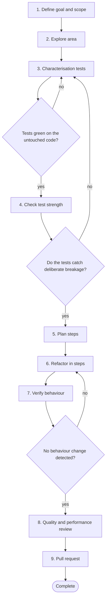

# Workflow 03: Refactor an existing service

> Change the structure, keep the behaviour, and prove both.

Refactoring with an assistant is dangerous because the assistant is eager to improve things and may change semantics silently. This workflow pins current behaviour with tests before touching the structure, then proceeds in small verified steps.

## When to use

- A service is hard to change, understand or test.
- Duplication, large functions or tangled dependencies slow delivery.
- You need to prepare code for a feature without changing behaviour.

## Starting inputs

| Input | Why it is needed |
| --- | --- |
| Refactoring goal and non goals | Prevents drift into a rewrite. |
| The code and its callers | Defines the area of change. |
| Existing tests and their quality | The safety net, if it is trustworthy. |
| Pain points and metrics | Complexity, churn or defect hot spots that justify the work. |
| Behaviour that must not change | Public contracts, data formats, error behaviour. |

## Workflow diagram

Diamonds are gates. If the answer is *no*, return to the step shown and repeat before continuing. The full list of checkpoints and the evidence each needs is below.

## Sequence of activities

| # | Activity | Skill | Prompts | Developer responsibility | Output |
| --- | --- | --- | --- | --- | --- |
| 1 | **Define goal, scope and non goals** | [Refactoring Specialist](../skills/refactoring-specialist/SKILL.md) | [Behaviour Preserving Refactoring](../prompts/development/refactoring.md) | Decide what is in and out. Behaviour change is out. | One page scope |
| 2 | **Explore the area and its callers** | [Repository Explorer](../skills/repository-explorer/SKILL.md) | [Repository Exploration](../prompts/development/repository-exploration.md), [Dependency Analysis](../prompts/development/dependency-analysis.md) | Confirm callers and usage by search, not by assistant memory. | Map of callers, dependencies, coupling |
| 3 | **Write characterisation tests** | [Unit Test Engineer](../skills/unit-test-engineer/SKILL.md), [Regression Analyst](../skills/regression-analyst/SKILL.md) | [Unit Test Generation](../prompts/testing/unit-test-generation.md), [Regression Test Generation](../prompts/testing/regression-test-generation.md) | Pin current behaviour, including odd behaviour. Log oddities as questions, do not fix them now. | Tests that describe what happens today |
| 4 | **Check the strength of those tests** | [Mutation Testing Specialist](../skills/mutation-testing-specialist/SKILL.md) | [Mutation Testing Analysis](../prompts/testing/mutation-testing.md) | Break the code on purpose; the tests must notice. | Mutation findings and added tests |
| 5 | **Plan small steps** | [Implementation Planner](../skills/implementation-planner/SKILL.md), [Refactoring Specialist](../skills/refactoring-specialist/SKILL.md) | [Implementation Planning](../prompts/development/implementation-planning.md) | Approve an ordered list of tiny, individually safe changes. | Step list with a test run after each |
| 6 | **Refactor step by step** | [Refactoring Specialist](../skills/refactoring-specialist/SKILL.md) | [Behaviour Preserving Refactoring](../prompts/development/refactoring.md) | Run tests after every step. Commit often. Read each diff for semantics. | Series of small commits |
| 7 | **Verify behaviour is unchanged** | [Regression Analyst](../skills/regression-analyst/SKILL.md) | [Regression Test Generation](../prompts/testing/regression-test-generation.md) | Run the whole suite and any contract or integration tests; compare outputs on sample data. | Verification evidence |
| 8 | **Review quality and performance** | [Code Quality Reviewer](../skills/code-quality-reviewer/SKILL.md), [Performance Analyst](../skills/performance-analyst/SKILL.md) | [Performance Review](../prompts/code_review/performance-review.md) | Confirm the goal was met and nothing regressed in speed or memory. | Review notes, before and after measures where relevant |
| 9 | **Open the pull request** | [PR Readiness Reviewer](../skills/pr-readiness-reviewer/SKILL.md) | [PR Readiness Assessment](../prompts/code_review/pr-readiness-assessment.md), [PR Description Drafting](../prompts/code_review/pr-description-drafting.md) | Explain the goal, the steps and the evidence of unchanged behaviour. Keep behaviour changes out. | Pull request |

## Step notes

### Step 1: Define goal, scope and non goals

A refactoring with no stated goal never ends.

### Step 2: Explore the area and its callers

Find every caller of public interfaces you may touch.

### Step 3: Write characterisation tests

Mark them as characterisation tests. See scenario S9 for a worked example.

### Step 4: Check the strength of those tests

Weak characterisation tests give false confidence.

### Step 5: Plan small steps

Prefer rename, extract, move, inline. Avoid steps that cannot be verified.

### Step 6: Refactor step by step

Watch for silent changes: integer to float, evaluation order, error handling, defaults.

### Step 7: Verify behaviour is unchanged

If a characterisation test had to change, stop and decide whether you changed behaviour.

### Step 8: Review quality and performance

Measure; do not assume that a cleaner structure is faster or slower.

### Step 9: Open the pull request

Consider several small pull requests rather than one large one.

## Required outputs

- Scope statement with non goals.
- Characterisation tests.
- Series of small, verified commits.
- Evidence that behaviour is unchanged.
- Review notes on quality and performance.
- Pull request.

## Validation checkpoints

| Checkpoint | After step | Evidence required |
| --- | --- | --- |
| Characterisation tests green | 3 | Suite output on the untouched code |
| Tests catch deliberate breakage | 4 | Mutation results or a manual break experiment |
| Behaviour unchanged | 7 | Suite output, unchanged characterisation tests |
| Goal met | 8 | Before and after on the metric named in step 1 |

## Completion criteria

The workflow is complete when **all** of these are true:

- [ ] The stated refactoring goal is met.
- [ ] Characterisation tests are unchanged and pass.
- [ ] No behaviour change is mixed into the pull request.
- [ ] The full suite passes.
- [ ] Odd behaviours discovered are recorded as questions or tickets.

## Common failure modes

| Failure mode | Countermeasure |
| --- | --- |
| Refactor without tests | Characterise first; stop if you cannot |
| Assistant rewrites rather than refactors | Ask for one named transformation at a time |
| Behaviour changes sneak in | Characterisation tests unchanged; review for semantics |
| Endless cleanup | Scope and non goals in step 1 |

## Related

**Handbook:** [Chapter 5: Test Driven Development](../handbook/05_test_driven_development/README.md), [Chapter 7: Code Quality](../handbook/07_code_quality/README.md)

**Templates:** [AI task](../templates/ai_task_template.md), [Pull request](../templates/pull_request_template.md)

**Examples:** [Scenario S9: refactoring exercise](../examples/scenarios.md#s9-refactoring-exercise)

**Skills used:** [Refactoring Specialist](../skills/refactoring-specialist/SKILL.md), [Repository Explorer](../skills/repository-explorer/SKILL.md), [Unit Test Engineer](../skills/unit-test-engineer/SKILL.md), [Regression Analyst](../skills/regression-analyst/SKILL.md), [Mutation Testing Specialist](../skills/mutation-testing-specialist/SKILL.md), [Implementation Planner](../skills/implementation-planner/SKILL.md), [Code Quality Reviewer](../skills/code-quality-reviewer/SKILL.md), [Performance Analyst](../skills/performance-analyst/SKILL.md), [PR Readiness Reviewer](../skills/pr-readiness-reviewer/SKILL.md)

---

Previous: [Workflow 02: Fix a defect](02_defect_fix.md) · Next: [Workflow 04: Introduce a new API](04_new_api.md) · [All workflows](README.md)
