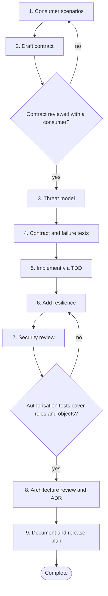

# Workflow 04: Introduce a new API

> Design the contract from the consumer's side, then build it defensively.

An API outlives its first implementation. This workflow puts the contract, failure behaviour and security first, and treats contract tests as the shared specification with consumers.

## When to use

- A new endpoint, event or public function is being introduced.
- An existing API is about to change.
- Another team will depend on the interface.

## Starting inputs

| Input | Why it is needed |
| --- | --- |
| Consumer scenarios | Who calls it, why, how often, with what data. |
| Existing API conventions | Naming, errors, pagination, versioning. |
| Authentication and authorisation model | Who may do what. |
| Non functional needs | Latency, volume, availability, data sensitivity. |
| Compatibility constraints | Existing consumers and versions. |

## Workflow diagram

Diamonds are gates. If the answer is *no*, return to the step shown and repeat before continuing. The full list of checkpoints and the evidence each needs is below.

## Sequence of activities

| # | Activity | Skill | Prompts | Developer responsibility | Output |
| --- | --- | --- | --- | --- | --- |
| 1 | **Capture consumer scenarios** | [Requirement Analyst](../skills/requirement-analyst/SKILL.md) | [Scenario Matrix Generation](../prompts/requirements/scenario-matrix-generation.md) | Confirm real consumers and real needs. | Scenarios including failure cases |
| 2 | **Draft the contract** | [API Contract Reviewer](../skills/api-contract-reviewer/SKILL.md) | [API Design Review](../prompts/architecture/api-design-review.md) | Own the design decisions; review against the conventions. | Contract draft (for example OpenAPI), error format, status codes, versioning approach |
| 3 | **Threat model the API** | [Security Reviewer](../skills/security-reviewer/SKILL.md) | [Threat Modelling](../prompts/architecture/threat-modelling.md) | Decide mitigations; the assistant lists threats. | Threats and mitigations |
| 4 | **Write contract and failure tests first** | [Integration Test Engineer](../skills/integration-test-engineer/SKILL.md), [TDD Engineer](../skills/tdd-engineer/SKILL.md) | [Contract Testing](../prompts/testing/contract-testing.md), [Negative Testing](../prompts/testing/negative-testing.md) | Assert exact status codes, error bodies and authorisation outcomes. | Failing contract tests |
| 5 | **Implement test first** | [TDD Engineer](../skills/tdd-engineer/SKILL.md) | [TDD Test Generation](../prompts/testing/tdd-test-generation.md), [Code Generation From a Plan](../prompts/development/code-generation.md) | Run tests yourself; reject unspecified behaviour. | Implementation passing the tests |
| 6 | **Add resilience** | [Defensive Programming Reviewer](../skills/defensive-programming-reviewer/SKILL.md) | [Defensive Coding Pass](../prompts/development/defensive-coding.md), [Resilience Review](../prompts/architecture/resilience-review.md) | Set timeouts, idempotency keys and limits deliberately. | Timeouts, retries, idempotency, pagination limits |
| 7 | **Security review** | [Security Reviewer](../skills/security-reviewer/SKILL.md) | [Security Review](../prompts/code_review/security-review.md) | Check authentication, authorisation (including object level), input validation and error disclosure. | Review findings and fixes |
| 8 | **Review the design and record decisions** | [Architecture Reviewer](../skills/architecture-reviewer/SKILL.md) | [Architecture Review](../prompts/architecture/architecture-review.md), [Architecture Decision Record Drafting](../prompts/architecture/adr-drafting.md) | Decide, then record the decision and alternatives. | ADR and design review notes |
| 9 | **Document and plan the release** | [Documentation Engineer](../skills/documentation-engineer/SKILL.md) | [Documentation Update](../prompts/development/documentation-update.md), [Release Readiness Check](../prompts/delivery/release-readiness-check.md) | Keep the spec in sync with the behaviour; plan rollout and deprecation. | Published spec, examples, release plan |

## Step notes

### Step 1: Capture consumer scenarios

Include what happens on bad input, unauthorised access and dependency failure.

### Step 2: Draft the contract

Check against the breaking change table in [Chapter 8](../handbook/08_architecture_and_design/README.md#5-api-design).

### Step 3: Threat model the API

Ask STRIDE questions at every trust boundary ([Chapter 9](../handbook/09_security_engineering/README.md#11-threat-modelling)).

### Step 4: Write contract and failure tests first

Include 400, 401, 403, 404, 409 and 5xx handling as specified.

### Step 5: Implement test first

Validate at the boundary; parse into valid types.

### Step 6: Add resilience

Idempotency for any operation consumers may retry.

### Step 7: Security review

Every endpoint must have an authorisation test for each role and the wrong tenant.

### Step 8: Review the design and record decisions

Use the [ADR template](../templates/adr_template.md).

### Step 9: Document and plan the release

Provide at least one runnable example per operation.

## Required outputs

- Consumer scenarios.
- Contract and error format.
- Threat model.
- Contract and failure tests.
- Implementation.
- ADR.
- Published documentation and release plan.

## Validation checkpoints

| Checkpoint | After step | Evidence required |
| --- | --- | --- |
| Contract reviewed with a consumer | 2 | Consumer sign off or recorded feedback |
| Failure behaviour specified | 4 | Tests for each error class |
| Authorisation tested | 7 | Per role and per object tests |
| Spec matches behaviour | 9 | Contract tests run against the spec |

## Completion criteria

The workflow is complete when **all** of these are true:

- [ ] Contract tests pass.
- [ ] Error behaviour, limits and idempotency are specified and tested.
- [ ] Authorisation is tested for each role and object ownership.
- [ ] Spec and documentation match behaviour.
- [ ] The decision is recorded in an ADR.
- [ ] Rollout and compatibility plan exists.

## Common failure modes

| Failure mode | Countermeasure |
| --- | --- |
| Contract shaped by the implementation | Design from consumer scenarios first |
| Missing authorisation on generated endpoints | Auth test per endpoint and role |
| Unbounded lists, no timeouts | Limits and timeouts are acceptance criteria |
| Breaking change shipped as minor | Use the breaking change table in review |

## Related

**Handbook:** [Chapter 8: Architecture and Design](../handbook/08_architecture_and_design/README.md), [Chapter 9: Security Engineering](../handbook/09_security_engineering/README.md), [Chapter 6: Defensive Programming and Edge Case Engineering](../handbook/06_defensive_programming/README.md)

**Templates:** [Technical design](../templates/technical_design_template.md), [ADR](../templates/adr_template.md), [Test plan](../templates/test_plan_template.md)

**Examples:** [Scenario S8: remote call handling](../examples/scenarios.md#s8-missing-integration-tests-and-inadequate-unit-tests)

**Skills used:** [Requirement Analyst](../skills/requirement-analyst/SKILL.md), [API Contract Reviewer](../skills/api-contract-reviewer/SKILL.md), [Security Reviewer](../skills/security-reviewer/SKILL.md), [Integration Test Engineer](../skills/integration-test-engineer/SKILL.md), [TDD Engineer](../skills/tdd-engineer/SKILL.md), [Defensive Programming Reviewer](../skills/defensive-programming-reviewer/SKILL.md), [Architecture Reviewer](../skills/architecture-reviewer/SKILL.md), [Documentation Engineer](../skills/documentation-engineer/SKILL.md)

---

Previous: [Workflow 03: Refactor an existing service](03_service_refactoring.md) · Next: [Workflow 05: Change a database schema](05_database_schema_change.md) · [All workflows](README.md)
