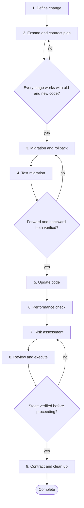

# Workflow 05: Change a database schema

> Change the data model without breaking the running system.

Schema changes run while old and new application versions coexist, and data loss is often irreversible. This workflow uses expand and contract steps, tests migrations on realistic data, and writes the rollback before the migration.

## When to use

- Adding, renaming, dropping or retyping columns or tables.
- Adding constraints or indexes on large tables.
- Moving data between stores.

## Starting inputs

| Input | Why it is needed |
| --- | --- |
| Reason for the change | To choose the least risky path. |
| Current schema and data volume | Migration time and locking depend on size. |
| Query patterns and consumers | Everything reading or writing the data, including reports and other services. |
| Deployment strategy | Rolling, blue/green and canary all run two versions at once. |
| Backup and restore capability | The last line of defence. |

## Workflow diagram

Diamonds are gates. If the answer is *no*, return to the step shown and repeat before continuing. The full list of checkpoints and the evidence each needs is below.

## Sequence of activities

| # | Activity | Skill | Prompts | Developer responsibility | Output |
| --- | --- | --- | --- | --- | --- |
| 1 | **Define the change and its compatibility needs** | [Database Design Reviewer](../skills/database-design-reviewer/SKILL.md) | [Database Schema Review](../prompts/architecture/database-schema-review.md) | List every reader and writer of the data; decide who must remain compatible. | Change description, consumer list |
| 2 | **Design the expand and contract plan** | [Database Design Reviewer](../skills/database-design-reviewer/SKILL.md), [Implementation Planner](../skills/implementation-planner/SKILL.md) | [Database Schema Review](../prompts/architecture/database-schema-review.md), [Implementation Planning](../prompts/development/implementation-planning.md) | Approve the staged plan: expand, dual write, backfill, switch reads, contract. | Staged plan with the deployment each stage needs |
| 3 | **Write the migration and the rollback** | [Database Design Reviewer](../skills/database-design-reviewer/SKILL.md) | [Database Schema Review](../prompts/architecture/database-schema-review.md), [Rollback Planning](../prompts/delivery/rollback-planning.md) | Write the rollback first; mark the point of no return. | Forward and backward scripts |
| 4 | **Test the migration on realistic data** | [Integration Test Engineer](../skills/integration-test-engineer/SKILL.md) | [Integration Test Generation](../prompts/testing/integration-test-generation.md) | Use a copy or realistic volume; measure duration and locking; test rollback. | Test results including timings |
| 5 | **Update the code in compatible steps** | [TDD Engineer](../skills/tdd-engineer/SKILL.md) | [TDD Test Generation](../prompts/testing/tdd-test-generation.md), [Existing Code Modification](../prompts/development/existing-code-modification.md) | Each code change must work before and after the migration stage. | Code changes with tests |
| 6 | **Check performance and indexing** | [Performance Analyst](../skills/performance-analyst/SKILL.md) | [Performance Review](../prompts/code_review/performance-review.md) | Verify real query plans for new queries and indexes. | Plans, timings, index decisions |
| 7 | **Assess release risk** | [Regression Analyst](../skills/regression-analyst/SKILL.md) | [Deployment Risk Analysis](../prompts/delivery/deployment-risk-analysis.md), [Rollback Planning](../prompts/delivery/rollback-planning.md) | Decide window, monitoring, abort criteria. | Risk assessment, runbook |
| 8 | **Review and execute stage by stage** | [PR Readiness Reviewer](../skills/pr-readiness-reviewer/SKILL.md) | [PR Readiness Assessment](../prompts/code_review/pr-readiness-assessment.md) | Run each stage in order, verifying before the next; do not combine stages for convenience. | Executed stages with verification notes |
| 9 | **Contract and clean up** | [Documentation Engineer](../skills/documentation-engineer/SKILL.md) | [Documentation Update](../prompts/development/documentation-update.md) | Remove the old structures only after nothing uses them; update documentation. | Old structures removed, docs updated |

## Step notes

### Step 1: Define the change and its compatibility needs

Include other services, jobs and reports.

### Step 2: Design the expand and contract plan

See the diagram in [Chapter 8](../handbook/08_architecture_and_design/README.md#6-database-design-and-data-modelling).

### Step 3: Write the migration and the rollback

Dropping data cannot be undone by redeploying; make that stage separate and late.

### Step 4: Test the migration on realistic data

Test on the same database engine and version as production; an embedded substitute can behave differently.

### Step 5: Update the code in compatible steps

Test queries against a real database, not mocks.

### Step 6: Check performance and indexing

Each index costs writes; justify it.

### Step 7: Assess release risk

Name the owner who can abort.

### Step 8: Review and execute stage by stage

Independent review by someone who owns the data.

### Step 9: Contract and clean up

Wait for at least one full release cycle and check access logs.

## Required outputs

- Consumer list.
- Staged plan.
- Forward and rollback scripts.
- Migration test results on realistic data.
- Risk assessment and runbook.
- Documentation of the final schema.

## Validation checkpoints

| Checkpoint | After step | Evidence required |
| --- | --- | --- |
| Plan compatible at every stage | 2 | Each stage lists the versions that must work |
| Migration and rollback verified | 4 | Run on realistic data with timings |
| Query plans reviewed | 6 | Plans for new queries |
| Each stage verified in production | 8 | Checks run and recorded |
| Nothing uses the old structure | 9 | Search and access logs |

## Completion criteria

The workflow is complete when **all** of these are true:

- [ ] The data model meets the new requirement.
- [ ] Old and new application versions worked at every stage.
- [ ] Rollback was tested and the point of no return was explicit.
- [ ] No data was lost or corrupted (verified).
- [ ] Old structures are removed and documentation updated.

## Common failure modes

| Failure mode | Countermeasure |
| --- | --- |
| One big migration with the code deploy | Expand and contract in separate deployments |
| Migration tested on an empty database | Realistic volume and the real engine |
| No rollback | Write it first; know the point of no return |
| Forgotten consumer breaks | Consumer inventory in step 1 |

## Related

**Handbook:** [Chapter 8: Architecture and Design](../handbook/08_architecture_and_design/README.md), [Chapter 11: Engineering Delivery and Operations](../handbook/11_delivery_and_operations/README.md), [Chapter 6: Defensive Programming and Edge Case Engineering](../handbook/06_defensive_programming/README.md)

**Templates:** [Technical design](../templates/technical_design_template.md), [Test plan](../templates/test_plan_template.md), [ADR](../templates/adr_template.md)

**Examples:** [Broken Code Lab: transaction rollback](../examples/broken_code_lab/05_missing_transaction_rollback/CHALLENGE.md)

**Skills used:** [Database Design Reviewer](../skills/database-design-reviewer/SKILL.md), [Implementation Planner](../skills/implementation-planner/SKILL.md), [Integration Test Engineer](../skills/integration-test-engineer/SKILL.md), [TDD Engineer](../skills/tdd-engineer/SKILL.md), [Performance Analyst](../skills/performance-analyst/SKILL.md), [Regression Analyst](../skills/regression-analyst/SKILL.md), [PR Readiness Reviewer](../skills/pr-readiness-reviewer/SKILL.md), [Documentation Engineer](../skills/documentation-engineer/SKILL.md)

---

Previous: [Workflow 04: Introduce a new API](04_new_api.md) · Next: [Workflow 06: Develop a data pipeline](06_data_pipeline.md) · [All workflows](README.md)
