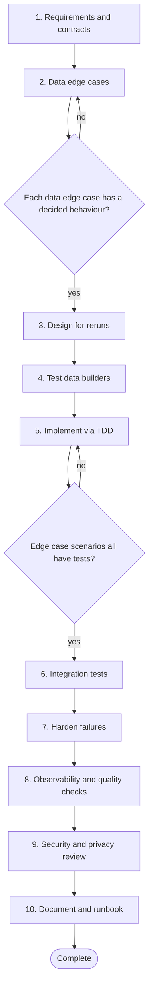

# Workflow 06: Develop a data pipeline

> Pipelines fail quietly. Design for reruns, bad data and visibility from the start.

Data pipelines have their own defect classes: duplicates, late and missing data, schema drift, partial runs and silent corruption. This workflow centres on data contracts, idempotent reruns and observability. The repository does not ship a runnable pipeline example; the testing techniques come from [Chapter 5](../handbook/05_test_driven_development/README.md) and the failure handling from [Chapter 6](../handbook/06_defensive_programming/README.md).

## When to use

- Building a batch or streaming job that moves or transforms data.
- Adding a new source, sink or transformation to an existing pipeline.
- A pipeline has silent data quality problems.

## Starting inputs

| Input | Why it is needed |
| --- | --- |
| Sources, sinks and their owners | Who to ask when data looks wrong. |
| Schemas or data contracts | What shape and meaning is promised. |
| Freshness, volume and correctness expectations | Defines what failure is. |
| Data sensitivity classification | Drives masking, access and retention. |
| Rerun and backfill expectations | Determines how idempotent it must be. |

## Workflow diagram

Diamonds are gates. If the answer is *no*, return to the step shown and repeat before continuing. The full list of checkpoints and the evidence each needs is below.

## Sequence of activities

| # | Activity | Skill | Prompts | Developer responsibility | Output |
| --- | --- | --- | --- | --- | --- |
| 1 | **Clarify requirements and data contracts** | [Requirement Analyst](../skills/requirement-analyst/SKILL.md) | [Requirement Clarification](../prompts/requirements/requirement-clarification.md) | Agree what correct output means; get the contract from producers. | Written data contract, SLAs |
| 2 | **Discover data edge cases** | [Edge Case Hunter](../skills/edge-case-hunter/SKILL.md) | [Edge Case Discovery](../prompts/requirements/edge-case-discovery.md) | Decide behaviour for each: reject, quarantine, default or alert. | Scenario matrix for data |
| 3 | **Design for idempotency and recovery** | [Architecture Reviewer](../skills/architecture-reviewer/SKILL.md) | [Architecture Review](../prompts/architecture/architecture-review.md), [Resilience Review](../prompts/architecture/resilience-review.md) | Make rerunning the same input produce the same result; decide checkpointing and dead letter handling. | Design with failure and rerun behaviour |
| 4 | **Prepare test data and builders** | [Unit Test Engineer](../skills/unit-test-engineer/SKILL.md) | [Test Data Builder Design](../prompts/testing/test-data-builder-design.md) | Create synthetic data that covers the edge cases; never copy production records. | Builders and fixtures |
| 5 | **Implement transformations test first** | [TDD Engineer](../skills/tdd-engineer/SKILL.md) | [TDD Test Generation](../prompts/testing/tdd-test-generation.md), [Code Generation From a Plan](../prompts/development/code-generation.md) | One transformation rule per cycle; exact expected rows. | Tested transformation code |
| 6 | **Test against real storage and schemas** | [Integration Test Engineer](../skills/integration-test-engineer/SKILL.md) | [Integration Test Generation](../prompts/testing/integration-test-generation.md), [Contract Testing](../prompts/testing/contract-testing.md) | Run with the real engine or a faithful one; test rerun, partial failure and duplicate input. | Integration tests including rerun |
| 7 | **Harden failure handling** | [Defensive Programming Reviewer](../skills/defensive-programming-reviewer/SKILL.md) | [Defensive Coding Pass](../prompts/development/defensive-coding.md) | Define retries, timeouts, poison record handling and alerts. | Retry and quarantine logic |
| 8 | **Add observability and data quality checks** | [Performance Analyst](../skills/performance-analyst/SKILL.md) | [Observability Gap Analysis](../prompts/delivery/observability-gap-analysis.md), [Performance Bottleneck Analysis](../prompts/debugging/performance-bottleneck-analysis.md) | Metrics for volume, freshness, rejects and duration; alerts that someone acts on. | Dashboards, alerts, quality checks |
| 9 | **Review security and privacy** | [Security Reviewer](../skills/security-reviewer/SKILL.md) | [Security Review](../prompts/code_review/security-review.md) | Verify access control, masking and retention; check logs for sensitive data. | Review findings and fixes |
| 10 | **Document and hand over** | [Documentation Engineer](../skills/documentation-engineer/SKILL.md) | [Documentation Update](../prompts/development/documentation-update.md) | Write the runbook: how to rerun, backfill, and handle failures. | Runbook and documentation |

## Step notes

### Step 1: Clarify requirements and data contracts

Ask which fields are required, what null means and how late data is treated.

### Step 2: Discover data edge cases

Include nulls, empty files, duplicates, out of order and late events, schema drift, encodings, time zones, huge values and partial files.

### Step 3: Design for idempotency and recovery

Prefer upserts and deterministic keys over append only inserts that duplicate on rerun.

### Step 4: Prepare test data and builders

See [test design](../handbook/05_test_driven_development/test_design.md#2-fixtures-and-test-data).

### Step 5: Implement transformations test first

Keep transformations pure functions where possible so they are testable without infrastructure.

### Step 6: Test against real storage and schemas

Assert that running the job twice yields the same result.

### Step 7: Harden failure handling

A single bad record must not silently stop the pipeline nor silently disappear.

### Step 8: Add observability and data quality checks

A pipeline that finishes with zero rows is a failure unless that is expected.

### Step 9: Review security and privacy

Do not log record contents.

### Step 10: Document and hand over

Test the runbook with someone who did not write it.

## Required outputs

- Data contract.
- Data edge case matrix with decided behaviours.
- Design with rerun and failure behaviour.
- Tested transformations.
- Integration tests, including rerun.
- Metrics and alerts.
- Runbook.

## Validation checkpoints

| Checkpoint | After step | Evidence required |
| --- | --- | --- |
| Contract agreed | 1 | Document signed off by the data owner |
| Every edge case has a decision | 2 | Matrix with decided behaviours |
| Rerun produces the same result | 6 | Integration test running the job twice |
| Failures visible | 8 | Alert fired in a fault injection test |

## Completion criteria

The workflow is complete when **all** of these are true:

- [ ] Outputs match the contract for normal and edge inputs.
- [ ] Rerunning and backfilling produce correct results without duplicates.
- [ ] Bad records are handled by a decided policy and are visible.
- [ ] Metrics and alerts exist and have been exercised.
- [ ] A runbook exists and has been tried by someone else.
- [ ] No sensitive data appears in logs or test fixtures.

## Common failure modes

| Failure mode | Countermeasure |
| --- | --- |
| Duplicates after retry or rerun | Idempotent writes and an explicit test |
| Silent data loss | Count reconciliation and reject quarantine |
| Schema drift breaks silently | Contract tests and schema validation at ingestion |
| Production data in test fixtures | Synthetic builders only |

## Related

**Handbook:** [Chapter 5: Test Driven Development](../handbook/05_test_driven_development/README.md), [Chapter 6: Defensive Programming and Edge Case Engineering](../handbook/06_defensive_programming/README.md), [Chapter 8: Architecture and Design](../handbook/08_architecture_and_design/README.md), [Chapter 9: Security Engineering](../handbook/09_security_engineering/README.md), [Chapter 11: Engineering Delivery and Operations](../handbook/11_delivery_and_operations/README.md)

**Templates:** [Technical design](../templates/technical_design_template.md), [Test plan](../templates/test_plan_template.md)

**Examples:** [Test design: fixtures and builders](../handbook/05_test_driven_development/test_design.md)

**Skills used:** [Requirement Analyst](../skills/requirement-analyst/SKILL.md), [Edge Case Hunter](../skills/edge-case-hunter/SKILL.md), [Architecture Reviewer](../skills/architecture-reviewer/SKILL.md), [Unit Test Engineer](../skills/unit-test-engineer/SKILL.md), [TDD Engineer](../skills/tdd-engineer/SKILL.md), [Integration Test Engineer](../skills/integration-test-engineer/SKILL.md), [Defensive Programming Reviewer](../skills/defensive-programming-reviewer/SKILL.md), [Performance Analyst](../skills/performance-analyst/SKILL.md), [Security Reviewer](../skills/security-reviewer/SKILL.md), [Documentation Engineer](../skills/documentation-engineer/SKILL.md)

---

Previous: [Workflow 05: Change a database schema](05_database_schema_change.md) · Next: [Workflow 07: Write unit and integration tests](07_unit_and_integration_testing.md) · [All workflows](README.md)
