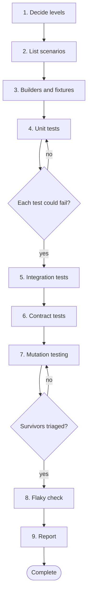

# Workflow 07: Write unit and integration tests

> Choose the level, derive the cases from requirements, and prove the tests can fail.

Use this workflow when the task is the tests themselves: adding coverage to existing code, strengthening weak suites, or designing the test strategy for a change.

## When to use

- Existing code has weak or missing tests.
- A change needs a test plan across unit, integration and contract levels.
- A suite passes but you do not trust it.

## Starting inputs

| Input | Why it is needed |
| --- | --- |
| Code under test and its requirement | Expected values must come from the requirement, not the code. |
| Test framework and run commands | Evidence needs real runs. |
| Existing tests | To follow their style and avoid duplication. |
| Real boundaries involved | Database, HTTP, messaging, files. |
| Known defects or risky areas | Where to concentrate effort. |

## Workflow diagram

Diamonds are gates. If the answer is *no*, return to the step shown and repeat before continuing. The full list of checkpoints and the evidence each needs is below.

## Sequence of activities

| # | Activity | Skill | Prompts | Developer responsibility | Output |
| --- | --- | --- | --- | --- | --- |
| 1 | **Decide the test levels** | [Unit Test Engineer](../skills/unit-test-engineer/SKILL.md) | [Unit Test Generation](../prompts/testing/unit-test-generation.md) | Choose what to cover at unit, integration and contract level. | Short test strategy |
| 2 | **List scenarios and edge cases** | [Edge Case Hunter](../skills/edge-case-hunter/SKILL.md) | [Edge Case Discovery](../prompts/requirements/edge-case-discovery.md), [Scenario Matrix Generation](../prompts/requirements/scenario-matrix-generation.md) | Confirm expected values with the requirement; flag unspecified behaviour. | Scenario matrix |
| 3 | **Create builders and fixtures** | [Unit Test Engineer](../skills/unit-test-engineer/SKILL.md) | [Test Data Builder Design](../prompts/testing/test-data-builder-design.md) | Valid defaults, explicit overrides, no production data. | Test data builders |
| 4 | **Write unit tests** | [Unit Test Engineer](../skills/unit-test-engineer/SKILL.md), [TDD Engineer](../skills/tdd-engineer/SKILL.md) | [Unit Test Generation](../prompts/testing/unit-test-generation.md), [Boundary Testing](../prompts/testing/boundary-testing.md), [Negative Testing](../prompts/testing/negative-testing.md) | Exact assertions; below, at and above boundaries; specific exception types; no side effects on failure. | Unit tests |
| 5 | **Write integration tests** | [Integration Test Engineer](../skills/integration-test-engineer/SKILL.md) | [Integration Test Generation](../prompts/testing/integration-test-generation.md) | Use real boundaries, own data per test, test failure paths. | Integration tests |
| 6 | **Write contract tests where services meet** | [Integration Test Engineer](../skills/integration-test-engineer/SKILL.md) | [Contract Testing](../prompts/testing/contract-testing.md) | Pin the shape and semantics both sides rely on. | Contract tests |
| 7 | **Challenge the suite with mutation testing** | [Mutation Testing Specialist](../skills/mutation-testing-specialist/SKILL.md) | [Mutation Testing Analysis](../prompts/testing/mutation-testing.md) | Triage survivors; mark equivalent mutants; write killing tests. | Survivor list and new tests |
| 8 | **Remove flakiness** | [Unit Test Engineer](../skills/unit-test-engineer/SKILL.md) | [Flaky Test Diagnosis](../prompts/testing/flaky-test-diagnosis.md) | Run repeatedly and in random order; fix causes, do not add retries. | Stable suite |
| 9 | **Report** | [PR Readiness Reviewer](../skills/pr-readiness-reviewer/SKILL.md) | [PR Readiness Assessment](../prompts/code_review/pr-readiness-assessment.md) | Report counts, scenario coverage and gaps with real output. | Test report |

## Step notes

### Step 1: Decide the test levels

Logic goes in unit tests; each real boundary needs at least one integration test.

### Step 2: List scenarios and edge cases

If no requirement exists, write characterisation tests and mark them as such.

### Step 3: Create builders and fixtures

Fresh state per test.

### Step 4: Write unit tests

Read each assertion and ask whether it could fail.

### Step 5: Write integration tests

Timeouts, 5xx, malformed responses, constraint violations.

### Step 6: Write contract tests where services meet

Only where another team or service depends on the interface.

### Step 7: Challenge the suite with mutation testing

Run on critical logic. See [property based and mutation testing](../handbook/05_test_driven_development/property_based_and_mutation_testing.md).

### Step 8: Remove flakiness

Time, randomness, shared state and ordering are the usual causes.

### Step 9: Report

State what is not covered.

## Required outputs

- Test strategy.
- Scenario matrix.
- Unit, integration and contract tests.
- Mutation findings.
- A stable suite.
- Report with gaps.

## Validation checkpoints

| Checkpoint | After step | Evidence required |
| --- | --- | --- |
| Expected values come from requirements | 2 | Scenario to source trace |
| Tests can fail | 4 | Deliberate breakage turns tests red |
| Survivors triaged | 7 | Survivor list with decisions |
| Suite is stable | 8 | Repeated and shuffled runs |

## Completion criteria

The workflow is complete when **all** of these are true:

- [ ] Every scenario is covered or recorded as deferred.
- [ ] Each test fails when the behaviour it checks is broken.
- [ ] Each real boundary has an integration test.
- [ ] Mutation survivors on critical logic are killed or recorded as equivalent.
- [ ] The suite is deterministic.
- [ ] Gaps are stated in the report.

## Common failure modes

| Failure mode | Countermeasure |
| --- | --- |
| Tests mirror the implementation | Expected values from requirement |
| Everything mocked | Integration tests at boundaries |
| Weak assertions | Mutation testing and assertion review |
| Flaky suite | Remove causes, no blind retries |

## Related

**Handbook:** [Chapter 5: Test Driven Development](../handbook/05_test_driven_development/README.md), [Chapter 6: Defensive Programming and Edge Case Engineering](../handbook/06_defensive_programming/README.md)

**Templates:** [Test plan](../templates/test_plan_template.md), [Scenario matrix](../templates/scenario_matrix_template.md)

**Examples:** [Scenario S7: weak assertions](../examples/scenarios.md#s7-weak-assertions-and-mutation-testing), [Scenario S8: integration tests](../examples/scenarios.md#s8-missing-integration-tests-and-inadequate-unit-tests), [Broken Code Lab](../examples/broken_code_lab/README.md)

**Skills used:** [Unit Test Engineer](../skills/unit-test-engineer/SKILL.md), [Edge Case Hunter](../skills/edge-case-hunter/SKILL.md), [TDD Engineer](../skills/tdd-engineer/SKILL.md), [Integration Test Engineer](../skills/integration-test-engineer/SKILL.md), [Mutation Testing Specialist](../skills/mutation-testing-specialist/SKILL.md), [PR Readiness Reviewer](../skills/pr-readiness-reviewer/SKILL.md)

---

Previous: [Workflow 06: Develop a data pipeline](06_data_pipeline.md) · Next: [Workflow 08: Handle a production incident](08_production_incident.md) · [All workflows](README.md)
