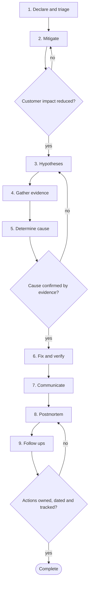

# Workflow 08: Handle a production incident

> Stabilise first, understand second, learn third.

Under pressure, assistants are tempting and dangerous: they produce confident explanations and scripts quickly. This workflow keeps humans in command of mitigation and production changes, and uses assistants for reading, summarising and hypothesis generation.

## When to use

- An alert fires or users report that the service is degraded.
- A release is suspected of causing harm.
- Data may be wrong or exposed.

## Starting inputs

| Input | Why it is needed |
| --- | --- |
| Alert or report | What triggered the incident. |
| Dashboards, logs and traces | Evidence. Redact secrets and personal data before sharing with any tool. |
| List of recent changes | Deployments, flags, config, dependency changes. |
| On call roles and escalation path | Who commands, who investigates, who communicates. |
| Runbooks and rollback procedures | Fast mitigation options. |

## Workflow diagram

Diamonds are gates. If the answer is *no*, return to the step shown and repeat before continuing. The full list of checkpoints and the evidence each needs is below.

## Sequence of activities

| # | Activity | Skill | Prompts | Developer responsibility | Output |
| --- | --- | --- | --- | --- | --- |
| 1 | **Declare and triage** | None (human activity) | None | Decide severity and roles. Open an incident channel and a timeline. | Incident declared, commander and scribe named |
| 2 | **Mitigate first** | None (human activity) | None | Roll back, flip a flag, scale, fail over or shed load. Do not wait for the root cause. | Harm stopped or reduced |
| 3 | **Form hypotheses** | [Debugging Specialist](../skills/debugging-specialist/SKILL.md) | [Hypothesis Driven Debugging](../prompts/debugging/hypothesis-driven-debugging.md) | Rank by likelihood and cost to test; write them in the timeline. | Ranked hypotheses with a test each |
| 4 | **Gather and read the evidence** | [Debugging Specialist](../skills/debugging-specialist/SKILL.md) | [Log Analysis](../prompts/debugging/log-analysis.md), [Stack Trace Analysis](../prompts/debugging/stack-trace-analysis.md), [Performance Bottleneck Analysis](../prompts/debugging/performance-bottleneck-analysis.md) | Redact before sharing. Verify every assistant claim against the raw data. | Evidence supporting or rejecting each hypothesis |
| 5 | **Determine the cause** | [Debugging Specialist](../skills/debugging-specialist/SKILL.md), [Regression Analyst](../skills/regression-analyst/SKILL.md) | [Production Incident Analysis](../prompts/debugging/production-incident-analysis.md), [Root Cause Analysis](../prompts/debugging/root-cause-analysis.md) | Confirm with evidence; separate trigger, root cause and contributing factors. | Cause statement |
| 6 | **Fix and verify** | [TDD Engineer](../skills/tdd-engineer/SKILL.md) | [Regression Test Generation](../prompts/testing/regression-test-generation.md) | Reproduce as a test where possible; apply a reviewed fix, even in a hurry; verify with metrics. | Fix deployed and verified |
| 7 | **Communicate** | None (human activity) | None | Update stakeholders on a schedule, with facts and next update time. | Status updates |
| 8 | **Run a blameless postmortem** | [Documentation Engineer](../skills/documentation-engineer/SKILL.md) | [Production Incident Analysis](../prompts/debugging/production-incident-analysis.md) | Facts from records. Ask what in the system and process allowed it. | Postmortem document |
| 9 | **Close the follow ups** | [Regression Analyst](../skills/regression-analyst/SKILL.md) | [Observability Gap Analysis](../prompts/delivery/observability-gap-analysis.md) | Owners and dates for each action; track to done. | Tracked actions: tests, alerts, guardrails, process changes |

## Step notes

### Step 1: Declare and triage

A human decision. Declare early; downgrading is cheap.

### Step 2: Mitigate first

Use prepared options from [Chapter 11](../handbook/11_delivery_and_operations/README.md#6-rollback-strategies). Any production change is made by a human.

### Step 3: Form hypotheses

Check what changed first: deployments, flags, config, traffic, dependencies.

### Step 4: Gather and read the evidence

A metric shows that, a trace shows where, a log shows why.

### Step 5: Determine the cause

Beware the first plausible story.

### Step 6: Fix and verify

Emergency does not suspend review; use a fast review path.

### Step 7: Communicate

The communications role owns this, not the investigators.

### Step 8: Run a blameless postmortem

Use records for the timeline, not an assistant's memory.

### Step 9: Close the follow ups

Prevention means a test, alert or design change, not a reminder to be careful.

## Required outputs

- Incident timeline.
- Mitigation record.
- Cause statement with evidence.
- Fix with regression test.
- Postmortem.
- Tracked follow up actions.

## Validation checkpoints

| Checkpoint | After step | Evidence required |
| --- | --- | --- |
| Impact reduced before diagnosis | 2 | Metrics show recovery |
| Cause evidence based | 5 | Logs, traces or experiments cited |
| Fix reviewed and verified | 6 | Review record and recovery metrics |
| Actions tracked | 9 | Tickets with owners and dates |

## Completion criteria

The workflow is complete when **all** of these are true:

- [ ] Service is restored and verified by metrics.
- [ ] The cause and contributing factors are documented with evidence.
- [ ] A regression test or equivalent guardrail exists.
- [ ] A blameless postmortem is published.
- [ ] Every action has an owner and a date.
- [ ] No secrets or personal data were sent to unapproved tools during the incident.

## Common failure modes

| Failure mode | Countermeasure |
| --- | --- |
| Debugging before mitigating | Mitigate first rule |
| Assistant's confident wrong cause | Evidence required for every claim |
| Unreviewed hotfix causes a second incident | Fast review path, not no review |
| Actions never closed | Owners, dates and tracking |

## Related

**Handbook:** [Chapter 11: Engineering Delivery and Operations](../handbook/11_delivery_and_operations/README.md), [Chapter 9: Security Engineering](../handbook/09_security_engineering/README.md)

**Templates:** [AI task](../templates/ai_task_template.md), [Pull request](../templates/pull_request_template.md)

**Examples:** [Broken Code Lab: race condition](../examples/broken_code_lab/04_race_condition/CHALLENGE.md)

**Skills used:** [Debugging Specialist](../skills/debugging-specialist/SKILL.md), [Regression Analyst](../skills/regression-analyst/SKILL.md), [TDD Engineer](../skills/tdd-engineer/SKILL.md), [Documentation Engineer](../skills/documentation-engineer/SKILL.md)

---

Previous: [Workflow 07: Write unit and integration tests](07_unit_and_integration_testing.md) · Next: [Workflow 09: Review a pull request](09_pull_request_review.md) · [All workflows](README.md)
