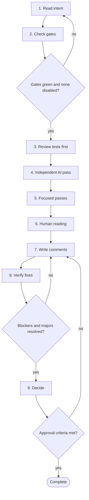

# Workflow 09: Review a pull request

> Review the evidence, not the confidence.

A pull request review combines automated gates, an independent AI pass and an accountable human reading. The reviewer reads tests first, uses assistants to widen coverage, and decides. Reviewers should push back on large, unexplained or unverified changes; a smaller pull request is a legitimate request.

## When to use

- You are asked to review a pull request.
- You want to self review before requesting review.
- A change was largely produced by an assistant.

## Starting inputs

| Input | Why it is needed |
| --- | --- |
| The pull request, description and linked requirement | Review is against intent, not only the diff. |
| CI results | Mechanical checks come first. |
| Test evidence in the description | What the author claims was run. |
| Risk area | Security, money, data and public APIs need a human. |
| The team's approval criteria | The bar for merging. |

## Workflow diagram

Diamonds are gates. If the answer is *no*, return to the step shown and repeat before continuing. The full list of checkpoints and the evidence each needs is below.

## Sequence of activities

| # | Activity | Skill | Prompts | Developer responsibility | Output |
| --- | --- | --- | --- | --- | --- |
| 1 | **Read the requirement and the description** | None (human activity) | None | Understand what should change and why. Check the scope. Ask for a split if it is too large. | Your own understanding of intent |
| 2 | **Check the automated gates** | [PR Readiness Reviewer](../skills/pr-readiness-reviewer/SKILL.md) | [PR Readiness Assessment](../prompts/code_review/pr-readiness-assessment.md) | Build, tests, lint, types and scans green; no gate disabled. | Gate status |
| 3 | **Review the tests first** | [Unit Test Engineer](../skills/unit-test-engineer/SKILL.md), [Mutation Testing Specialist](../skills/mutation-testing-specialist/SKILL.md) | [Unit Test Generation](../prompts/testing/unit-test-generation.md), [Mutation Testing Analysis](../prompts/testing/mutation-testing.md) | Do assertions check behaviour? Were any weakened or deleted? Could each fail? | Notes on test strength |
| 4 | **Run an independent AI pass** | [Code Quality Reviewer](../skills/code-quality-reviewer/SKILL.md) | [Independent Code Review](../prompts/code_review/independent-code-review.md) | Use a fresh session with the requirement and the diff; ask for defects with file and line evidence. | Candidate findings |
| 5 | **Run focused passes on risk** | [Control Flow Analyst](../skills/control-flow-analyst/SKILL.md), [Defensive Programming Reviewer](../skills/defensive-programming-reviewer/SKILL.md), [Security Reviewer](../skills/security-reviewer/SKILL.md), [Performance Analyst](../skills/performance-analyst/SKILL.md) | [Control Flow Review](../prompts/code_review/control-flow-review.md), [Null Handling Review](../prompts/code_review/null-handling-review.md), [Exception Handling Review](../prompts/code_review/exception-handling-review.md), [Security Review](../prompts/code_review/security-review.md), [Performance Review](../prompts/code_review/performance-review.md) | Choose passes according to what the change touches. | Findings by area |
| 6 | **Read the code yourself** | None (human activity) | None | Read the production change against the requirement and the scenario list. Own what you approve. | Your findings |
| 7 | **Write comments with severity** | None (human activity) | None | Label blocker, major, minor, nit or question; state the problem and consequence. | Review comments |
| 8 | **Verify the fixes** | [Regression Analyst](../skills/regression-analyst/SKILL.md) | [Regression Test Generation](../prompts/testing/regression-test-generation.md) | Confirm each blocker has a test and a fix; re-run the suite; check no new changes crept in. | Verified resolution |
| 9 | **Decide** | [PR Readiness Reviewer](../skills/pr-readiness-reviewer/SKILL.md) | [PR Readiness Assessment](../prompts/code_review/pr-readiness-assessment.md) | Approve only if the approval criteria are met and you would be comfortable being paged for it. | Approve, request changes or decline |

## Step notes

### Step 1: Read the requirement and the description

Decline politely to review changes too large to read carefully.

### Step 2: Check the automated gates

A green pipeline is necessary, not sufficient.

### Step 3: Review the tests first

The tests are the specification. Read the deleted lines.

### Step 4: Run an independent AI pass

Verify each finding; discard those without evidence.

### Step 5: Run focused passes on risk

Not every pass for every change; match the risk.

### Step 6: Read the code yourself

If you cannot understand a section, that is a finding.

### Step 7: Write comments with severity

Use the [code review template](../templates/code_review_template.md) and the [AI code review checklist](../templates/ai_code_review_checklist.md).

### Step 8: Verify the fixes

Re-read changed lines after each round.

### Step 9: Decide

State what you did not review.

## Required outputs

- Review comments with severity.
- A record of what was and was not reviewed.
- A decision.

## Validation checkpoints

| Checkpoint | After step | Evidence required |
| --- | --- | --- |
| Scope reviewable | 1 | Change small enough to read, or a split requested |
| Gates green | 2 | CI status with no disabled checks |
| Tests judged | 3 | Notes on assertion strength and deleted lines |
| Findings evidenced | 4 | File and line for each AI finding |
| Criteria met | 9 | Checklist against the team's approval criteria |

## Completion criteria

The workflow is complete when **all** of these are true:

- [ ] Every blocker and major finding is resolved or has an agreed rebuttal.
- [ ] The reviewer can say what was reviewed and what was not.
- [ ] Test strength was explicitly assessed.
- [ ] The author explained any section the reviewer questioned.
- [ ] The decision is recorded.

## Common failure modes

| Failure mode | Countermeasure |
| --- | --- |
| Rubber stamp | Read tests first; state what was reviewed |
| Approving because an assistant said fine | Evidence required; human reading step |
| Review of an unreadable diff | Request a split |
| Review by the authoring assistant session | Fresh session with requirement and diff |

## Related

**Handbook:** [Chapter 10: Code Review and Pull Requests](../handbook/10_code_review_and_pull_requests/README.md), [Chapter 7: Code Quality](../handbook/07_code_quality/README.md), [Chapter 9: Security Engineering](../handbook/09_security_engineering/README.md)

**Templates:** [Code review](../templates/code_review_template.md), [AI code review checklist](../templates/ai_code_review_checklist.md), [Pull request](../templates/pull_request_template.md)

**Examples:** [Scenario catalogue (defect classes to look for)](../examples/scenarios.md)

**Skills used:** [PR Readiness Reviewer](../skills/pr-readiness-reviewer/SKILL.md), [Unit Test Engineer](../skills/unit-test-engineer/SKILL.md), [Mutation Testing Specialist](../skills/mutation-testing-specialist/SKILL.md), [Code Quality Reviewer](../skills/code-quality-reviewer/SKILL.md), [Control Flow Analyst](../skills/control-flow-analyst/SKILL.md), [Defensive Programming Reviewer](../skills/defensive-programming-reviewer/SKILL.md), [Security Reviewer](../skills/security-reviewer/SKILL.md), [Performance Analyst](../skills/performance-analyst/SKILL.md), [Regression Analyst](../skills/regression-analyst/SKILL.md)

---

Previous: [Workflow 08: Handle a production incident](08_production_incident.md) · Next: [Workflow 10: Prepare a production release](10_production_release.md) · [All workflows](README.md)
