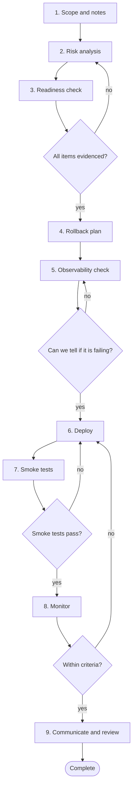

# Workflow 10: Prepare a production release

> A release is a decision with a plan, a tripwire and a way back.

This workflow turns a set of merged changes into a monitored production release, with the rollback decided before the deploy rather than during the incident.

## When to use

- Shipping to production, including small releases.
- A release contains migrations, flag changes or a public API change.
- Moving from manual to a more automated release process.

## Starting inputs

| Input | Why it is needed |
| --- | --- |
| List of changes in the release | Scope and risk. |
| Pipeline and environment status | Is the artefact the one that was tested? |
| Migrations and flag settings | The riskiest parts. |
| Monitoring and alerting state | You must be able to see the effect. |
| On call and communication contacts | Who needs to know and who can abort. |

## Workflow diagram

Diamonds are gates. If the answer is *no*, return to the step shown and repeat before continuing. The full list of checkpoints and the evidence each needs is below.

## Sequence of activities

| # | Activity | Skill | Prompts | Developer responsibility | Output |
| --- | --- | --- | --- | --- | --- |
| 1 | **Define scope and write the release notes** | [Documentation Engineer](../skills/documentation-engineer/SKILL.md) | [Changelog and Release Notes](../prompts/delivery/changelog-and-release-notes.md) | Check the notes against the actual changes; add breaking changes and actions required. | Release notes, changelog entry |
| 2 | **Analyse deployment risk** | [Regression Analyst](../skills/regression-analyst/SKILL.md) | [Deployment Risk Analysis](../prompts/delivery/deployment-risk-analysis.md) | Rate each change; identify migrations, API changes and one way doors. | Risk table |
| 3 | **Run the readiness check** | [PR Readiness Reviewer](../skills/pr-readiness-reviewer/SKILL.md) | [Release Readiness Check](../prompts/delivery/release-readiness-check.md) | Tests green, scans clean, migrations reviewed, docs updated, flags set. | Completed readiness checklist |
| 4 | **Plan the rollback** | [Regression Analyst](../skills/regression-analyst/SKILL.md) | [Rollback Planning](../prompts/delivery/rollback-planning.md) | Write the steps and the point of no return; confirm the previous artefact exists. | Rollback runbook |
| 5 | **Check observability** | [Debugging Specialist](../skills/debugging-specialist/SKILL.md) | [Observability Gap Analysis](../prompts/delivery/observability-gap-analysis.md) | Confirm dashboards, alerts and logs will show failure of the new behaviour. | Gaps and fixes |
| 6 | **Choose the strategy and deploy** | None (human activity) | None | Rolling, blue/green, canary or flag; deploy outside risky times; announce. | Deployed artefact |
| 7 | **Run smoke tests** | None (human activity) | None | Critical journeys on production using safe test data. | Smoke results |
| 8 | **Monitor against criteria** | None (human activity) | None | Watch error rate, latency, business metrics against baseline for a defined time. | Monitoring record |
| 9 | **Communicate and review** | [Documentation Engineer](../skills/documentation-engineer/SKILL.md) | [Changelog and Release Notes](../prompts/delivery/changelog-and-release-notes.md) | Announce the outcome; retire flags and temporary code; note lessons. | Announcement, follow ups |

## Step notes

### Step 1: Define scope and write the release notes

Do not publish what the assistant drafted without checking it against the diff.

### Step 2: Analyse deployment risk

Ask: what is the worst realistic outcome, and how would we notice?

### Step 3: Run the readiness check

Every item needs evidence, not a tick.

### Step 4: Plan the rollback

Rehearse in a test environment for risky releases.

### Step 5: Check observability

Define success and abort criteria for the rollout.

### Step 6: Choose the strategy and deploy

Human decision and action.

### Step 7: Run smoke tests

A failure halts promotion or triggers rollback.

### Step 8: Monitor against criteria

Abort if criteria are breached; do not rationalise a bad metric.

### Step 9: Communicate and review

Remove flags with expiry dates.

## Required outputs

- Release notes.
- Risk table.
- Readiness checklist with evidence.
- Rollback runbook.
- Smoke test results.
- Monitoring record and release outcome.

## Validation checkpoints

| Checkpoint | After step | Evidence required |
| --- | --- | --- |
| Readiness evidenced | 3 | Checklist with links to outputs |
| Rollback ready | 4 | Runbook and the previous artefact available |
| Failure would be visible | 5 | Dashboards and alerts checked |
| Smoke tests pass | 7 | Results |
| Within criteria | 8 | Metrics against baseline |

## Completion criteria

The workflow is complete when **all** of these are true:

- [ ] The release is deployed and verified by smoke tests.
- [ ] Monitoring stayed within the criteria for the agreed period.
- [ ] Release notes are published and accurate.
- [ ] Rollback was ready and was not needed, or was executed cleanly.
- [ ] Temporary flags and code have owners and expiry dates.

## Common failure modes

| Failure mode | Countermeasure |
| --- | --- |
| Rollback invented during the incident | Written and checked in step 4 |
| Deploy without being able to see failure | Observability check and criteria |
| Big bang release | Smaller, more frequent releases |
| Release notes copied from commits unchecked | Verify against the diff |

## Related

**Handbook:** [Chapter 11: Engineering Delivery and Operations](../handbook/11_delivery_and_operations/README.md), [Chapter 8: Architecture and Design](../handbook/08_architecture_and_design/README.md)

**Templates:** [Pull request](../templates/pull_request_template.md), [ADR](../templates/adr_template.md)

**Skills used:** [Documentation Engineer](../skills/documentation-engineer/SKILL.md), [Regression Analyst](../skills/regression-analyst/SKILL.md), [PR Readiness Reviewer](../skills/pr-readiness-reviewer/SKILL.md), [Debugging Specialist](../skills/debugging-specialist/SKILL.md)

---

Previous: [Workflow 09: Review a pull request](09_pull_request_review.md) · [All workflows](README.md)
