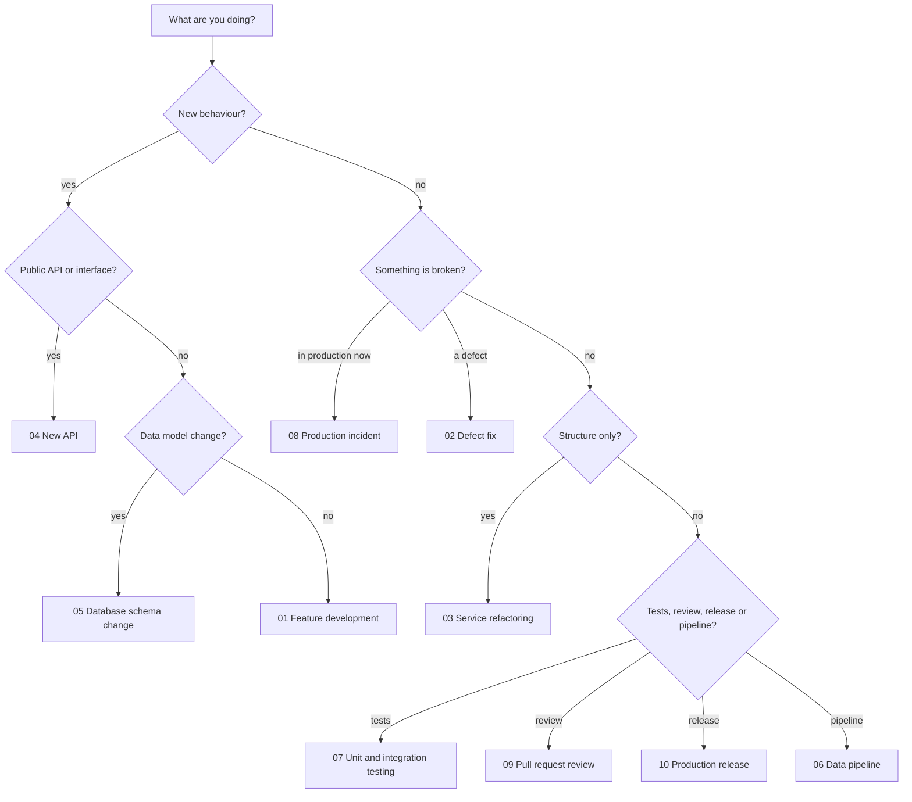

# Workflows

Ten end to end workflows describe how common engineering activities are executed with AI assistance. Each one is a sequence of steps with the skill to invoke, the prompt to start from, what the **developer** must still do, what comes out, and where to stop and check.

Workflows connect the rest of the repository:

- **Skills** ([skills](../skills/README.md)) are the capabilities invoked at each step.
- **Prompts** ([prompts](../prompts/README.md)) are the starting text for each activity.
- **Handbook chapters** ([handbook](../handbook/README.md)) explain the *why*.
- **Templates** ([templates](../templates/README.md)) give the artefacts a shape.

## The ten workflows

| # | Workflow | In one line | Steps | Main skills |
| --- | --- | --- | --- | --- |
| 01 | [Build a new feature](01_feature_development.md) | From an ambiguous ticket to a reviewed, tested, documented change. | 10 | Requirement Analyst, Business Rule Analyst, Edge Case Hunter, Repository Explorer, ... |
| 02 | [Fix a defect](02_defect_fix.md) | Reproduce it, prove it, fix it, and make sure it cannot return. | 9 | Debugging Specialist, Repository Explorer, TDD Engineer, Regression Analyst, ... |
| 03 | [Refactor an existing service](03_service_refactoring.md) | Change the structure, keep the behaviour, and prove both. | 9 | Refactoring Specialist, Repository Explorer, Unit Test Engineer, Regression Analyst, ... |
| 04 | [Introduce a new API](04_new_api.md) | Design the contract from the consumer's side, then build it defensively. | 9 | Requirement Analyst, API Contract Reviewer, Security Reviewer, Integration Test Engineer, ... |
| 05 | [Change a database schema](05_database_schema_change.md) | Change the data model without breaking the running system. | 9 | Database Design Reviewer, Implementation Planner, Integration Test Engineer, TDD Engineer, ... |
| 06 | [Develop a data pipeline](06_data_pipeline.md) | Pipelines fail quietly. Design for reruns, bad data and visibility from the start. | 10 | Requirement Analyst, Edge Case Hunter, Architecture Reviewer, Unit Test Engineer, ... |
| 07 | [Write unit and integration tests](07_unit_and_integration_testing.md) | Choose the level, derive the cases from requirements, and prove the tests can fail. | 9 | Unit Test Engineer, Edge Case Hunter, TDD Engineer, Integration Test Engineer, ... |
| 08 | [Handle a production incident](08_production_incident.md) | Stabilise first, understand second, learn third. | 9 | Debugging Specialist, Regression Analyst, TDD Engineer, Documentation Engineer |
| 09 | [Review a pull request](09_pull_request_review.md) | Review the evidence, not the confidence. | 9 | PR Readiness Reviewer, Unit Test Engineer, Mutation Testing Specialist, Code Quality Reviewer, ... |
| 10 | [Prepare a production release](10_production_release.md) | A release is a decision with a plan, a tripwire and a way back. | 9 | Documentation Engineer, Regression Analyst, PR Readiness Reviewer, Debugging Specialist |

## Anatomy of a workflow

Every workflow page has the same sections:

| Section | Content |
| --- | --- |
| **When to use** | Situations that call for this workflow |
| **Starting inputs** | What you need before you begin, and why |
| **Workflow diagram** | A Mermaid flowchart; diamonds are gates that send you back if the answer is no |
| **Sequence of activities** | A table: activity, skill, prompts, developer responsibility, output |
| **Step notes** | Practical detail for each step |
| **Required outputs** | The artefacts that must exist at the end |
| **Validation checkpoints** | What to check, after which step, and the evidence required |
| **Completion criteria** | A checklist that defines "done" |
| **Common failure modes** | What goes wrong, and the countermeasure |

## How to choose

## Principles that apply to every workflow

1. **The developer stays accountable.** The responsibility column is not decoration; it names what a person must do.
2. **Evidence over assertion.** Test output, query plans, metrics and logs are quoted from real runs.
3. **Unspecified means ask.** Where behaviour is not defined, the step produces a question for the owner.
4. **Small steps, verified.** Each step ends with a result you can inspect.
5. **Adapt, do not skip.** Remove steps that do not apply, but write down why.

## Using a workflow with an assistant

1. Open the workflow page and note the inputs you have and lack.
2. Start each step with the linked prompt, giving the real context.
3. Ask the assistant to invoke the named skill; if your tool supports skills it can load them, otherwise paste the `SKILL.md` ([tools](../tools/README.md)).
4. Do the developer responsibility part yourself.
5. Check the gate before moving on.

The [AI task template](../templates/ai_task_template.md) is a convenient way to hand a step to an assistant.

[Back to the repository README](../README.md)
